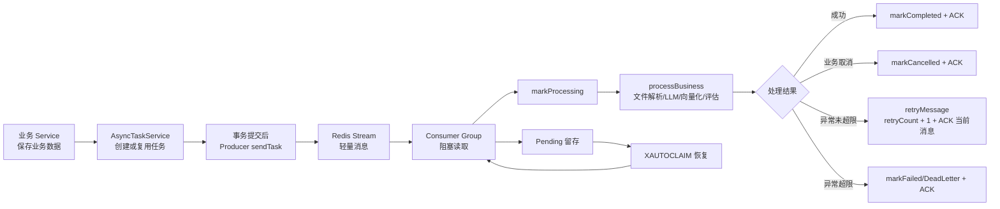

# common/async 异步任务模块面试总览

## 1. 一句话定位

`common/async` 不是一个简单的线程池工具类，而是项目里的“异步任务基础设施模板”。它把简历 AI 分析、知识库向量化、模拟面试评估、语音面试评估这类耗时任务，从用户请求线程中拆出去，统一交给 Redis Stream 消费者后台处理，并且补上了任务状态、去重、重试、取消、TraceId、指标记录和 pending 消息恢复。

面试中可以这样开场：

> 这个模块解决的是 AI 面试平台里“请求快返回、耗时任务可靠执行”的问题。比如用户上传简历或知识库文档后，后面会有文件解析、LLM 调用、向量化、报告生成，这些步骤耗时不稳定。如果放在 HTTP 请求里，用户要等很久，而且失败后不好恢复。所以我抽象了一套基于 Redis Stream 的异步任务模板，Producer 负责轻量入队，Consumer 负责统一消费、状态流转、重试和 ACK，业务模块只实现自己的 payload 解析和业务处理。

## 2. 这个目录下的代码在整个系统里的位置

这个目录下核心源码只有三个：

| 文件 | 角色 | 面试里怎么说 |
| --- | --- | --- |
| `AbstractStreamProducer.java` | Redis Stream 生产者模板 | 统一封装 XADD、TraceId 透传、发送失败回调、指标记录 |
| `AbstractStreamConsumer.java` | Redis Stream 消费者模板 | 统一封装消费循环、消费者组、ACK、重试、取消、pending 恢复 |
| `AsyncTaskCancelledException.java` | 异步任务取消异常 | 表示“业务上无需继续处理”，例如关联实体已删除，直接标记取消并 ACK |

但真实闭环还依赖几个外部组件：

| 组件 | 作用 |
| --- | --- |
| `AsyncTaskStreamConstants` | 定义 Stream key、group、消费者前缀、字段名、最大重试次数、pending 恢复参数 |
| `RedisService` | 封装 Redisson 的 `XADD`、`XREADGROUP`、`XACK`、`XAUTOCLAIM` |
| `AsyncTaskService` | 维护异步任务表，处理去重、状态流转、手动重试、手动取消 |
| `PendingMessageRecoveryService` | 应用启动和定时扫描 pending 消息，调用消费者恢复 |
| 业务 Producer/Consumer | 简历分析、知识库向量化、面试评估、语音评估四条业务管道 |

面试时不要只说“我用了 Redis Stream”。更准确的说法是：

> 我用 Redis Stream 做消息传递，用异步任务表做状态和幂等，用模板方法模式把通用可靠性逻辑沉到 common 层，业务模块只关心自己的处理逻辑。

## 3. 业务场景为什么需要它

AI 面试平台里有几个典型耗时场景：

| 场景 | 为什么不能同步做 | 异步后的价值 |
| --- | --- | --- |
| 简历上传后 AI 分析 | Tika 解析和 LLM 评分耗时不可控 | 上传接口快速返回，后台分析，前端轮询状态 |
| 知识库文档向量化 | 文件下载、解析、分块、Embedding、pgvector 写入都慢 | 用户先看到任务状态，失败可重试 |
| 模拟面试结束后评估报告 | 需要汇总问题答案并调用 LLM 生成报告 | 交卷后立即返回，报告稍后生成 |
| 语音面试结束后生成评估 | 转写内容和多轮评价可能较重 | 避免 WebSocket 或请求线程被阻塞 |

所以面试中的业务表述应该先讲：

> 这个模块的核心价值不是“异步”两个字，而是把用户动作和 AI 计算解耦。用户触发任务后系统立刻记录一条可追踪的任务，后端后台消费；任务失败时可以重试，应用重启后 pending 消息还能恢复，用户也能看到任务状态。

## 4. 整体链路怎么讲

可以按下面这条链路讲，面试官通常能听出来你真的理解系统：

1. 用户触发业务动作，比如上传简历、上传知识库、提交面试。
2. Service 先完成业务数据落库，例如简历记录、知识库记录、面试会话记录。
3. 业务 Producer 调用 `AsyncTaskService.createOrReusePendingTask()` 创建或复用任务，防止同一个业务对象重复入队。
4. Producer 通过 `TransactionAfterCommitExecutor` 在事务提交后再执行 `sendTask()`，避免消息被消费时数据库事务还没提交。
5. `AbstractStreamProducer` 调用 `RedisService.streamAdd()` 写入 Redis Stream，消息里只放 `taskId`、`businessId`、具体业务 ID、`retryCount` 和可选 `traceId`。
6. `AbstractStreamConsumer` 启动单线程消费循环，使用消费者组阻塞读取新消息。
7. 消费者解析 payload，标记任务处理中，执行具体业务逻辑。
8. 成功则标记完成并 ACK。
9. 可取消场景抛 `AsyncTaskCancelledException`，标记取消并 ACK，不重试。
10. 普通异常按 `retryCount` 判断是否重新 XADD；超过 3 次后标记失败或死信，并 ACK 当前消息。
11. 如果消费者崩溃导致未 ACK，消息会留在 PEL，由 `PendingMessageRecoveryService` 定期 `XAUTOCLAIM` 后重新处理。

可以画成这样：

## 5. 四条业务管道如何落地

这个 common 模板被四类业务复用：

| 管道 | Producer | Consumer | 业务处理 |
| --- | --- | --- | --- |
| 知识库向量化 | `VectorizeStreamProducer` | `VectorizeStreamConsumer` | 下载文档、解析、分块、向量化、写 pgvector |
| 简历分析 | `AnalyzeStreamProducer` | `AnalyzeStreamConsumer` | 解析简历文本、调用 AI 评分、保存分析结果 |
| 模拟面试评估 | `EvaluateStreamProducer` | `EvaluateStreamConsumer` | 汇总题目和答案、调用 LLM、生成面试报告 |
| 语音面试评估 | `VoiceEvaluateStreamProducer` | `VoiceEvaluateStreamConsumer` | 根据语音面试会话生成最终评估 |

这也是面试亮点：

> 我没有给每个模块各写一套消费逻辑，而是把 Redis Stream 的通用行为抽成模板。业务侧只需要告诉父类：streamKey 是什么、payload 怎么解析、业务怎么处理、失败怎么更新状态。

## 6. 设计亮点

### 6.1 模板方法模式

`AbstractStreamConsumer` 固定了消费骨架：

1. 创建消费者组。
2. 阻塞读取消息。
3. 解析 payload。
4. 标记处理中。
5. 执行业务。
6. 标记成功、取消、失败或重试。
7. ACK 当前消息。
8. 恢复 TraceId。

子类只实现业务差异：

| 抽象方法 | 子类负责什么 |
| --- | --- |
| `streamKey()` | 当前业务使用哪个 Redis Stream |
| `groupName()` | 当前消费者组名称 |
| `parsePayload()` | 从 Map 解析出业务 payload |
| `markProcessing()` | 更新任务和业务对象状态 |
| `processBusiness()` | 真正的文件解析、LLM、向量化或评估逻辑 |
| `markCompleted()` | 成功后的状态更新 |
| `markCancelled()` | 业务取消后的状态更新 |
| `markFailed()` | 最终失败后的状态更新 |
| `retryMessage()` | 重新入队并更新任务重试状态 |

### 6.2 轻量消息

Redis Stream 里不放完整简历文本、文档内容、面试上下文，只放 ID 和 retryCount。

好处：

- Redis 消息体小，不会被大文本撑爆。
- 大内容留在数据库或对象存储，失败后可以重新读取。
- 日志和排查更清晰，消息只承担“任务索引”的职责。

面试中可以说：

> 我把 Stream 当作任务触发器，而不是大对象存储。消息只传任务 ID 和业务 ID，真正的大内容从 DB 或文件存储重新取，这样 Redis 压力小，也更容易重试。

### 6.3 任务表做幂等和可观测

Redis Stream 本身不适合承载完整业务状态，所以项目里有 `AsyncTaskService` 和异步任务表。

它提供：

- `createOrReusePendingTask()`：同一个 `taskType + businessId` 活跃任务只创建一次。
- `markEnqueued()`：记录 Redis messageId。
- `markProcessing()`：消费前标记处理中。
- `markCompleted()`：成功终态。
- `markCancelled()`：业务取消终态。
- `markFailed()`：重试耗尽后的失败终态。
- `markDeadLetter()`：连重新入队都失败时的死信状态。
- `retryTask()`：对失败、取消、死信任务做人工重试。

面试重点是：

> Redis Stream 负责“消息流转”，任务表负责“业务状态和幂等”。这两个职责不能混在一起。

### 6.4 TraceId 透传

`AbstractStreamProducer` 在入队时读取 `TraceIdFilter.currentTraceId()`，把 traceId 放进消息。Consumer 消费时把它写回 MDC。

这能做到：

- 用户请求日志和后台异步日志可以串起来。
- 失败排查时可以从接口请求追到后台任务。
- 消费线程复用时，finally 会恢复之前的 MDC，避免日志串号。

### 6.5 Pending 恢复

Consumer 正常处理后会 ACK。如果 JVM 崩溃、线程退出、网络抖动导致没有 ACK，消息会进入 Redis Stream 消费者组的 PEL。

项目通过两层恢复：

- 启动时：`ApplicationReadyEvent` 后立即恢复一次。
- 运行时：`@Scheduled(fixedDelay = 60_000)` 每分钟恢复一次。

恢复动作是 `streamAutoClaim()`，也就是 Redis Stream 的 `XAUTOCLAIM`。

## 7. 这个模块要诚实说明的边界

面试里不要把它说成“绝对可靠、绝对不重复”。更专业的说法是：

| 边界 | 真实情况 | 面试里的成熟回答 |
| --- | --- | --- |
| 是否 exactly-once | 不是 | Redis Stream 是至少一次语义，业务要做幂等 |
| 是否完全不会丢消息 | 大多数常见故障可恢复，但 Redis 持久化和分布式事务仍有边界 | 生产可用 Redis AOF、主从、补偿扫描或 Outbox |
| 是否有独立死信队列 | 当前是任务状态标记 `DEAD_LETTER`，不是独立 DLQ Stream | 如果规模变大，可加 `dead-letter stream` 便于运维消费 |
| 重试是否有退避 | 当前是重新 XADD，基本是立即重试 | 可扩展 nextRetryAt 或延迟队列 |
| 60 秒 pending 恢复是否一定合理 | 不一定，长时间 LLM 任务可能超过 60 秒 | 要根据任务耗时调大 idleTimeout，或增加心跳和租约机制 |
| 单线程消费者吞吐如何 | 简单稳定，但单实例吞吐有限 | 可多实例扩容，或每类任务配置并发消费者 |
| Stream maxLen=1000 是否一定安全 | 小规模可以，大积压可能不够 | 生产要按任务峰值调参并监控积压 |

这类“承认边界并给出下一步”的回答，会比单纯吹技术栈更可信。

## 8. 两分钟面试表达模板

可以直接这样讲：

> 我们项目里有很多 AI 相关的耗时任务，比如简历分析、知识库向量化、面试报告生成。如果这些逻辑放在接口里同步执行，用户等待时间长，失败后也很难补偿。所以我在 common/async 下抽了一套基于 Redis Stream 的异步任务模板。
>
> 生产端会先通过 AsyncTaskService 创建或复用一条任务记录，避免同一个业务对象重复入队，然后在事务提交后再把轻量消息写到 Redis Stream。消息里只放 taskId、businessId、具体业务 ID、retryCount 和 traceId，不放大文本。
>
> 消费端用 AbstractStreamConsumer 做模板方法，统一处理消费者组创建、阻塞读取、payload 解析、状态流转、业务执行、重试、取消、ACK 和 pending 恢复。业务模块只实现 processBusiness，比如简历模块调用 AI 评分，知识库模块做文档向量化。
>
> 可靠性上，我们不是宣称 exactly-once，而是用至少一次投递加业务幂等。Producer 侧有 createOrReusePendingTask 防重复，Consumer 侧处理前后更新任务状态，已完成任务会跳过；如果业务异常会最多重试 3 次，消费者崩溃导致未 ACK 的消息会留在 PEL，启动和定时任务通过 XAUTOCLAIM 恢复。这个设计适合当前项目中等规模的异步 AI 任务，如果后续任务量更大，我会补独立死信队列、延迟退避重试、Outbox 和更细粒度并发配置。

## 9. 面试中一句话总结

> 这个模块的核心不是“用了 Redis”，而是把 AI 平台里的耗时任务抽象成“任务表状态机 + Redis Stream 消息流 + 模板消费者 + 幂等重试恢复”的通用异步框架。
