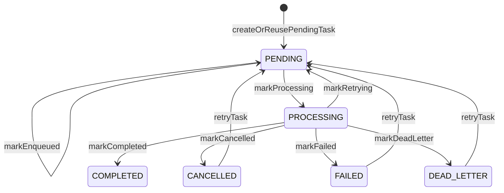

# 可靠性、重试、ACK 和 Pending 恢复怎么讲

## 1. 先给结论

这个异步框架的可靠性模型可以概括为：

> Redis Stream 提供至少一次投递，任务表提供状态和幂等，Consumer 通过 ACK、重试和 pending 恢复保证常见故障下任务不会无声丢失。

不要说“绝对不丢、绝对不重复”。更专业的表达是：

> 当前设计不是 exactly-once，而是 at-least-once 加业务幂等。只要业务处理做到幂等，重复消费就不会造成错误结果。

## 2. 状态机怎么讲

异步任务在 `AsyncTaskService` 里大致有这些状态流转：



各状态的面试解释：

| 状态            | 含义                  |
| ------------- | ------------------- |
| `PENDING`     | 任务已创建或已入队，等待消费      |
| `PROCESSING`  | Consumer 已取到消息，正在处理 |
| `COMPLETED`   | 处理成功，终态             |
| `CANCELLED`   | 业务上取消，不再处理，终态       |
| `FAILED`      | 重试耗尽，处理失败，终态        |
| `DEAD_LETTER` | 重新入队也失败，需要人工介入，终态   |

面试回答：

> 我没有只依赖 Redis Stream 判断任务进度，而是把任务状态放到数据库。这样前端能查进度，后台能做人工重试，失败原因也能持久化。

## 3. ACK 的位置为什么重要

### 3.1 成功路径

成功时顺序是：

1. 业务逻辑执行完成。
2. 任务和业务状态更新为成功。
3. ACK Redis 消息。

这样做是为了避免：

- 先 ACK。
- 后面 DB 更新失败。
- 消息已经从 PEL 移除，任务却没完成。

所以正确表达是：

> ACK 是告诉 Redis“这条消息已经处理完”。所以必须放在业务结果落库之后。宁愿 ACK 失败导致重复处理，也不要先 ACK 导致任务丢失。

### 3.2 失败重试路径

普通异常时：

1. Consumer 捕获异常。
2. 如果 `retryCount < MAX_RETRY_COUNT`，调用 `retryMessage()`。
3. 子类重新 XADD 一条新消息，`retryCount + 1`。
4. `AsyncTaskService.markRetrying()` 更新任务表。
5. ACK 当前消息。

为什么重试后要 ACK 当前消息？

> 当前这次处理已经结束了，新的尝试由新消息承载。如果不 ACK 当前消息，它会留在 PEL，后面又可能被恢复，造成更多重复。

### 3.3 取消路径

如果是 `AsyncTaskCancelledException`：

1. 标记取消。
2. ACK。
3. 不重试。

取消不是系统故障，而是业务上不需要继续处理。

## 4. 最大重试次数怎么讲

常量里设置：

```java
MAX_RETRY_COUNT = 3
```

处理逻辑：

- 当前 retryCount 小于 3：重新入队。
- 达到 3：标记失败，不再自动重试。

面试中可以这样解释：

> 重试用于处理临时问题，比如 LLM 超时、Redis 短暂抖动、对象存储偶发失败。但如果连续失败 3 次，大概率不是瞬时问题，继续自动重试只会浪费资源，所以进入失败终态，留给人工查看和手动重试。

## 5. Pending Entries List 是什么

Redis Stream 消费者组里有一个 PEL，也就是 Pending Entries List。

当消费者通过消费者组读到消息后：

- 消息会进入该消费者的 pending 列表。
- 只有 ACK 后才会从 PEL 移除。
- 如果消费者崩溃、断网、JVM 被 kill，消息不会消失，而是继续留在 PEL。

面试解释：

> PEL 是 Redis Stream 提供的未确认消息账本。它记录“哪些消息已经投递给消费者，但还没有被确认处理完成”。这正是我们能做故障恢复的基础。

## 6. Pending 恢复链路

项目里 pending 恢复由 `PendingMessageRecoveryService` 触发：

1. 应用启动完成后执行一次恢复。
2. 每 60 秒定时执行一次恢复。
3. 遍历所有 `AbstractStreamConsumer` Bean。
4. 调用每个消费者的 `recoverPendingMessages(60000, 10)`。
5. Consumer 调用 `redisService.streamAutoClaim()`。
6. Redis 使用 `XAUTOCLAIM` 把空闲超过 60 秒的 pending 消息认领给当前消费者。
7. 对认领到的消息重新调用 `processMessage()`。

面试回答：

> Redis Stream 不会自动把 pending 消息重新发给其他消费者，需要我们主动 claim。这里用 XAUTOCLAIM 做故障转移，应用重启或消费者异常退出后，未 ACK 消息能被重新处理。

## 7. 如何避免重复消费造成错误

重复消费可能发生在这些情况：

| 场景                        | 为什么会重复              |
| ------------------------- | ------------------- |
| ACK 失败                    | 业务已完成，但消息仍在 PEL     |
| JVM 崩溃恢复                  | 业务可能执行了一部分，重启后重新处理  |
| retry XADD 成功但 ACK 当前消息失败 | 新旧两条消息都可能被处理        |
| pending idle 设置过短         | 长任务还在执行，恢复服务又认领     |
| 多实例部署                     | 故障恢复时其他实例接管 pending |

所以框架通过两层幂等兜底：

### 7.1 Producer 侧去重

`AsyncTaskService.createOrReusePendingTask()` 按任务类型和业务 ID 查活跃任务。

同一个业务对象已经有活跃任务时，Producer 不再重复发送。

### 7.2 Consumer 侧业务幂等

各业务 Consumer 会在执行前判断是否已经完成。例如：

- 简历已经分析完成且有分析结果，直接跳过。
- 知识库向量化已经完成且有 chunk，直接跳过。
- 面试会话已经评估并有分数，直接跳过。
- 语音面试已有评估结果，直接跳过。

面试回答：

> 我不依赖消息队列提供 exactly-once，而是在业务上做幂等。Producer 防止重复创建任务，Consumer 防止重复写结果。这样即使消息被重新投递，也不会产生多份报告或重复向量数据。

## 8. 失败和死信的区别

当前项目里有两个相关状态：

| 状态            | 触发场景            | 含义                        |
| ------------- | --------------- | ------------------------- |
| `FAILED`      | 业务执行失败且自动重试耗尽   | 任务处理失败，但消息流转本身正常          |
| `DEAD_LETTER` | 重新 XADD 重试消息也失败 | 消息无法继续通过 Stream 流转，需要人工介入 |

要注意：

> 当前项目的 `DEAD_LETTER` 是任务表状态，不是一个独立的 Redis dead-letter stream。

面试中可以补充演进方案：

> 如果任务规模上来，我会加独立死信队列，比如 `xxx:dead-letter:stream`，把失败 payload、错误堆栈、最后一次 messageId 都写进去，方便运维系统统一消费和告警。

## 9. 这个设计能防哪些故障

| 故障                | 当前设计如何处理                                |
| ----------------- | --------------------------------------- |
| 用户重复点击上传或提交       | `createOrReusePendingTask()` 复用活跃任务     |
| Redis XADD 失败     | `onSendFailed()` 更新业务失败状态               |
| Consumer 处理业务异常   | 自动重试，最多 3 次                             |
| 关联业务对象被删除         | 抛 `AsyncTaskCancelledException`，取消并 ACK |
| Consumer 崩溃未 ACK  | 消息留在 PEL，XAUTOCLAIM 恢复                  |
| ACK 失败            | 消息留在 PEL，后续恢复，依赖业务幂等                    |
| malformed message | 解析失败后 ACK，避免 poison message             |
| 自动重试仍失败           | 标记 `FAILED` 或 `DEAD_LETTER`，支持人工重试      |

## 10. 当前设计的真实边界和下一步

### 10.1 Redis 和 DB 不是一个分布式事务

当前做法是：

- 先提交 DB。
- afterCommit 后 XADD。
- XADD 成功后 markEnqueued。

这已经避免了“消息先消费、DB 还没提交”的问题，但仍不是严格分布式事务。

极端问题：

- DB commit 成功后，应用在 XADD 前宕机，任务表有 PENDING，但 Redis 没消息。
- XADD 成功后，markEnqueued 失败，任务表 messageId 不完整。

下一步：

> 可以引入 Outbox 模式。业务事务内只写任务表和 outbox 表，由独立投递器扫描 outbox 发送 Redis Stream，并记录投递状态，实现更强的最终一致性。

### 10.2 重试没有退避

当前重试是重新 XADD，下一轮可能很快再次消费。

如果是 LLM 服务限流或第三方短暂故障，立即重试可能加重压力。

下一步：

- 增加 `nextRetryAt` 延迟重试。
- 使用 Redis ZSet 做延迟队列。
- 或者在 Consumer 内按指数退避控制重试投递。
- Redis ZSet 可以实现延时消息队列。做法是把任务 ID 或消息体作为 member，把任务触发时间作为 score。消费者定时扫描 `score <= 当前时间` 的任务，然后取出执行。为了避免多个消费者重复消费，需要用 Lua 脚本保证“查询到期任务”和“删除任务”是原子操作。

  不过 ZSet 实现的是比较轻量的延时队列，它没有 Redis Stream、RocketMQ 那种完整的 ACK、Pending、重试和消费组机制。任务一旦从 ZSet 删除后，如果消费者执行过程中宕机，消息就可能丢失。

### 10.3 Pending idle timeout 要谨慎

当前 pending 恢复阈值是 60 秒。

如果某些 LLM 或文件处理任务正常耗时就超过 60 秒，恢复服务可能误以为消费者挂了，导致重复处理。

下一步：

- 按任务类型配置不同 idle timeout。
- 对长任务增加 heartbeat 或 lease 续期。
- recovery 时检查任务 `updatedAt` 或处理中状态，避免误抢正在执行的任务。

### 10.4 单线程吞吐有限

当前每个 Consumer Bean 单线程处理。

下一步：

- 多实例扩容消费者组。
- 每类任务配置并发数。
- 对 LLM 调用和 CPU 密集任务分开线程池。
- 增加积压监控和告警。

## 11. 面试官可能追问和回答

### Q1：你们怎么保证消息不丢？

回答：

> 常规情况下，消息写入 Redis Stream 后，Consumer 读到但未 ACK 会进入 PEL。如果消费者崩溃，pending 消息不会消失，启动和定时恢复会通过 XAUTOCLAIM 重新处理。发送端失败会更新任务失败状态。更严格地说，它不是绝对不丢，因为 Redis 持久化策略、DB 和 Redis 非事务仍有边界，生产可以加 AOF、Redis 高可用、Outbox 和补偿扫描。

### Q2：你们怎么保证消息不重复？

回答：

> 我不会承诺消息不重复。Redis Stream 是至少一次投递，重复是可能的。我是在业务层保证幂等：Producer 通过任务表防重复入队，Consumer 处理前检查业务是否已完成，ACK 失败或 pending 恢复导致的重复消费不会重复生成结果。

### Q3：为什么失败重试时重新 XADD，而不是不 ACK 等 pending 恢复？

回答：

> 不 ACK 更像异常恢复，不适合做正常重试控制。重新 XADD 可以显式更新 retryCount，记录新的 messageId，把当前这次失败闭环掉。pending 恢复留给消费者崩溃、ACK 失败这类异常场景。

### Q4：如果重试消息 XADD 失败怎么办？

回答：

> 子类的 retryMessage 会捕获重新入队失败，标记任务为 DEAD\_LETTER 或失败状态，并记录错误。因为连重新投递都失败了，继续自动重试意义不大，需要人工介入或后续补偿。

### Q5：为什么解析失败直接 ACK，会不会丢任务？

回答：

> 如果字段缺失导致 payload 都解析不出来，继续重试大概率还是失败，会形成 poison message。这里选择 ACK 并记录日志。生产上可以把坏消息写入 dead-letter stream，便于人工排查。

## 12. 面试表达小结

> 这个模块的可靠性不是靠某一个点，而是靠组合拳：事务提交后投递降低脏读风险，Redis Stream ACK 和 PEL 负责未确认消息恢复，任务表负责状态和幂等，异常路径负责重试和失败终态。它目前适合中等规模 AI 后台任务，后续可以继续演进 Outbox、退避重试、独立死信队列和长任务租约。

