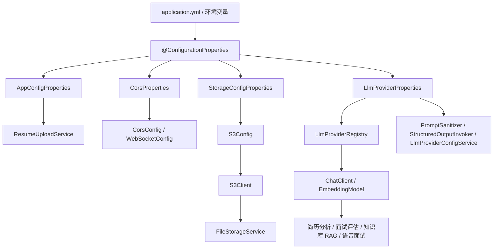

# common/config 配置模块总览怎么讲

## 1. 一句话定位

`common/config` 是整个 AI 面试平台的基础设施装配层。它不直接写业务逻辑，而是把跨模块都会用到的能力注册成 Spring Bean，或者把 `application.yml` / 环境变量中的配置映射成类型安全的 Java 对象。

面试中可以这样开场：

> 这个模块主要解决“配置集中管理”和“基础设施 Bean 统一装配”的问题。项目里有前后端跨域、文件上传限制、RustFS/S3 存储、多 LLM Provider、Embedding 模型、Swagger 文档和 JSON 序列化这些横切能力。如果把这些配置散落在业务 Service 里，后期换模型、换存储、改跨域域名、调整上传类型都会很难维护。所以我把它们集中到 `common/config`，通过 `@ConfigurationProperties` 做类型安全绑定，通过 `@Configuration + @Bean` 把底层客户端注册进 Spring 容器。

## 2. 这个目录下有哪些配置类

| 文件 | 主要职责 | 面试关键词 |
| --- | --- | --- |
| `AppConfigProperties` | 绑定 `app.resume`，管理简历上传目录和允许类型 | 文件上传配置、业务参数外置 |
| `CorsProperties` | 绑定 `app.cors`，管理允许的前端来源 | 跨域白名单、环境隔离 |
| `CorsConfig` | 注册 `/api/**` 的 `CorsFilter` | CORS、预检请求、凭证传递 |
| `StorageConfigProperties` | 绑定 `app.storage`，管理 RustFS/S3 连接参数 | 对象存储配置、密钥外置 |
| `S3Config` | 创建 AWS SDK `S3Client` Bean | S3 兼容、forcePathStyle、MinIO/RustFS |
| `LlmProviderProperties` | 绑定 `app.ai`，管理 Provider、Embedding、Advisor、安全配置 | 多模型配置中心 |
| `LlmEmbeddingConfig` | 把 Registry 中的默认 EmbeddingModel 暴露为 Spring Bean | 动态 Provider 和 Spring AI 桥接 |
| `JacksonConfig` | 提供全局 `ObjectMapper` Bean | JSON 序列化、统一对象映射 |
| `OpenApiConfig` | 提供 OpenAPI 元信息 Bean | Swagger、接口文档 |

## 3. 这个模块在业务链路中的作用

配置模块支撑了平台的几条核心业务链路：

| 业务链路 | 配置模块参与点 |
| --- | --- |
| 前端调用后端接口 | `CorsProperties + CorsConfig` 放行 Vite/部署域名 |
| 简历上传 | `AppConfigProperties` 控制上传目录和 MIME 类型 |
| 简历/知识库文件存储 | `StorageConfigProperties + S3Config` 提供 RustFS/S3 客户端 |
| 知识库向量化 | `LlmProviderProperties + LlmEmbeddingConfig` 提供默认 EmbeddingModel |
| 模拟面试/简历评分/语音面试 | `LlmProviderProperties` 给 `LlmProviderRegistry` 提供模型、API Key、Advisor 参数 |
| 前后端联调 | `OpenApiConfig` 提供 Swagger UI 元信息 |
| JSON 入参出参和内部序列化 | `JacksonConfig` 提供全局 ObjectMapper |

所以面试里不要把它讲成“写了几个配置类”，而要讲成：

> 配置模块把平台运行依赖的外部资源和框架扩展点集中管理，让业务代码只依赖抽象好的 Bean 和 Properties，而不是自己到处读配置、创建客户端或硬编码参数。

## 4. 典型调用关系



## 5. 面试时可以按四条主线讲

### 5.1 配置外置化

以前如果写死在代码里：

```java
String endpoint = "http://localhost:9000";
String apiKey = "...";
```

会有几个问题：

- 开发、测试、生产环境无法灵活切换。
- API Key 容易泄露进代码仓库。
- 改域名、换模型、换桶名都要重新编译发布。
- 单元测试很难替换配置。

项目现在用 `@ConfigurationProperties` 把配置集中映射成对象，例如：

- `app.resume.*`
- `app.cors.*`
- `app.storage.*`
- `app.ai.*`

面试回答：

> 我们把会随环境变化的参数都外置到 YAML 和环境变量里，再用 `@ConfigurationProperties` 绑定成类型安全对象。业务代码注入这些 Properties，而不是散落使用 `@Value`，这样配置结构更清晰，也方便后续扩展。

### 5.2 基础设施 Bean 装配

有些能力不能只是读配置，还要创建框架对象，例如：

- `CorsFilter`
- `S3Client`
- `EmbeddingModel`
- `OpenAPI`
- `ObjectMapper`

这些通过 `@Configuration + @Bean` 统一装配。

面试回答：

> 对外部 SDK 或框架扩展点，我统一在配置类里创建 Bean。业务层只注入 `S3Client`、`EmbeddingModel` 这类抽象，不关心它们怎么初始化。

### 5.3 AI Provider 配置中心

项目不是只接一个固定模型，而是通过 `LlmProviderProperties` 支持多个 Provider：

- DashScope。
- Kimi。
- DeepSeek。
- GLM。
- 本地 LM Studio。

每个 Provider 可以配置：

- `baseUrl`
- `apiKey`
- `model`
- `embeddingModel`
- `embeddingDimensions`
- `supportsEmbedding`
- `temperature`

面试亮点：

> 这里不是把模型调用写死在 Service 里，而是把 Provider 配置抽出来，交给 `LlmProviderRegistry` 统一创建和缓存 ChatClient / EmbeddingModel。这样业务只传 providerId，就可以动态切换模型。

### 5.4 安全与生产边界

配置模块也体现了一些安全意识：

- API Key 通过环境变量占位符注入。
- `LlmProviderProperties.SecurityConfig` 支持 API Key 加密密钥配置。
- CORS 使用白名单来源，而不是直接对所有来源放开。
- S3 密钥放在配置中，业务代码不硬编码。

但也要诚实说明边界：

- 当前 `StorageConfigProperties` 没有加 `@Validated` / `@NotBlank`，配置缺失可能到运行时才暴露。
- `CorsProperties.allowedOrigins` 是逗号字符串，WebSocket 侧 `split(",")` 没有 trim，生产上可以改成 `List<String>` 更稳。
- `JacksonConfig` 当前注释提到 tools.jackson，但实际 import 是 `com.fasterxml.jackson.databind.ObjectMapper`，这点需要修正注释或实现。
- 当前看到的 `application.yml` 主要使用环境变量占位符；根 `.env` 是否由启动脚本或其他机制加载，需要结合运行脚本确认，不能只看这个 config 目录就过度承诺。

## 6. 一分钟表达模板

> `common/config` 是项目的配置和基础设施装配层。它把简历上传、跨域、对象存储、AI Provider、Embedding、Swagger 和 JSON 序列化这类横切配置集中起来。简单参数用 `@ConfigurationProperties` 做类型安全绑定，比如 `app.storage`、`app.cors`、`app.ai`；需要框架对象的地方用 `@Configuration + @Bean` 注册，比如 `S3Client`、`CorsFilter`、`EmbeddingModel`、`OpenAPI`。这样业务 Service 不需要硬编码配置，也不需要自己创建底层 SDK 客户端。配置变更可以通过 YAML、环境变量或动态 Provider 配置来完成，系统更容易适配开发、测试和生产环境。

## 7. 这个模块的面试亮点

| 亮点 | 讲法 |
| --- | --- |
| 配置集中化 | 用 `@ConfigurationProperties` 替代散落 `@Value` |
| 环境隔离 | 通过环境变量占位符切换开发/生产参数 |
| 多模型扩展 | `LlmProviderProperties` 支撑多 Provider 和默认模型选择 |
| Spring AI 桥接 | `LlmEmbeddingConfig` 把动态 EmbeddingModel 代理成 Spring Bean |
| S3 兼容适配 | `S3Config.forcePathStyle(true)` 兼容 RustFS/MinIO |
| 跨域治理 | `CorsConfig` 只对 `/api/**` 注册规则，WebSocket 单独配置 |
| 可观测联调 | `OpenApiConfig` 支持 Swagger 接口文档 |

## 8. 可以主动承认的不足

面试时可以这样说：

> 这个模块已经把核心配置集中起来了，但还有几个可优化点。第一，Properties 类可以增加 `@Validated` 和字段校验，让配置错误在启动阶段快速失败。第二，CORS 的 allowedOrigins 可以从字符串改成 List，避免 split 和 trim 细节问题。第三，JacksonConfig 当前比较简化，如果涉及 LocalDateTime 或更多定制序列化，应该用 `Jackson2ObjectMapperBuilder` 注册 JavaTimeModule，而不是裸 new ObjectMapper。第四，OpenAPI 可以补充 JWT/鉴权 scheme 和更多模块描述。第五，生产环境的密钥加载和 Provider 配置持久化可以进一步标准化。

这种回答会显得你不是只会写配置类，而是理解配置治理和生产落地。

