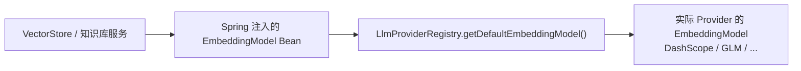

# LLM Provider 与 Embedding 配置怎么讲

## 1. 为什么这是配置模块的重点

AI 面试平台的核心能力依赖大模型：

- 简历分析。
- 面试出题。
- 答案评估。
- 知识库 RAG。
- 语音面试总结。

如果系统只写死一个模型，比如只写死 DashScope，那么会有几个问题：

- 模型不可切换。
- 不同业务无法选择不同 Provider。
- API Key 管理混乱。
- RAG 的 Embedding 模型和 Chat 模型无法分开配置。
- 本地开发、生产部署、不同厂商兼容都很难。

所以项目把 AI 配置集中到 `LlmProviderProperties`，再由 `LlmProviderRegistry` 使用这些配置创建 `ChatClient` 和 `EmbeddingModel`。

面试中可以这样说：

> 我们没有让业务 Service 直接依赖某个厂商 SDK，而是通过 `app.ai.providers` 把多个模型厂商抽象成配置。`LlmProviderProperties` 负责类型安全绑定，`LlmProviderRegistry` 负责运行时创建和缓存客户端，业务只需要通过 providerId 获取 ChatClient。

## 2. `LlmProviderProperties` 的结构

核心结构：

```java
@ConfigurationProperties(prefix = "app.ai")
public class LlmProviderProperties {
  private String defaultProvider = "dashscope";
  private String defaultEmbeddingProvider;
  private Integer embeddingDimensions = 1024;
  private Map<String, ProviderConfig> providers;
  private AdvisorConfig advisors = new AdvisorConfig();
  private String configYamlPath;
  private String configEnvPath;
  private SecurityConfig security = new SecurityConfig();
}
```

面试里按这几块讲：

| 配置块 | 作用 |
| --- | --- |
| 默认 Provider | 没有显式指定 provider 时走默认模型 |
| 默认 Embedding Provider | 知识库向量化和向量检索默认使用哪个模型 |
| providers Map | 多厂商连接信息 |
| embeddingDimensions | 向量维度，和 pgvector 表维度保持一致 |
| advisors | 工具调用、记忆、安全、日志等 Advisor 开关 |
| security | API Key 加密相关配置 |
| configYamlPath / configEnvPath | 运行时 Provider 配置持久化路径 |

## 3. 多 Provider 怎么讲

`application.yml` 里预置了多个 Provider：

| Provider | 特点 |
| --- | --- |
| `dashscope` | 默认 Provider，支持 Chat 和 Embedding |
| `glm` | 支持 Chat 和 Embedding |
| `deepseek` | 当前配置为 Chat，不支持 Embedding |
| `kimi` | 当前配置为 Chat，不支持 Embedding |
| `lmstudio` | 本地模型，适合开发调试，当前不支持 Embedding |

每个 Provider 配置包含：

```yaml
base-url:
api-key:
model:
embedding-model:
embedding-dimensions:
supports-embedding:
temperature:
```

面试回答：

> Provider 配置是一个 Map，key 是 providerId。这样新增厂商时不需要新增字段，只要增加一个 providerId 配置块。Registry 根据 providerId 读取配置并构造客户端，这就是配置驱动的多模型扩展。

## 4. 为什么 Chat 和 Embedding 要分开配置

RAG 场景里至少有两类模型：

- Chat Model：负责回答问题、生成报告、面试出题。
- Embedding Model：负责把文本转成向量，用于 pgvector 相似度检索。

两者不能混用。

代码里通过这些字段区分：

- `model`：聊天模型。
- `embeddingModel`：向量模型。
- `supportsEmbedding`：这个 Provider 是否能做向量。
- `embeddingDimensions`：向量维度。

面试回答：

> RAG 的向量模型和对话模型不是一回事。比如 DeepSeek 可能只配置 Chat，不一定提供本项目使用的 Embedding；DashScope 的 `text-embedding-v3` 才是向量模型。所以配置里显式区分 `model` 和 `embeddingModel`，并通过 `supportsEmbedding` 防止把聊天模型误用于向量化。

## 5. `LlmEmbeddingConfig` 解决了什么问题

`LlmEmbeddingConfig` 注册了一个 `EmbeddingModel` Bean：

```java
@Bean
public EmbeddingModel embeddingModel(LlmProviderRegistry registry) {
  return new EmbeddingModel() {
    @Override
    public EmbeddingResponse call(EmbeddingRequest request) {
      return registry.getDefaultEmbeddingModel().call(request);
    }

    @Override
    public float[] embed(Document document) {
      return registry.getDefaultEmbeddingModel().embed(document);
    }
  };
}
```

它的关键点是“代理”。

Spring AI 的 VectorStore 这类组件希望容器里有一个 `EmbeddingModel` Bean，但项目的 EmbeddingModel 是动态的：默认 Provider 可能来自配置文件，也可能来自数据库设置，后续还可能 reload。

如果直接在启动时创建一个固定 EmbeddingModel，会有两个问题：

- Provider 切换后 Bean 不会自动变。
- 默认 Embedding Provider 的逻辑会散落在多个地方。

所以这里注册的是一个代理 Bean：



面试回答：

> 这个配置类用了代理模式。对 Spring AI 来说，它拿到的是一个普通 `EmbeddingModel` Bean；但每次真正调用时，都会委托到 `LlmProviderRegistry` 获取当前默认的 EmbeddingModel。这样既满足 Spring 自动注入，又保留了 Provider 动态切换能力。

## 6. Advisor 配置怎么讲

`LlmProviderProperties.AdvisorConfig` 控制 Spring AI Advisor 链：

| 字段 | 默认 | 作用 |
| --- | --- | --- |
| `enabled` | true | Advisor 总开关 |
| `toolCallEnabled` | true | 是否启用工具调用 |
| `toolCallConversationHistoryEnabled` | false | 工具调用是否携带历史 |
| `streamToolCallResponses` | false | 工具调用是否流式 |
| `messageChatMemoryEnabled` | false | 是否启用消息记忆 |
| `messageChatMemoryMaxMessages` | 120 | 记忆窗口大小 |
| `simpleLoggerEnabled` | false | 是否启用简单日志 Advisor |
| `safeguardEnabled` | true | 是否启用安全词拦截 |
| `safeguardWords` | 内置若干中英文注入短语 | Prompt 注入基础防护 |
| `promptSanitizerEnabled` | true | Prompt 净化器开关 |

面试回答：

> 大模型调用不是只有“发 prompt”这么简单。项目里通过 Advisor 配置控制工具调用、记忆、安全拦截和日志。比如 MessageChatMemory 默认关闭，是为了避免不同面试会话之间串扰；SafeGuard 默认开启，用于拦截一些典型 prompt injection 句式。

## 7. API Key 安全怎么讲

`SecurityConfig`：

```java
private String apiKeyEncryptionKey;
private boolean requireEncryptionKey = false;
```

它被 `ApiKeyEncryptionService` 使用。

结合项目整体：

- YAML 中的 API Key 使用环境变量占位符。
- 运行时 Provider 配置可以写到外部 YAML / env 文件。
- 数据库模式下可以用加密服务保存 API Key。

面试回答：

> API Key 不应该写死在代码里。这个项目一方面通过环境变量注入，另一方面在 Provider 管理模块里支持加密密钥配置，便于把数据库中的 API Key 加密保存。配置层只暴露安全参数，真正的加解密逻辑放在 service 里。

## 8. 和 `LlmProviderRegistry` 的关系

严格来说，多模型创建和缓存逻辑不在 `common/config`，而在 `common/ai/LlmProviderRegistry`。

但 `LlmProviderProperties` 是它的配置来源之一。

Registry 的配置优先级是：

1. 数据库中的 Provider 配置优先。
2. 配置文件中的 `LlmProviderProperties` 作为回退。

面试里可以这样讲：

> 配置类只负责承载配置，不负责创建模型客户端。真正的工厂和缓存逻辑在 Registry 里。这样职责清晰：Properties 管配置结构，Registry 管运行时实例。

## 9. 为什么排除 Spring AI 默认 OpenAI 自动配置

主启动类 `App` 排除了多个 Spring AI OpenAI 自动配置：

- `OpenAiChatAutoConfiguration`
- `OpenAiEmbeddingAutoConfiguration`
- `OpenAiAudioSpeechAutoConfiguration`
- 等等。

原因：

项目不希望 Spring AI 自动创建一个固定 OpenAI Bean，而是由自定义的 `LlmProviderRegistry + LlmProviderProperties` 管理多 Provider。

面试回答：

> Spring AI 默认自动配置更适合单 Provider 项目。但我们要支持 DashScope、GLM、DeepSeek、Kimi、本地模型等多个 OpenAI-compatible Provider，所以排除了默认 OpenAI 自动配置，避免和自定义 Registry 产生 Bean 冲突。

## 10. 真实边界和可优化点

### 10.1 `LlmProviderProperties` 只覆盖部分 `app.ai`

`application.yml` 里还有 `app.ai.agent-utils.skills-root`，这个实际由 `AgentUtilsProperties` 绑定，不在当前 config 目录。

面试时不要说所有 `app.ai` 都由 `LlmProviderProperties` 管。更准确地说：

> `LlmProviderProperties` 管 Provider、Advisor、安全和动态配置路径；AgentUtils 的 skills-root 由另一个 Properties 类管理。

### 10.2 缺少启动期配置校验

例如：

- 默认 Provider 不存在。
- `supportsEmbedding=true` 但 `embeddingModel` 为空。
- `embeddingDimensions` 和 pgvector 维度不一致。
- API Key 为空但当前环境要求真实调用。

这些很多会在 Registry 创建模型或业务调用时暴露。

更好的做法：

- 加 `@Validated`。
- 启动时做 Provider 配置一致性检查。
- 对生产环境开启 `requireEncryptionKey`。

### 10.3 Embedding 维度必须和数据库一致

`application.yml` 中：

```yaml
spring.ai.vectorstore.pgvector.dimensions: 1024
app.ai.embedding-dimensions: 1024
```

这两个必须一致。

如果模型实际输出维度和 pgvector 表维度不同，会导致写入或检索报错。

面试回答：

> 向量维度是 RAG 系统里的硬约束，不是随便改的配置。Embedding 模型、Spring AI pgvector 配置和数据库 vector 列维度必须一致。

## 11. 高频追问

### Q1：新增一个 Provider 要改代码吗？

回答：

> 如果它兼容 OpenAI API，大多数情况下只需要增加一段 `app.ai.providers.{id}` 配置，并在管理后台或配置文件里提供 baseUrl、apiKey、model。如果路径格式特殊，则由 `ApiPathResolver` 适配；如果协议完全不兼容，才需要新增模型适配代码。

### Q2：为什么要有 defaultProvider 和 defaultEmbeddingProvider？

回答：

> Chat 和 Embedding 是两类能力。默认 Chat Provider 用于普通对话、简历分析、面试评估；默认 Embedding Provider 用于知识库向量化和检索。它们可以相同，也可以不同，所以拆开配置更灵活。

### Q3：`EmbeddingModel` 代理 Bean 会不会影响性能？

回答：

> 代理本身只是多一次方法委托，性能影响很小。真正耗时的是远程 Embedding API 调用。这样做的收益是 Provider 切换和 Spring 注入兼容，远大于这点开销。

### Q4：为什么 MessageChatMemory 默认关闭？

回答：

> 面试系统里会话边界非常重要，如果全局默认开记忆，容易出现不同用户、不同面试会话上下文串扰。需要记忆的场景应该按业务会话 ID 显式管理，而不是全局默认开启。

## 12. 面试表达小结

> AI 配置这块的核心是“模型能力配置化，运行时实例 Registry 化”。`LlmProviderProperties` 负责描述有哪些 Provider、默认用谁、谁支持 Embedding、Advisor 怎么开；`LlmEmbeddingConfig` 用代理 Bean 把动态 EmbeddingModel 接入 Spring AI；真正创建和缓存客户端由 `LlmProviderRegistry` 完成。这样业务代码不绑定具体厂商，后续扩展模型和切换 Provider 都比较自然。

