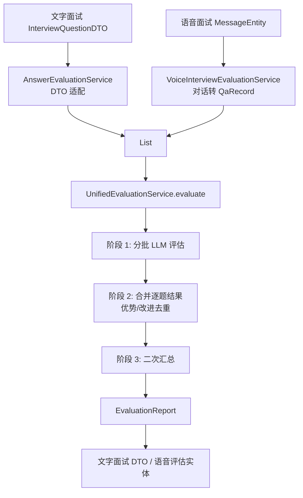

# common/evaluation 评估模块总览怎么讲

## 1. 一句话定位

`common/evaluation` 是项目里的“统一面试评估引擎”。它把文字模拟面试和语音面试的评估逻辑抽成一套公共能力：输入统一的问答记录 `QaRecord`，调用 LLM 做分批评分和二次汇总，最后输出统一的 `EvaluationReport`。

面试中可以这样开场：

> 这个模块解决的是面试平台里“不同面试形态共用一套评分引擎”的问题。文字面试和语音面试的数据来源不一样，前者来自题目 DTO 和用户提交答案，后者来自多轮语音对话转写，但最终都可以抽象成“问题、分类、用户回答”。所以我把评估核心放到 `common/evaluation`，调用方只负责 DTO 适配，真正的 LLM 评分、分批、汇总、兜底和报告结构都由统一服务完成。

## 2. 这个目录下有哪些代码

| 文件 | 角色 | 面试里怎么说 |
| --- | --- | --- |
| `QaRecord.java` | 通用问答输入模型 | 把文字面试和语音面试统一成问题、分类、回答 |
| `EvaluationReport.java` | 通用评估输出模型 | 输出总分、分类得分、逐题反馈、优势、改进建议、参考答案 |
| `InterviewEvaluationProperties.java` | 评估配置属性 | 配置 batchSize 和四个 Prompt 模板路径 |
| `UnifiedEvaluationService.java` | 核心评估服务 | 三阶段流水线：分批评估、合并批次、二次汇总 |

它的外部依赖主要是：

| 依赖 | 作用 |
| --- | --- |
| `StructuredOutputInvoker` | 调用 LLM 并把 JSON 结构化输出转成 Java record，带配置驱动重试和本地 JSON 修复 |
| `ChatClient` | Spring AI 聊天客户端，由业务侧传入 |
| `PromptTemplate` | 渲染 StringTemplate 格式 prompt |
| `BeanOutputConverter` | 给 LLM 输出格式约束，并转换成 DTO |
| `InterviewSkillService` | 调用方用于构建参考答案基线，注入评估 prompt |

## 3. 为什么要抽成 common

项目里有两种面试评估：

| 场景 | 原始数据 | 适配方式 |
| --- | --- | --- |
| 文字模拟面试 | `InterviewQuestionDTO` | `AnswerEvaluationService` 转成 `QaRecord` |
| 语音面试 | `VoiceInterviewMessageEntity` | `VoiceInterviewEvaluationService` 从 AI 提问和用户转写构造 `QaRecord` |

如果不抽公共引擎，两个模块会各写一套：

- LLM prompt。
- 分批策略。
- JSON 结构化输出。
- 评分合并。
- 参考答案生成。
- 失败兜底。

这样后续改评分标准、改 batchSize、改输出字段都要改两份。

面试回答：

> 我把“评估算法和报告结构”放在 common 层，把“业务 DTO 适配和持久化”留在各自模块。这样文字面试和语音面试复用同一套评分标准，减少重复代码，也避免两个场景评分口径不一致。

## 4. 整体链路

一句话概括：

> 调用方把不同来源的数据适配成 `QaRecord`，统一评估服务产出 `EvaluationReport`，调用方再转回自己的 DTO 或实体。

## 5. 核心流程怎么讲

`UnifiedEvaluationService.evaluate()` 的流程分三阶段：

1. 输入预处理。
   - `resumeText` 为空转空字符串。
   - 简历上下文超过 3000 字符截断。
   - `referenceContext` 为空转空字符串。
   - 参考基线超过 6000 字符截断。

2. 分批评估。
   - 按 `app.interview.evaluation.batch-size` 切分问答，默认 8 题一批。
   - 每批渲染 prompt。
   - 用 `StructuredOutputInvoker` 调 LLM。
   - 返回 `BatchReportDTO`，包含逐题评分、批次评语、优势和改进建议。
   - 单批失败返回 null，后面合并时零分兜底。

3. 合并批次。
   - 逐题评估结果按批次顺序合并。
   - 缺失的题给 0 分和默认反馈。
   - 综合评语拼接。
   - 优势和改进建议用 `LinkedHashSet` 去重，最多 8 条。

4. 二次汇总。
   - 构造分类得分概览。
   - 构造最多 20 条题目高亮。
   - 再调用 LLM 生成全局综合评价、优势、改进建议。
   - 二次汇总失败时，降级使用批次聚合结果。

5. 构建最终报告。
   - 生成逐题详情。
   - 生成参考答案。
   - 按分类计算平均分。
   - 计算总分。
   - 返回 `EvaluationReport`。

## 6. 业务价值怎么讲

这个模块的业务价值不是“调用了一次大模型”，而是：

| 价值 | 说明 |
| --- | --- |
| 评分口径统一 | 文字和语音面试共用一套 rubric |
| 报告结构统一 | 前端和导出服务拿到稳定字段 |
| 长面试可处理 | 分批解决上下文窗口和输出稳定性问题 |
| 失败可降级 | 单批失败和汇总失败都不会让整个报告崩掉 |
| 参考答案可生成 | 每题不仅有分数，还有参考答案和关键点 |
| 可配置 | batchSize 和 prompt 路径外置 |

面试中可以强调：

> 用户最关心的是面试结束后能不能拿到一份完整、可信、可改进的报告。这个模块保证即使 LLM 某个批次失败，也能返回完整结构，只是失败批次按 0 分兜底，而不是整个报告生成失败。

## 7. 当前实现里要诚实说明的边界

| 边界 | 当前真实情况 | 下一步怎么做 |
| --- | --- | --- |
| 分数校验 | LLM 返回分数没有显式 clamp 到 0 到 100 | 增加分数归一化和边界裁剪 |
| 题目对齐 | 合并主要按列表位置对齐，不按 questionIndex 强校验 | 改成按 questionIndex 映射合并 |
| 未回答题总分 | 当前实际把未回答题按 0 分纳入平均，注释里“排除未回答”与实现不完全一致 | 明确产品口径，修正注释或修正计算逻辑 |
| 空列表输入 | 空问答仍可能进入二次汇总流程 | 空列表直接返回空报告 |
| 评估客观性 | 主要依赖 LLM 主观评分 | 增加固定评测集、人工标注样本、评分一致性检查 |
| 批次串行 | 当前按批次串行调用 LLM | 可引入受控并发和 Provider 限流 |

面试中这段很重要：

> 我不会把它说成完全客观的评分系统。当前是 LLM 驱动的结构化评估，工程上做了分批、重试、兜底和统一结构。后续要提升可信度，需要引入固定评测集、人工标注对照、分数校准和统计一致性验证。

## 8. 两分钟面试表达模板

> `common/evaluation` 是我抽出来的统一面试评估引擎。项目里既有文字模拟面试，也有语音面试，它们的原始数据不同，但本质都是一组问答。所以我定义了 `QaRecord` 作为统一输入，`EvaluationReport` 作为统一输出，核心评估逻辑放在 `UnifiedEvaluationService`。
>
> 评估流程分三阶段。第一阶段按配置的 batchSize 分批调用 LLM，避免一次性把大量问答塞进模型导致上下文过长或输出不稳定。每批通过 PromptTemplate 注入简历、问答和参考答案基线，再用 StructuredOutputInvoker 做结构化输出解析。第二阶段把所有批次的逐题评分、参考答案、优势和改进建议合并，缺失批次按 0 分兜底。第三阶段再基于合并后的分类得分和题目高亮调用 LLM 做二次汇总，生成全局综合评价。如果二次汇总失败，就降级用批次聚合结果。
>
> 这个设计的重点是复用和稳定性：文字面试和语音面试共用同一套评分标准；单批失败不会拖垮整个报告；Prompt 路径和 batchSize 可配置；输出结构稳定，方便前端展示和报告持久化。它的边界是评分仍然依赖 LLM 主观判断，后续需要加入固定评测集、人工标注对照和分数校准。

## 9. 一句话总结

> 这个模块把面试评估从业务模块里抽成了“通用问答输入 + 分批结构化评分 + 全局二次汇总 + 降级兜底 + 统一报告输出”的公共引擎。

