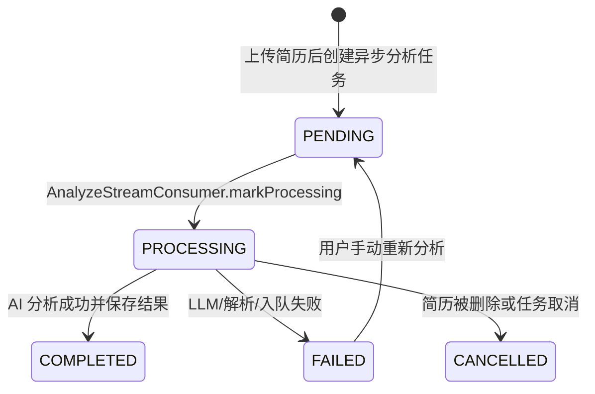

# common/model 模块总览怎么讲

## 1. 一句话定位

`common/model` 目前只有一个核心枚举：`AsyncTaskStatus`。它的定位不是复杂领域模型，而是整个项目里“业务对象异步处理进度”的通用状态枚举。

面试中可以这样开场：

> 这个模块目前很小，只定义了一个通用异步状态枚举 `AsyncTaskStatus`。它用于标记业务对象的异步处理进度，比如简历的 AI 分析状态、模拟面试报告评估状态、语音面试评估状态。它让前端和各业务模块可以用统一的状态语义判断“任务是否还在排队、是否处理中、是否完成、是否失败”。

## 2. 源码内容

```java
public enum AsyncTaskStatus {
    PENDING,
    PROCESSING,
    COMPLETED,
    FAILED,
    CANCELLED,
    DEAD_LETTER
}
```

每个状态的业务含义：

| 状态 | 含义 | 前端/业务表现 |
| --- | --- | --- |
| `PENDING` | 已触发异步任务，等待消费者处理 | 展示“排队中/分析中/评估准备中” |
| `PROCESSING` | 消费者已经取到任务，正在执行业务逻辑 | 展示“处理中” |
| `COMPLETED` | 业务处理成功 | 展示结果，比如 AI 分析、面试报告 |
| `FAILED` | 业务处理失败 | 展示失败原因，允许用户重试或稍后再试 |
| `CANCELLED` | 业务上取消或无需继续处理 | 展示取消状态，或内部记录 |
| `DEAD_LETTER` | 超过重试或进入死信语义 | 用于极端失败状态，通常需要人工介入 |

## 3. 这个枚举解决什么问题

AI 面试平台里很多操作不是同步完成的：

- 上传简历后，后台异步解析和 AI 分析。
- 完成模拟面试后，后台生成评估报告。
- 结束语音面试后，后台生成语音评估。
- 部分模块还会有知识库向量化这类异步处理。

如果没有统一状态，前端就不知道该怎么展示：

- 是还没开始？
- 是正在处理？
- 是已经完成？
- 是失败了？
- 是失败后还能不能重试？

`AsyncTaskStatus` 给这些异步业务对象提供了统一的状态语言。

面试回答：

> 这个枚举的价值在于把异步业务流程显式建模。业务对象不只是“有数据/没数据”，而是有一个完整的处理生命周期。前端可以根据状态轮询和展示，后端消费者也可以根据状态做幂等判断。

## 4. 它在哪些业务里用到了

| 业务对象 | 字段 | 含义 |
| --- | --- | --- |
| `ResumeEntity` | `analyzeStatus` | 简历 AI 分析状态 |
| `InterviewSessionEntity` | `evaluateStatus` | 模拟面试报告评估状态 |
| `VoiceInterviewSessionEntity` | `evaluateStatus` | 语音面试评估状态 |
| `ResumeListItemDTO` / `ResumeDetailDTO` | `analyzeStatus` | 返回给前端展示简历分析进度 |
| `SessionListItemDTO` | `evaluateStatus` | 返回给前端展示面试报告状态 |
| 语音面试 Controller | `evaluateStatus` | 判断报告是否生成完成、是否还在处理中 |

典型例子：

```java
@Enumerated(EnumType.STRING)
@Column(length = 20)
private AsyncTaskStatus analyzeStatus = AsyncTaskStatus.PENDING;
```

这里使用 `EnumType.STRING`，数据库里存的是 `PENDING`、`PROCESSING` 这种字符串。

面试回答：

> 我们没有用 int 存枚举 ordinal，而是用字符串存储。这样数据库可读性更好，也避免以后调整枚举顺序导致历史数据语义错乱。

## 5. 和异步任务表状态有什么区别

项目里还有一个很像的枚举：

```java
modules.asynctask.model.AsyncTaskStatusDTO
```

它和 `common.model.AsyncTaskStatus` 枚举值一样，但职责不同。

| 枚举 | 使用位置 | 关注点 |
| --- | --- | --- |
| `common.model.AsyncTaskStatus` | 业务实体字段，如简历、面试会话、语音会话 | 业务对象对外展示状态 |
| `modules.asynctask.model.AsyncTaskStatusDTO` | `AsyncTaskEntity`、`AsyncTaskService`、任务列表接口 | 异步任务调度、去重、重试、运维管理 |

面试中要特别讲清楚：

> 业务对象状态和任务表状态是两层状态。比如简历的 `analyzeStatus` 告诉前端这份简历分析到哪一步；异步任务表的 `status` 告诉后台这个任务是否入队、处理中、重试、死信。两者会同步更新，但不是同一个职责。

## 6. 典型状态流转

以简历分析为例：



以面试评估为例：

1. 用户完成面试。
2. `InterviewSessionService` 把 `evaluateStatus` 更新为 `PENDING`。
3. `EvaluateStreamConsumer` 消费任务后更新为 `PROCESSING`。
4. 评估报告生成成功后更新为 `COMPLETED`。
5. LLM 调用失败或重试失败时更新为 `FAILED`。

面试回答：

> 这个状态枚举配合 Redis Stream 消费者使用。Producer 提交任务后把业务对象置为 PENDING，Consumer 开始处理时置为 PROCESSING，成功后置为 COMPLETED，失败后置为 FAILED。前端通过轮询这些状态决定展示 loading、报告结果还是错误提示。

## 7. 它和知识库 `VectorStatus` 的关系

知识库模块没有直接使用 `AsyncTaskStatus`，而是用了自己的：

```java
modules.knowledgebase.model.VectorStatus
```

`VectorStatus` 只有：

- `PENDING`
- `PROCESSING`
- `COMPLETED`
- `FAILED`

为什么可以有领域专用状态？

> 因为知识库字段叫 `vectorStatus`，语义是“向量化状态”，不是通用的“任务状态”。它和 `AsyncTaskStatus` 的状态流转很相似，但领域表达更具体。

面试里可以这样答：

> common 里提供的是通用异步业务状态，但不是所有模块都必须强行复用。知识库向量化使用 `VectorStatus`，是为了让字段语义更贴合领域。状态设计要兼顾复用和可读性。

## 8. 当前实现里要诚实说明的点

| 点 | 当前情况 | 面试中怎么说 |
| --- | --- | --- |
| 注释滞后 | 文件注释写“四种状态”，但枚举已有六种 | 这是注释需要同步修正，不影响运行 |
| 与 `AsyncTaskStatusDTO` 重复 | 两个枚举值完全一样 | 职责分层合理，但可以考虑抽象转换或统一命名 |
| 缺少状态机约束 | 代码中可以直接 set 任意状态 | 后续可用状态机或集中方法校验非法流转 |
| 部分状态不一定在所有业务实体使用 | 例如业务实体未必会真的保存 `DEAD_LETTER` | 不要说所有业务都完整使用六种状态 |
| 错误信息单独字段保存 | 如 `analyzeError`、`evaluateError` | 状态只表达阶段，错误详情放 error 字段 |

## 9. 一分钟表达模板

> `common/model` 目前主要是 `AsyncTaskStatus` 枚举，它定义了异步业务对象的状态生命周期：PENDING、PROCESSING、COMPLETED、FAILED、CANCELLED、DEAD_LETTER。它被简历分析、模拟面试评估、语音面试评估等业务实体使用，比如 `ResumeEntity.analyzeStatus`、`InterviewSessionEntity.evaluateStatus`。它的作用是让前端可以统一展示异步任务进度，也让后端消费者在处理任务时有明确的状态流转。需要注意的是，它和异步任务表里的 `AsyncTaskStatusDTO` 是两层状态：前者是业务对象状态，后者是任务调度状态。

## 10. 一句话总结

> `AsyncTaskStatus` 是项目里异步业务对象的统一进度语言，核心价值是让后台任务、业务实体和前端展示之间有一致的状态语义。

