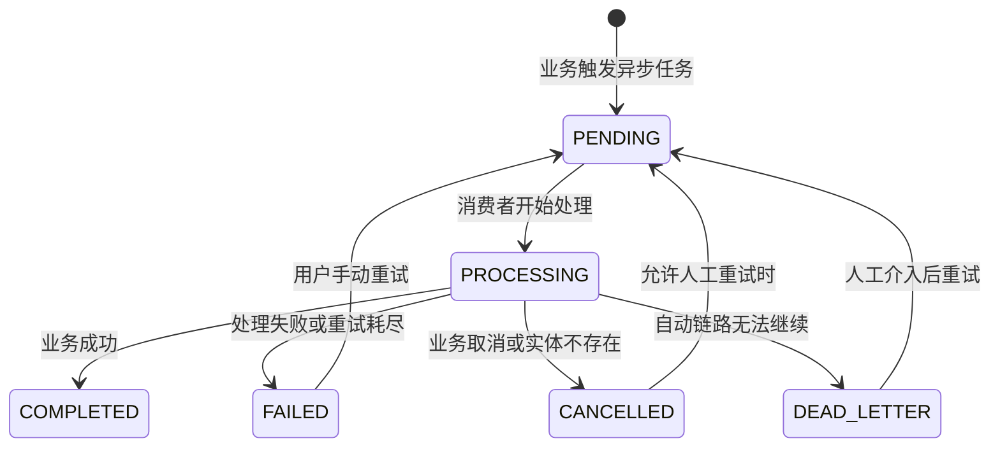

# AsyncTaskStatus 状态机怎么讲

## 1. 为什么一个枚举也值得讲

面试官可能觉得一个 enum 没什么技术含量。你要讲的不是“我写了六个枚举值”，而是：

> 我用枚举把异步业务的生命周期显式建模，并让状态流转贯穿 Producer、Consumer、业务实体和前端展示。

一个好的状态枚举可以避免：

- 前端不知道任务卡在哪。
- 后端失败只打日志，业务对象没有状态。
- 用户重复触发任务时无法判断是否已经在处理。
- 任务完成后无法区分成功、失败、取消。

## 2. 六个状态逐个讲

### 2.1 `PENDING`

含义：

> 业务已经触发异步处理，但消费者还没真正开始处理。

典型场景：

- 用户上传简历，接口快速返回 `analyzeStatus=PENDING`。
- 用户完成面试，评估任务入队，`evaluateStatus=PENDING`。
- 语音面试结束，评估任务触发，`evaluateStatus=PENDING`。

面试回答：

> PENDING 是用户请求和后台处理之间的缓冲状态。它告诉前端“任务已提交，不是没反应”。

### 2.2 `PROCESSING`

含义：

> 消费者已经拿到任务，正在执行业务逻辑。

典型代码：

```java
protected void markProcessing(AnalyzePayload payload) {
    asyncTaskService.markProcessing(payload.taskId());
    updateAnalyzeStatus(payload.resumeId(), AsyncTaskStatus.PROCESSING, null);
}
```

面试回答：

> PROCESSING 由消费者在真正开始处理前更新。这样前端能区分“还在排队”和“已经开始分析”。

### 2.3 `COMPLETED`

含义：

> 异步业务处理成功，结果已经落库。

典型场景：

- 简历分析结果保存成功。
- 面试报告生成并保存成功。
- 语音面试评估结果保存成功。

面试回答：

> COMPLETED 应该在业务结果落库后再更新，否则会出现前端看到完成但查不到结果的问题。

### 2.4 `FAILED`

含义：

> 业务处理失败，用户或运维需要看到失败状态。

典型场景：

- Redis Stream 发送失败。
- LLM 调用失败。
- 文件解析失败。
- 重试入队失败。

通常配套字段：

- `analyzeError`
- `evaluateError`

面试回答：

> 状态只表达失败阶段，失败原因不要塞进枚举，而是放到单独 error 字段。这样前端既能展示失败状态，也能展示具体原因。

### 2.5 `CANCELLED`

含义：

> 任务不再需要继续处理，通常不是系统故障。

典型场景：

- 用户删除了关联业务对象。
- 任务被手动取消。
- 消费时发现业务实体已经不存在。

面试回答：

> CANCELLED 和 FAILED 要区分。FAILED 是系统尝试处理但失败，CANCELLED 是业务上不需要处理，重试通常没有意义。

### 2.6 `DEAD_LETTER`

含义：

> 任务已经进入死信语义，自动处理链路无法继续，需要人工介入。

注意：

当前 common 业务实体里不一定实际广泛保存 `DEAD_LETTER`，异步任务表的 `AsyncTaskStatusDTO.DEAD_LETTER` 使用更明确。

面试回答：

> DEAD_LETTER 用来表达自动重试链路已经兜不住了。它不一定每个业务实体都会直接展示，但在任务表和运维视角很有价值。

## 3. 通用状态流转图



面试要点：

> 这是逻辑状态机，不代表代码里已经强制校验每条流转。当前很多地方是直接 setStatus，后续可以引入集中状态机防止非法流转。

## 4. 简历分析里的状态流转

流程：

1. 用户上传简历。
2. `ResumeEntity.analyzeStatus` 初始为 `PENDING`。
3. `AnalyzeStreamProducer` 入队失败时更新为 `FAILED`。
4. `AnalyzeStreamConsumer.markProcessing()` 更新为 `PROCESSING`。
5. AI 分析成功并保存后更新为 `COMPLETED`。
6. 失败时更新为 `FAILED`。
7. 用户重新分析时可重置为 `PENDING`。

面试回答：

> 简历上传接口不等待 AI 分析完成，而是立刻返回 PENDING。前端轮询详情接口，看到 PROCESSING 就展示处理中，看到 COMPLETED 就展示评分报告，看到 FAILED 就展示失败原因和重试入口。

## 5. 模拟面试评估里的状态流转

流程：

1. 用户完成面试或提前交卷。
2. `InterviewSessionService` 更新 `evaluateStatus=PENDING`。
3. `EvaluateStreamConsumer` 开始处理时更新 `PROCESSING`。
4. `AnswerEvaluationService` 生成报告并保存后更新 `COMPLETED`。
5. 失败则更新 `FAILED`，同时写入 `evaluateError`。

面试回答：

> 面试会话本身有自己的 SessionStatus，例如 CREATED、IN_PROGRESS、COMPLETED、EVALUATED；而 evaluateStatus 只表达报告生成这个异步子任务的状态。两者不要混淆。

## 6. 语音面试评估里的状态流转

流程：

1. 语音面试结束时，会话状态变成 `COMPLETED`。
2. `VoiceInterviewService.triggerEvaluation()` 把 `evaluateStatus` 置为 `PENDING`。
3. `VoiceEvaluateStreamConsumer` 消费任务后置为 `PROCESSING`。
4. 评估生成成功置为 `COMPLETED`。
5. 失败置为 `FAILED`。

前端 Controller 会根据状态返回：

- 已完成：返回评估结果。
- PENDING / PROCESSING：返回“评估生成中”。
- 失败：返回失败状态。

## 7. 为什么用 EnumType.STRING

业务实体里通常这样写：

```java
@Enumerated(EnumType.STRING)
@Column(length = 20)
private AsyncTaskStatus evaluateStatus;
```

好处：

- 数据库可读，直接看到 `PENDING`。
- 枚举顺序调整不会破坏历史数据。
- 排查问题时更直观。

如果用 `EnumType.ORDINAL`：

- `PENDING` 可能存 0。
- 后续在中间插入枚举值会导致历史数据语义错乱。

面试回答：

> 对持久化枚举，我更倾向于用 STRING，而不是 ORDINAL。状态字段可读性和长期兼容性比节省几个字节更重要。

## 8. 当前实现边界

### 8.1 没有集中状态机校验

当前很多地方可以直接：

```java
session.setEvaluateStatus(status);
```

这意味着理论上可以从 `COMPLETED` 又改回 `PROCESSING`。

下一步：

- 封装 `AsyncTaskStatusTransition`。
- 定义允许流转表。
- 非法流转打日志或抛业务异常。

### 8.2 注释需要更新

`AsyncTaskStatus` 注释说“四种状态”，但代码已有六种。

面试里不要避讳：

> 这是注释滞后，应该修正为六种状态。代码行为以枚举定义为准。

### 8.3 业务实体和任务表状态可能短暂不一致

例如：

- 异步任务表已经 `PROCESSING`，业务实体状态更新失败。
- 业务实体已经 `FAILED`，任务表重试状态又回到 `PENDING`。

当前项目通过消费者同步更新两边来减少不一致，但没有分布式事务。

下一步：

- 在监控页对比任务表和业务对象状态。
- 增加补偿扫描。
- 状态更新放在明确事务边界内。

## 9. 高频追问

### Q1：为什么 `CANCELLED` 和 `FAILED` 分开？

回答：

> FAILED 表示系统尝试处理但失败，可能需要重试；CANCELLED 表示业务上不需要继续处理，比如实体已删除。分开后重试策略和前端文案都更清楚。

### Q2：为什么 `DEAD_LETTER` 也放到 common 枚举里？

回答：

> 它表达自动链路无法继续，需要人工介入。虽然目前业务实体未必广泛使用这个状态，但保留它可以和任务表状态语义对齐。不过面试里要说明它在任务表中的使用更明确。

### Q3：如果用户重复触发任务，状态怎么处理？

回答：

> 业务状态只是展示层面，真正的重复入队控制在 `AsyncTaskService.createOrReusePendingTask()`。状态可以提示用户任务已经在 PENDING 或 PROCESSING，但幂等不能只靠前端状态判断。

## 10. 面试表达小结

> `AsyncTaskStatus` 是异步业务状态机的枚举表达。它的重点不是枚举本身，而是它贯穿了用户请求、消息队列、消费者、数据库实体和前端轮询展示。

