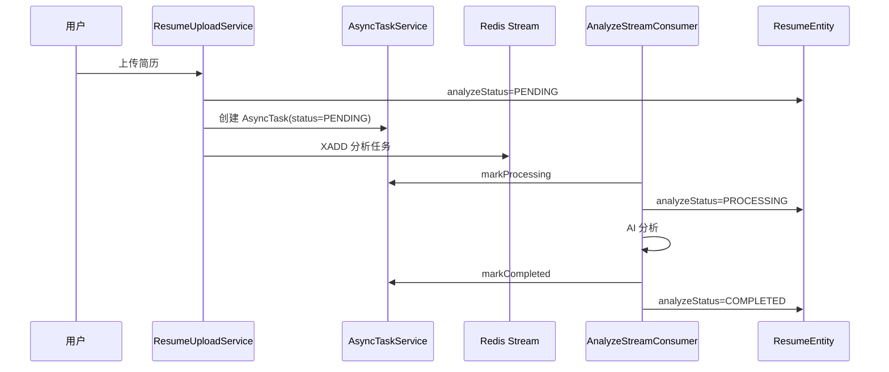

# 业务状态与任务表状态分层怎么讲

## 1. 先讲结论

项目里有两套相似状态：

```text
common.model.AsyncTaskStatus
modules.asynctask.model.AsyncTaskStatusDTO
```

它们枚举值一样：

- `PENDING`
- `PROCESSING`
- `COMPLETED`
- `FAILED`
- `CANCELLED`
- `DEAD_LETTER`

但职责不同。

面试回答：

> 这不是简单重复，而是两层状态。业务状态给前端和业务对象看，任务表状态给异步调度和运维看。两者会一起更新，但表达的是不同对象的生命周期。

## 2. 两层状态分别是什么

| 层级 | 枚举 | 存在哪里 | 谁使用 |
| --- | --- | --- | --- |
| 业务对象状态 | `AsyncTaskStatus` | `ResumeEntity.analyzeStatus`、`InterviewSessionEntity.evaluateStatus`、`VoiceInterviewSessionEntity.evaluateStatus` | 前端页面、业务 Service、消费者幂等判断 |
| 异步任务状态 | `AsyncTaskStatusDTO` | `AsyncTaskEntity.status` | `AsyncTaskService`、异步任务管理接口、监控指标 |

## 3. 为什么不能只用一层状态

假设只在业务实体上存状态，会缺少：

- taskId。
- Redis messageId。
- retryCount。
- maxRetryCount。
- streamKey。
- payloadJson。
- activeFlag / activeKey。
- 手动重试、取消、死信管理。

假设只在异步任务表上存状态，会缺少：

- 业务列表页直接展示状态。
- 简历详情页快速看到分析进度。
- 面试会话列表看到报告生成状态。
- 业务实体自己的错误字段。

所以需要两层。

面试回答：

> 任务表更像运维账本，业务状态更像产品状态。任务表回答“这条异步任务怎么调度、重试、追踪”，业务状态回答“这个简历/面试会话现在对用户是什么状态”。

## 4. 简历分析中的双状态

简历上传后会有两个对象：

1. `ResumeEntity`
   - `analyzeStatus`
   - `analyzeError`

2. `AsyncTaskEntity`
   - `status`
   - `messageId`
   - `retryCount`
   - `lastError`
   - `activeFlag`

典型流转：



面试回答：

> 简历表的 analyzeStatus 是用户可见状态，异步任务表记录更细的调度状态。消费者处理时同时更新这两层，保证前端展示和后台运维都能对上。

## 5. 面试评估中的双状态

`InterviewSessionEntity` 有：

- `SessionStatus`：会话生命周期，如 CREATED、IN_PROGRESS、COMPLETED、EVALUATED。
- `evaluateStatus`：报告生成这个异步子任务状态。

这两个也要分开。

例如：

| 字段 | 含义 |
| --- | --- |
| `status=COMPLETED` | 用户已经完成答题 |
| `evaluateStatus=PENDING` | 报告还在排队生成 |
| `evaluateStatus=PROCESSING` | 后台正在生成报告 |
| `evaluateStatus=COMPLETED` | 报告已生成 |
| `status=EVALUATED` | 会话整体进入已评估状态 |

面试回答：

> 面试会话完成和报告评估完成不是一回事。用户交卷后，会话可以是 COMPLETED，但报告生成仍然是 PENDING 或 PROCESSING。所以需要独立的 evaluateStatus。

## 6. 语音面试中的双状态

语音面试也类似：

- `VoiceInterviewSessionStatus` 表达通话会话状态。
- `InterviewPhase` 表达当前阶段：INTRO、TECH、PROJECT、HR、COMPLETED。
- `AsyncTaskStatus evaluateStatus` 表达评估报告生成状态。

面试回答：

> 语音面试有更复杂的会话状态，比如暂停、恢复、阶段流转，这些不能和评估报告状态混在一起。evaluateStatus 只负责报告生成进度。

## 7. 为什么知识库用 VectorStatus

知识库模块使用：

```java
VectorStatus
```

字段：

```java
KnowledgeBaseEntity.vectorStatus
```

这说明状态建模不是一刀切。

`VectorStatus` 更贴近业务语义：

- 它不是“分析状态”。
- 不是“评估状态”。
- 而是“向量化状态”。

面试回答：

> 对通用异步评估/分析状态，我用 `AsyncTaskStatus`；对知识库向量化这种强领域状态，保留 `VectorStatus`。这样可读性更好，不会为了复用而牺牲领域表达。

## 8. 状态一致性怎么保证

当前通过消费者模板约定：

- `markProcessing()` 同时更新任务表和业务实体。
- `markCompleted()` 同时更新任务表和业务实体。
- `markFailed()` 同时更新任务表和业务实体。
- 发送失败回调 `onSendFailed()` 更新业务实体失败状态。

例如简历：

```java
asyncTaskService.markProcessing(payload.taskId());
updateAnalyzeStatus(payload.resumeId(), AsyncTaskStatus.PROCESSING, null);
```

面试回答：

> 一致性不是靠前端猜，而是消费者在每个关键阶段同时更新任务表和业务实体。这样异步任务管理页和业务列表页看到的状态基本一致。

## 9. 当前边界

### 9.1 没有严格分布式事务

任务表和业务实体可能在同一个数据库事务里，也可能因为异常出现短暂不一致。Redis 消息和数据库更不是一个事务。

下一步：

- 补偿扫描。
- Outbox。
- 状态一致性巡检。

### 9.2 两套枚举值重复

现在两个枚举值完全一样，维护时要注意同步。

下一步：

- 抽共享状态接口。
- 增加转换方法。
- 或者明确命名为 `BusinessAsyncStatus` 和 `AsyncTaskLifecycleStatus`，降低混淆。

### 9.3 前端状态不等于任务幂等

前端看到 `PENDING` 可以提示用户不要重复点，但真正防重复要靠：

```java
AsyncTaskService.createOrReusePendingTask()
```

面试回答：

> 状态展示不能当作并发控制。幂等必须在后端任务创建处保证。

## 10. 高频追问

### Q1：为什么不直接复用 `AsyncTaskStatusDTO`？

回答：

> `AsyncTaskStatusDTO` 属于 asynctask 模块，是任务管理模型；业务实体放在 resume、interview、voiceinterview 里，如果直接依赖 DTO，会让业务对象依赖任务管理接口模型。common 里的 `AsyncTaskStatus` 更适合作为跨业务的状态枚举。

### Q2：为什么两个枚举值一样还分开？

回答：

> 因为它们描述的对象不同。一个描述业务对象的处理结果，一个描述任务记录的调度生命周期。枚举值相同是因为当前生命周期一致，但职责边界不同。

### Q3：会不会导致状态不一致？

回答：

> 有可能，所以消费者在 markProcessing、markCompleted、markFailed 里同步更新两边。生产上可以再加补偿任务和一致性监控。

### Q4：如果任务表 DEAD_LETTER，业务状态应该是什么？

回答：

> 当前很多业务实体会展示为 FAILED，因为对用户来说就是处理失败；任务表保留 DEAD_LETTER 供运维判断“自动链路已经不可恢复”。如果产品需要，也可以把业务状态也展示为 DEAD_LETTER。

## 11. 面试表达小结

> 这个状态模型的关键是分层：业务对象状态服务用户体验，异步任务状态服务调度运维。两者同步但不混用。

