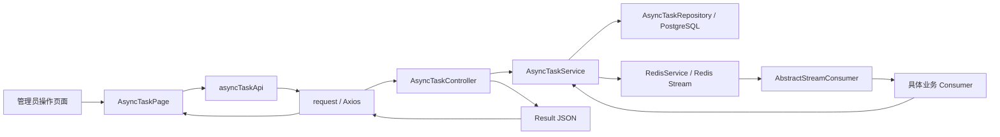
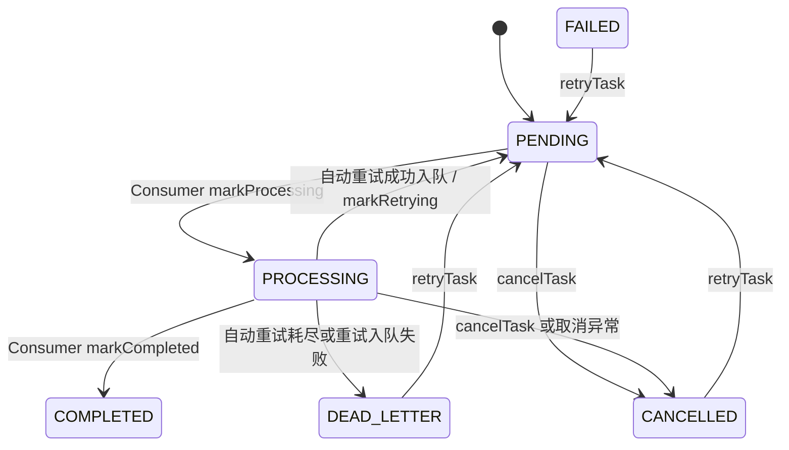

# AsyncTaskController 完整调用链总览

> 本文不是“接口清单”，而是本目录两篇方法解析的阅读入口。所有结论均以当前代码为准，
> 调用链从 React 页面开始，经过 HTTP 客户端、Controller、Service、Repository/Redis，
> 最后回到前端界面；涉及重试时还会继续追踪到 Redis Stream Consumer 和业务处理结果。

## 1. 模块解决什么问题

`AsyncTaskController` 是异步任务管理后台的 HTTP 入口，提供四个接口：

| Controller 方法 | HTTP 接口 | 当前前端调用方 | 作用 |
|---|---|---|---|
| `listTasks` | `GET /api/async-tasks` | `AsyncTaskPage.loadTasks` | 查询、筛选任务列表 |
| `getTask` | `GET /api/async-tasks/{id}` | 当前没有页面调用；只定义了 `asyncTaskApi.get` | 按主键查询一条任务 |
| `retryTask` | `POST /api/async-tasks/{id}/retry` | `AsyncTaskPage.handleRetry` | 将终态任务重新写入原 Redis Stream |
| `cancelTask` | `POST /api/async-tasks/{id}/cancel` | `AsyncTaskPage.handleCancel` | 将活跃任务标记为取消 |

需要先澄清两个容易被旧文档写错的事实：

1. 当前详情面板不是通过 `getTask` 加载的。用户点击表格行时，`TaskTable` 直接把列表中的
   `AsyncTask` 对象交给 `setSelectedTask`。
2. 当前业务页面没有使用 `getTask` 每两秒轮询任务状态。异步任务管理页只会在首次进入、
   筛选条件变化、点击刷新，以及重试/取消成功后调用 `listTasks`。

## 2. 从页面到数据源的总链路



这条图里存在两种性质不同的路径：

- 查询、取消：主要是同步的 HTTP → 数据库 → HTTP 返回闭环。
- 重试：HTTP 请求先完成“状态重置 + 消息重新入队”，真正业务执行在请求返回后由 Consumer
  异步完成，因此有“接口闭环”和“任务执行闭环”两段。

## 3. 前端入口是怎样出现的

代码位置：

- `frontend/src/App.tsx`
- `frontend/src/pages/AdminDashboardPage.tsx`
- `frontend/src/components/admin/AdminNav.tsx`
- `frontend/src/pages/AsyncTaskPage.tsx`

调用顺序：

1. `App.tsx` 使用 `lazy(() => import('./pages/AsyncTaskPage'))` 延迟加载页面组件。
2. React Router 将 `/admin/async-tasks` 映射到 `<AsyncTaskPage />`。
3. 管理台卡片和 `AdminNav` 的“异步任务”链接都会导航到该路径。
4. `AsyncTaskPage` 挂载后，`useEffect` 调用 `loadTasks()`，发起第一次列表请求。

## 4. HTTP 响应如何回到页面

所有四个 Controller 方法都返回 `Result<T>`。完整返回链是：

```text
Controller
  → Result.success(data)
  → Spring MVC + Jackson 序列化
  → HTTP 200，响应体 { code: 200, message: "success", data: ... }
  → frontend/src/api/request.ts 响应拦截器
  → code === 200：把 response.data 改成 result.data
  → request.get/post 的 .then(res => res.data)
  → asyncTaskApi 返回 Promise<AsyncTask...>
  → AsyncTaskPage 更新 React state
  → 页面重新渲染
```

业务异常则走另一条闭环：

```text
Service 抛出 BusinessException
  → GlobalExceptionHandler.handleBusinessException
  → HTTP 200 + Result.error(code, message)
  → Axios 响应拦截器发现 code !== 200
  → Promise.reject(new Error(message))
  → AsyncTaskPage catch
  → getErrorMessage(err)
  → setError(message)
  → 页面顶部显示红色错误提示
```

因此，前端不能只看 HTTP 状态码；真正的成功条件是响应体 `code === 200`。

## 5. 数据库状态和 Redis Stream 的关系

`AsyncTaskEntity` 是任务的可查询状态记录，Redis Stream 消息负责驱动后台执行。两者通过
以下字段关联：

| 字段 | 作用 |
|---|---|
| `id` | 数据库任务主键，同时作为 Stream 消息的 `taskId` |
| `taskType` | 决定任务类型以及手动重试时专属业务字段名 |
| `businessId` | 简历、知识库、面试会话或语音会话的业务 ID |
| `streamKey` | 手动重试时决定消息重新写入哪个 Stream |
| `messageId` | 最近一次 XADD 返回的 Redis Stream 消息 ID |
| `status` | 管理页面展示的统一任务状态 |
| `retryCount` | Consumer 自动重试次数；手动重试会重置为 0 |
| `activeFlag` / `activeKey` | 标识同一业务对象是否已有活跃任务 |

四种任务的路由关系：

| `taskType` | `streamKey` | 专属消息字段 | Consumer | 核心业务方法 |
|---|---|---|---|---|
| `RESUME_ANALYZE` | `resume:analyze:stream` | `resumeId` | `AnalyzeStreamConsumer` | `processBusiness` → `gradingService.analyzeResume` |
| `KB_VECTORIZE` | `knowledgebase:vectorize:stream` | `kbId` | `VectorizeStreamConsumer` | `processBusiness` → `vectorService.vectorizeAndStore` |
| `INTERVIEW_EVALUATE` | `interview:evaluate:stream` | `sessionId` | `EvaluateStreamConsumer` | `processBusiness` → `evaluationService.evaluateInterview` |
| `VOICE_INTERVIEW_EVALUATE` | `voice:evaluate:stream` | `voiceSessionId` | `VoiceEvaluateStreamConsumer` | `processBusiness` → `evaluationService.generateEvaluation` |

## 6. 状态机：代码当前真正允许的流转



`FAILED` 主要来自首次 Producer 入队失败时的 `markFailed`；Consumer 自动重试耗尽后，四个
具体 Consumer 的 `markFailed` 实现实际调用的是 `AsyncTaskService.markDeadLetter`，所以终态
是 `DEAD_LETTER`，不是 `FAILED`。

## 7. 三份文档怎样阅读

| 文档 | 重点 |
|---|---|
| `00-执行计划.md` | 真实调用方、公共响应链、状态机和代码地图 |
| `01-listTasks-getTask.md` | 两个查询接口从页面触发到数据库查询、DTO 返回和 UI 更新的逐步闭环 |
| `02-retryTask-cancelTask.md` | 重试与取消从按钮确认到后台执行、Redis 消费、异常路径和并发边界的逐步闭环 |

## 8. 当前实现中必须正视的边界

这些不是文档猜测，而是从现有代码直接得出的结论：

- `getTask` 已封装在 `asyncTaskApi`，但当前没有前端调用者，也没有任务状态轮询。
- `listTasks` 没有分页，空筛选会一次读取并返回全部任务。
- `retryTask` 标注了 `@Transactional`，事务内部调用了 Redis `XADD`，与本项目“事务内禁止
  调外部 API”的规范冲突，并存在数据库提交与 Redis 入队无法原子一致的风险。
- `cancelTask` 只改数据库，不删除 Stream 消息、不 ACK，也不打断已经运行的 LLM/文件处理。
- 对 `PROCESSING` 任务执行取消后，Consumer 若随后正常结束，当前 `finishTask` 没有
  `CANCELLED` 状态保护，可能再次把状态覆盖成 `COMPLETED`；若业务随后抛错，也可能继续
  自动重试。这是实际竞态，不能描述成“取消一定阻止后续状态落库”。
- 手动重试构造的消息没有携带 `traceId`，因此不会继承本次 HTTP 请求的链路追踪标识。

以上边界在后续两篇文档中会放回各自调用链的准确位置说明。
