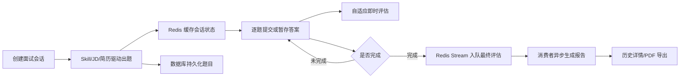

# 模拟面试模块总览与业务闭环

## 1. 模块基础讲解 

`interview` 模块承担的是平台里最核心的“模拟面试闭环”：用户基于简历、岗位方向或 JD 创建一场文字面试，系统生成问题，用户逐题回答，后台做即时能力分析和最终评估，最后沉淀成历史记录与 PDF 报告。

面试时可以先把业务价值讲清楚：这个模块不是简单的题库 CRUD，而是把“候选人准备面试”拆成一条可重复、可追踪、可评估的工作流。候选人不只看到题目，还能看到自己在哪些能力维度薄弱、哪些回答需要补深度、下次复盘应该优先补什么。

核心链路可以概括为：

模块内主要组件分工如下：

- `InterviewController`：提供 REST API，负责会话创建、获取题目、提交/暂存答案、交卷、报告、详情、导出和删除。
- `InterviewSessionService`：核心编排服务，管理会话生命周期、Redis 缓存恢复、状态推进、最终评估触发。
- `InterviewQuestionService`：出题引擎，支持 Skill 出题、简历出题、JD 自定义分类、历史题去重、追问生成和 fallback。
- `InterviewPersistenceService`：封装数据库写读，包括会话、答案 upsert、报告保存、历史题提取、自适应状态保存。
- `EvaluateStreamProducer` / `EvaluateStreamConsumer`：基于 Redis Stream 做最终评估异步化、重试和死信处理。
- `AnswerEvaluationService`：文字面试 DTO 适配器，把题目答案转成通用评估模型，再调用 `UnifiedEvaluationService`。
- `AdaptiveInterviewService` 及子服务：提交每题答案后做即时评估、能力画像更新和下一步策略建议。
- `InterviewSkillService`：加载 `resources/skills` 下的预设面试方向，解析 JD，注入 reference 材料。
- `InterviewHistoryService`：负责历史详情组装和 PDF 导出。

这个模块体现了几个工程设计思想：

- 业务状态和异步状态拆开：会话状态表示用户流程，评估状态表示后台任务流程。
- Redis 与数据库双存储：Redis 加速面试进行中的状态读写，数据库保证历史记录和报告持久化。
- LLM 调用集中封装：通过 `LlmProviderRegistry`、`StructuredOutputInvoker`、Prompt 模板和 Skill reference 降低大模型输出不稳定带来的风险。
- 同步体验和异步重任务拆分：答题接口尽量快速返回，最终报告通过 Redis Stream 后台生成。
- “增强能力不阻断主流程”：自适应即时评估失败时只记录日志并返回空结果，不影响用户继续答题。

常见面试讲法：

> 我负责的模拟面试模块是平台的核心 AI 闭环。它从候选人的简历、面试方向或 JD 出发生成题目，过程中用 Redis 保存面试进度，用数据库沉淀历史，用 Redis Stream 异步生成评估报告。同时每轮答题后会做一次轻量即时评估，累积能力画像。整个设计重点不是做一个题库，而是把“出题、答题、评估、复盘”做成可恢复、可追踪、可扩展的工作流。

## 2. 基础面试问题

**问题：这个模块解决的核心业务问题是什么？**

回答：它解决的是求职者缺少针对性练习和可量化反馈的问题。传统刷题只能看到题目，无法根据简历、岗位方向和历史表现生成个性化面试，也无法沉淀每次回答的薄弱点。这个模块通过 AI 出题、逐题答题、异步评估和能力画像，把面试准备变成一个闭环。

**问题：为什么需要同时使用 Redis 和数据库？**

回答：Redis 适合保存进行中的会话状态，比如当前题号、题目列表、暂存答案和未完成会话映射，读写快、适合用户交互。数据库适合保存长期数据，比如会话记录、答案、报告、能力画像和历史题目。代码中 `InterviewSessionService` 先查 Redis，缓存未命中再从数据库恢复，这样兼顾性能和持久性。

**问题：模块的分层关系是什么？**

回答：Controller 只做路由和委托；Service 负责业务编排；Repository 负责 JPA 查询；Infrastructure 提供 Redis、PDF、MapStruct 等基础能力。面试模块内部又按职责拆分为会话、出题、评估、历史、自适应和 Skill 管理几个子能力。

**问题：为什么最终评估要异步化？**

回答：最终评估需要调用 LLM，可能耗时较长、失败概率也比普通数据库操作高。如果在提交最后一题的请求里同步完成，会导致接口阻塞甚至超时。当前代码用 Redis Stream 入队评估任务，让用户流程先完成，后台消费者再生成报告。

**问题：这个模块有哪些对外 API？**

回答：主要包括创建会话、获取会话、获取当前题、提交答案、暂存答案、提前交卷、获取报告、查询未完成会话、查看详情、导出 PDF、删除会话，以及 Skill 列表和 JD 解析接口。

## 3. 进阶面试问题

**问题：这个模块中有哪些设计模式？**

回答：第一是门面/编排模式，`InterviewSessionService` 对外隐藏 Redis、DB、LLM、Stream 的复杂协作；第二是模板方法模式，Redis Stream 生产者和消费者继承通用抽象类，只实现 stream key、payload 构建和业务处理；第三是适配器模式，`AnswerEvaluationService` 把面试题 DTO 转成通用 `QaRecord`，复用通用评估引擎；第四是注册表/策略模式，`LlmProviderRegistry` 根据 provider 路由不同大模型；第五是 Repository 模式和 Mapper 模式，分别封装数据访问与 Entity/DTO 转换。

**问题：怎么保证异步任务不会重复执行？**

回答：生产端 `EvaluateStreamProducer` 通过 `AsyncTaskService.createOrReusePendingTask` 创建或复用待处理任务，避免同一会话重复入队。消费端 `EvaluateStreamConsumer` 在处理前检查会话是否已经是 `EVALUATED` 且有 `overallScore`，已评估就跳过。这样生产和消费两侧都有幂等保护。

**问题：Redis 缓存和数据库状态不一致怎么办？**

回答：代码采用“Redis 优先，数据库兜底恢复”的策略。获取会话时先查 Redis，查不到就从 `interview_sessions.questionsJson` 和 `interview_answers` 恢复题目、答案、当前题号和状态，再写回 Redis。风险是某些路径会先更新 Redis 后更新数据库，如果数据库失败，短期内 Redis 仍能用，但缓存过期后会丢失部分状态。这是当前实现需要优化的边界。

**问题：业务状态和异步评估状态为什么分开？**

回答：因为它们表达的是不同维度。`SessionStatus` 表示用户面试流程：创建、进行中、已完成、已评估。`AsyncTaskStatus` 表示后台评估任务：待处理、处理中、完成、失败、死信等。拆开后，用户可以完成面试但报告还在处理中，前端也能展示“面试已完成，报告生成中”的状态。

**问题：这个模块的 AI 调用有哪些稳定性措施？**

回答：出题、JD 解析、即时评估、自适应决策、最终评估都尽量走结构化输出转换器，要求模型返回 JSON，并通过 `StructuredOutputInvoker` 做重试和输出修复。出题失败有 fallback 题目，方向题失败可以降级，最终评估单批失败会零分兜底，自适应评估失败不会中断答题流程。

## 4. 技术延伸问题

**问题：如果不用 Redis Stream，还可以怎么实现最终评估异步化？**

回答：可以用几种方案。第一是本地线程池或虚拟线程，接入简单，但进程重启会丢任务，不适合可靠任务。第二是 Spring 事件或事务后事件，适合同进程解耦，但跨实例能力弱。第三是 RabbitMQ，适合传统任务队列和延迟重试。第四是 Kafka，吞吐高、可回放，但对单任务状态管理需要额外设计。第五是数据库任务表轮询，实现简单且可靠，但实时性和吞吐不如消息队列。当前 Redis Stream 是轻量、可消费组、可重试的折中方案。

**问题：如果要做实时面试体验，应该怎么改？**

回答：文字面试可以在提交答案后通过轮询或 SSE 推送即时评估结果；语音面试则更适合 WebSocket。当前模块已经把最终评估异步化，但报告结果不是实时推送，前端需要主动查询。可以增加评估状态查询接口或 SSE 通道，把 `evaluateStatus` 的变化推给前端。

**问题：如何用 RAG 增强面试题和评估？**

回答：当前 Skill reference 是静态 Markdown 注入 Prompt。升级成 RAG 后，可以把参考材料切片向量化，根据 skill、category、difficulty、JD 动态检索相关片段，再注入出题和评估 Prompt。这样比全量截断注入更精准，也能支持更大的知识库。

**问题：如果要支持多租户和用户权限，怎么改？**

回答：需要在 `InterviewSessionEntity` 中增加 `userId` 或租户字段，所有查询、删除、恢复未完成会话都加用户过滤。Redis key 也要包含 userId，避免不同用户的 resumeId 或 sessionId 映射互相影响。Controller 层从认证上下文获取用户身份，而不是只依赖路径参数。

**问题：如果要支持动态自适应出题，当前架构够吗？**

回答：当前自适应服务能评估每轮答案并给出下一步策略，但主流程仍使用预生成题目列表，`adaptiveDecision.nextQuestion` 没有真正替换下一题。所以当前更准确地说是“即时能力分析 + 自适应建议”。要变成真正动态自适应，需要让决策结果参与题目生成或题目队列更新。

## 5. 改进方案问题

**问题：当前 Controller 层有什么可改进点？**

回答：`CreateInterviewRequest` 和 `SubmitAnswerRequest` 有校验注解，但 `createSession` 没有加 `@Valid`，提交答案接口还使用 `Map<String, Object>` 手动取值，校验没有生效，也存在类型转换风险。建议改成 `@Valid @RequestBody SubmitAnswerRequest`，并统一让全局异常处理器返回 `Result.error`。

**问题：当前会话一致性有什么风险？**

回答：`createSession` 中保存数据库失败只记录 warn，仍返回 Redis 中的会话；`submitAnswer` 中数据库保存、自适应评估和最终评估入队放在一个 catch 里，失败后接口仍可能返回成功。这会带来“用户看到答题成功，但数据库/评估任务没有落下去”的风险。建议把关键写库和入队失败转为明确错误，或者引入 outbox 表保证最终一致。

**问题：删除会话还有什么遗漏？**

回答：`deleteInterview` 当前只调用 `persistenceService.deleteSessionBySessionId` 删除数据库记录，没有显式清理 Redis 中的 `interview:session:{sessionId}` 和 `interview:resume:{resumeId}` 映射。如果缓存还在，用户可能短时间读到已删除会话。建议删除时同时调用 `InterviewSessionCache.deleteSession`，并取消或标记相关异步任务。

**问题：列表查询怎么优化？**

回答：`listSessions` 当前查询所有会话再转换为 DTO，数据量大时会慢，也没有用户隔离。建议改为分页查询、按用户过滤、只投影列表需要字段，避免加载大字段如 `questionsJson`。

**问题：数据库建模怎么增强？**

回答：当前大量复杂结构存为 JSON 字符串，开发快，但查询和统计不方便。可以保留 JSON 作为快照，同时把关键字段拆表或用 PostgreSQL JSONB：比如分类得分、能力维度、评估任务状态、题目主题摘要。这样后续能做趋势分析、薄弱项排行榜和搜索。

## 6. 故障处理问题

**问题：用户提交最后一题后一直看不到报告，怎么排查？**

回答：先查 `interview_sessions.evaluateStatus` 是否为 `PENDING/PROCESSING/FAILED`。如果停在 `PENDING`，检查 Redis Stream 是否写入成功、消费者组是否运行。若为 `FAILED`，看 `evaluateError` 和 async task 表。再查消费者日志中是否有 LLM 调用异常、JSON 解析失败或会话被删除。

**问题：用户刷新页面后面试进度丢失怎么办？**

回答：先查 Redis 是否还有 `interview:session:{sessionId}`。如果没有，看数据库 `interview_sessions` 和 `interview_answers` 是否存在。代码支持缓存未命中后从数据库恢复，如果数据库没有保存成功，说明之前创建或答题时只写入了 Redis，需要检查数据库写入失败日志。

**问题：创建会话题目为空或数量不对怎么办？**

回答：检查 LLM 出题 Prompt、`StructuredOutputInvoker` 输出转换日志、Skill 分类分配和 reference 注入内容。代码中 `capToMainCount` 会截断过多主问题，AI 少生会记录 warn 并保留。若结构化输出失败，会走 fallback 题目。还要确认前端传入的 `questionCount` 是否在 3 到 20 之间，因为当前 Controller 未启用 `@Valid`。

**问题：删除会话后后台任务还在跑怎么办？**

回答：消费者会用 `findBySessionIdWithResume` 查会话，会话不存在时抛出 `AsyncTaskCancelledException`，父类会标记任务取消并 ack 丢弃。但生产端和删除接口没有主动取消任务，最好补充删除时取消 pending task、清理 Redis 缓存和前端状态。

**问题：PDF 导出失败怎么办？**

回答：`InterviewHistoryService.exportInterviewPdf` 会先查会话，再调用 `PdfExportService.exportInterviewReport`，失败会抛 `BusinessException(EXPORT_PDF_FAILED)`。但 Controller 里 catch 了所有异常并返回 500，绕过了统一 `Result`。排查时看 PDF 服务日志、会话报告字段是否完整、字体/模板资源是否可用。
