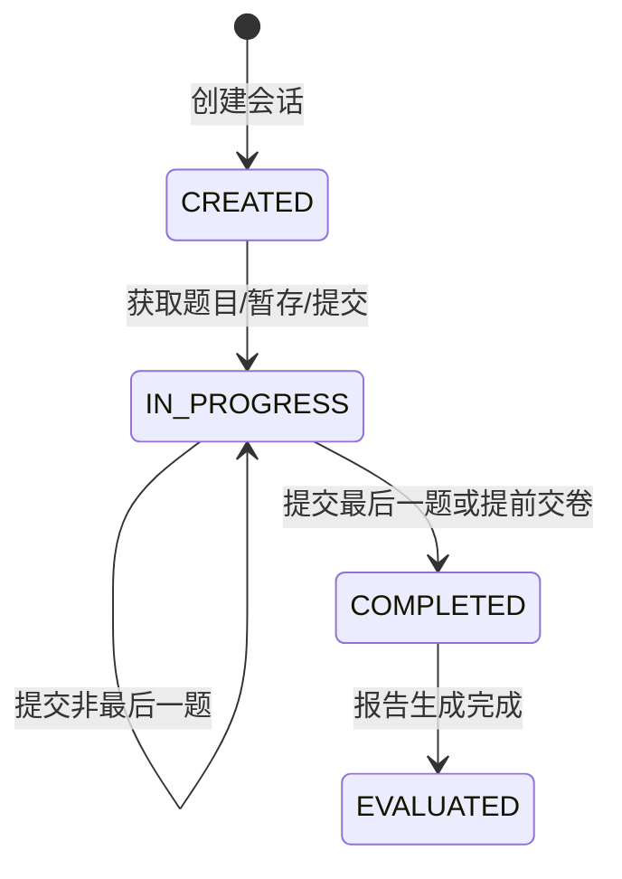
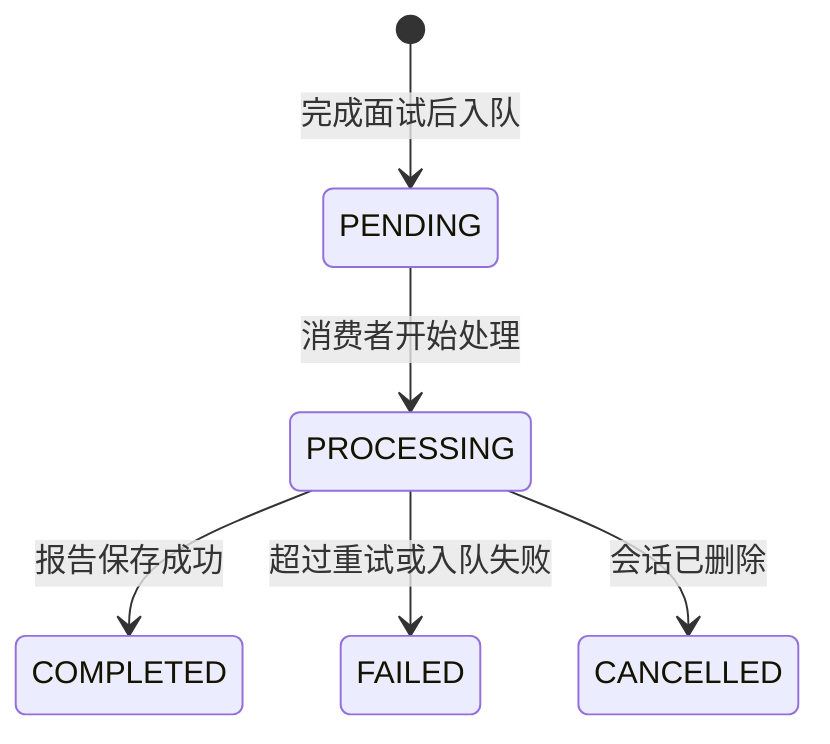

# 答题提交与状态流转

## 1. 模块基础讲解

答题流程由 `InterviewSessionService.submitAnswer()` 和 `saveAnswer()` 承担，分别对应“正式提交进入下一题”和“暂存当前答案”。

正式提交的主流程如下：

1. 根据 `sessionId` 从 Redis 获取会话，缓存不存在时从数据库恢复。
2. 反序列化题目列表，校验 `questionIndex` 是否有效。
3. 使用 `InterviewQuestionDTO.withAnswer()` 生成带答案的新题目对象。
4. 将当前索引推进到下一题。
5. 更新 Redis 中的题目列表和当前题号。
6. 保存答案到数据库，更新当前题号和会话状态。
7. 调用 `AdaptiveInterviewService.evaluateAndDecideSafely()` 做即时评估。
8. 如果已经是最后一题，更新评估状态为 `PENDING`，并通过 `EvaluateStreamProducer` 入队最终评估任务。
9. 返回 `SubmitAnswerResponse`，包含下一题和自适应结果。

暂存答案的主流程类似，但不会推进 `currentIndex`，也不会触发最终评估。它适合用户边写边保存，或前端自动保存草稿。

会话状态可以这样理解：

这里还存在一条异步评估状态线：

面试讲解时可以强调：业务状态负责用户流程，异步状态负责后台任务；两个状态互相配合，但不混成一个字段。

## 2. 基础面试问题

**问题：提交答案和暂存答案有什么区别？**

回答：提交答案会保存当前答案并推进到下一题，如果是最后一题会触发最终评估。暂存答案只更新当前题目的答案，不改变当前题号，也不触发评估。它们都复用 `SubmitAnswerRequest`，但行为不同。

**问题：提交答案后前端怎么知道下一步做什么？**

回答：后端返回 `SubmitAnswerResponse`。其中 `hasNextQuestion` 表示是否还有下一题，`nextQuestion` 是下一题内容，`currentIndex` 和 `totalQuestions` 用于展示进度。如果启用了自适应评估，还会返回本轮评估、决策和能力画像。

**问题：为什么 `InterviewQuestionDTO` 用不可变更新？**

回答：record 本身不可变，`withAnswer()` 会返回一个新对象，避免在多个地方共享同一个可变对象导致状态混乱。更新题目列表时，用新对象替换指定 index，再整体写回 Redis。

**问题：提前交卷怎么处理？**

回答：`completeInterview()` 会校验会话没有完成或评估过，然后把 Redis 和数据库状态更新为 `COMPLETED`，把评估状态设为 `PENDING`，最后发送评估任务到 Redis Stream。未回答题目在最终评估中会按 0 分处理。

**问题：如果缓存失效，用户还能继续答题吗？**

回答：可以。`getOrRestoreSession()` 会先查 Redis，查不到则从数据库恢复题目、答案、当前题号和状态，并重新写入 Redis。前提是之前的会话和答案已经成功保存到数据库。

## 3. 进阶面试问题

**问题：提交答案时如何处理越界题号？**

回答：`submitAnswer` 会检查 `questionIndex < 0 || questionIndex >= questions.size()`，越界时抛 `BusinessException(ErrorCode.INTERVIEW_QUESTION_NOT_FOUND)`。这是基本防御，避免前端传错题号导致数组访问异常。

**问题：当前代码是否防止乱序提交？**

回答：当前只校验题号是否在范围内，没有校验 `questionIndex` 是否等于服务端的 `currentIndex`。也就是说，前端理论上可以提交未来题或重复提交旧题。数据库 upsert 会保证一题一答，但状态推进可能被乱序请求影响。生产环境建议加“题号必须等于当前题号”的校验，或引入版本号/乐观锁。

**问题：当前代码如何处理重复提交？**

回答：答案表有 `(session_id, question_index)` 唯一约束，`saveAnswer` 会按 sessionId + questionIndex 查找已有答案并更新，因此答案记录层面是 upsert。但会话当前题号推进没有幂等检查，重复提交同一题可能把 currentIndex 反复设置为 `index + 1`，如果并发请求交错，仍可能产生状态问题。

**问题：自适应即时评估失败会影响答题吗？**

回答：不会。`evaluateAndDecideSafely` 内部捕获异常，失败时记录 warn 并返回 null。`SubmitAnswerResponse` 中自适应字段为空，主流程仍然继续。这是一个典型的“增强能力不阻断核心业务”的设计。

**问题：提交最后一题后为什么要设置 `evaluateStatus=PENDING`？**

回答：这告诉前端最终评估任务已经准备开始，但报告还没有完成。随后生产者会入队 Redis Stream，消费者处理时改为 `PROCESSING`，完成后改为 `COMPLETED`。这样用户可以看到报告生成进度，而不是只看到会话 `COMPLETED`。

**问题：当前事务边界有什么问题？**

回答：`submitAnswer` 本身不是一个大事务。它先更新 Redis，再尝试保存 DB 和入队。如果 DB 保存或入队失败，会被 catch 后只记录 warn，接口仍可能返回成功。这种设计保证用户交互不被轻易打断，但牺牲了强一致性。关键业务场景建议明确失败或用 outbox 保证最终一致。

## 4. 技术延伸问题

**问题：如果要支持多人同时协作面试，状态流转怎么改？**

回答：需要在会话上加参与者角色和权限，答题者、面试官、观察者看到的状态不同。当前单用户 currentIndex 不够，需要把题目状态、答题状态、面试官追问和评分事件都建成事件流，前端通过 WebSocket 或 SSE 同步。

**问题：如果要支持跳题和回退，当前设计够吗？**

回答：当前支持按题号保存答案，但主流程是线性推进。要支持跳题，需要把 `currentIndex` 从“唯一当前位置”改成“前端推荐位置”，同时记录每题状态：未答、草稿、已提交、跳过。最终评估按所有题状态处理。

**问题：如果要支持限时答题，应该放在哪一层？**

回答：会话实体需要增加开始时间、每题开始时间、截止时间等字段。Redis 缓存也要保存时间状态，提交时由服务端校验是否超时，不能只依赖前端倒计时。超时后可以自动提交空答案或标记跳过。

**问题：如果用事件溯源实现，会有什么变化？**

回答：每个动作都写成事件：SessionCreated、QuestionShown、AnswerSaved、AnswerSubmitted、InterviewCompleted、EvaluationQueued 等。当前状态由事件聚合得到。好处是审计能力强、并发冲突可追踪；缺点是实现复杂，需要事件存储和投影模型。

**问题：如何给答题提交做性能优化？**

回答：减少每次提交中的重操作。比如即时评估可以异步化或限流；Redis 更新可以用 Lua 或 pipeline 合并；数据库写入可以只保存答案和状态，不做额外查询；最终评估入队用事务后 outbox。对于高并发，关键是把 LLM 调用从提交接口里隔离。

## 5. 改进方案问题

**问题：提交答案接口如何改得更健壮？**

回答：改成强类型请求体，启用 `@Valid`，校验答案非空、题号合法、sessionId 与路径一致。再增加 currentIndex 校验，防止乱序提交。对重复提交可以返回幂等结果，不重复推进状态。

**问题：如何解决 Redis 和 DB 更新顺序问题？**

回答：可以把数据库作为事实来源，先在事务中保存答案和会话状态，再用事务提交后回调更新 Redis。或者采用 outbox 表记录缓存更新事件，由后台异步同步 Redis。这样即使缓存更新失败，也能从数据库恢复。

**问题：即时评估是否应该同步执行？**

回答：当前同步执行会增加提交答案接口耗时，但能马上返回能力画像。更稳的方案是可配置：默认同步但设置短超时，超时返回主流程结果；或者改成异步事件，前端通过轮询/SSE 获取本轮评估结果。

**问题：如何处理并发提交？**

回答：数据库层可以给 `InterviewSessionEntity` 增加 `@Version` 做乐观锁，提交时比较当前题号和版本。Redis 层可以用 Lua 脚本原子校验并更新 currentIndex。接口层可以对同一 sessionId 做短时间互斥或幂等 token。

**问题：提前交卷要注意什么边界？**

回答：要保证重复交卷幂等，已完成或已评估时返回明确状态；要保存当前草稿答案；要把未答题标记为未回答；要避免重复入队最终评估；要让前端看到报告处理中状态。

## 6. 故障处理问题

**问题：提交答案返回成功，但刷新后答案没了，怎么排查？**

回答：先查 Redis 会话中的 `questionsJson` 是否包含答案，再查 `interview_answers` 是否有对应 `(sessionId, questionIndex)`。如果 Redis 有而 DB 没有，说明数据库保存失败但接口没有报错。需要看 `保存答案到数据库失败` 日志，并考虑修复为关键写入失败时返回错误。

**问题：用户点了下一题但题号没有变化怎么办？**

回答：查 `sessionCache.updateCurrentIndex` 是否执行，Redis 中 currentIndex 是否更新；再查数据库 currentQuestionIndex 是否更新。也要确认前端调用的是 `POST /answers` 而不是 `PUT /answers`，后者只是暂存不会推进。

**问题：用户提前交卷后还能继续提交答案怎么办？**

回答：当前 `submitAnswer` 没有显式阻止 `COMPLETED/EVALUATED` 状态下提交，只要题号合法就可能更新。建议在提交前校验会话状态，已完成或已评估时返回 `INTERVIEW_ALREADY_COMPLETED`。

**问题：最后一题提交后评估任务没入队怎么办？**

回答：检查是否进入了 `!hasNextQuestion` 分支，`evaluateStatus` 是否设为 `PENDING`，`EvaluateStreamProducer.sendEvaluateTask` 是否调用。当前这些操作在 try-catch 内，如果数据库保存答案失败，后续入队也可能被跳过并被 warn 吞掉，需要看日志。

**问题：Map 请求体导致类型转换异常怎么办？**

回答：这属于接口设计问题。`Integer questionIndex = (Integer) body.get("questionIndex")` 对字段缺失、类型不符没有友好错误。建议改成强类型 DTO 并交给校验框架处理，错误统一由全局异常处理器返回。

