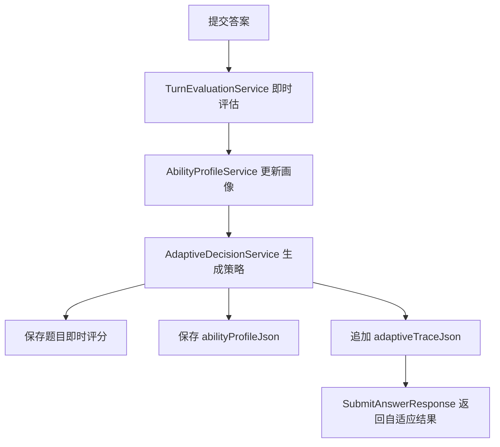

# 自适应面试与能力画像

## 1. 模块基础讲解

自适应面试子模块位于 `interview/adaptive` 包，目标是在用户每提交一题后，立即分析本轮回答质量，更新能力画像，并给出下一步面试策略。

核心类：

- `AdaptiveInterviewService`：门面编排服务，串联即时评估、画像更新、策略决策和持久化。
- `TurnEvaluationService`：单轮即时评估，调用 LLM 输出 `TurnEvaluationDTO`。
- `AbilityProfileService`：根据多轮评估结果滚动更新能力画像。
- `AdaptiveDecisionService`：根据本轮评估和能力画像决定下一步动作，LLM 失败时用本地规则兜底。
- `AdaptiveInterviewResultDTO`：封装单轮评估、能力画像和决策结果。
- `AdaptiveTraceDTO`：记录每轮题目的评估和决策链路。

每次提交答案后的流程：



即时评估的输出包括：

- `score`：本轮得分，标准化到 0-100。
- `depthLevel`：回答深度，标准化到 1-5。
- `missingKeyPoints`：缺失关键点，最多保留 10 个。
- `followUpSuggestion`：追问建议。
- `category`：能力分类，空值时回退为原题分类。

能力画像的算法是加权移动平均：

```text
newScore = (previousScore * previousCount + currentScore) / (previousCount + 1)
confidence = min(1.0, 0.25 + questionCount * 0.15)
```

也就是说，同一能力分类回答得越多，画像越稳定；缺失知识点会累积到 `weakKeywords` 中，最多保留 8 个。

策略决策支持六种动作：

- `FOLLOW_UP`：围绕当前薄弱点追问。
- `NEXT_CATEGORY`：切换到其他分类。
- `RAISE_DIFFICULTY`：提高难度。
- `LOWER_DIFFICULTY`：降低难度。
- `DEEP_DIVE_PROJECT`：深挖项目经验。
- `END_PHASE`：结束当前阶段。

需要诚实说明当前实现边界：当前代码已经完成“即时评估、能力画像和下一步策略建议”，但主流程仍然使用创建会话时预生成的题目列表。也就是说，`adaptiveDecision.nextQuestion` 会返回给前端，但没有真正替换 Redis 中的下一题。因此当前更准确地说是“自适应分析与建议”，还不是完全动态出题的自适应面试。

面试讲法：

> 我们在传统线性面试流程上加了一层自适应分析。每提交一道题后，系统会用纯 ChatClient 做结构化即时评估，再把得分合并到能力画像里，最后由 LLM 或本地规则生成下一步策略。为了不影响答题主链路，这部分使用 safe 方法封装，失败只降级为空结果，不阻断用户继续面试。

## 2. 基础面试问题

**问题：自适应面试模块的核心作用是什么？**

回答：它不是最终报告，而是每轮答题后的即时反馈机制。它会判断本题回答质量、缺失知识点和回答深度，累积成能力画像，并给出下一步追问或调整难度的建议。

**问题：能力画像包含哪些内容？**

回答：`AbilityProfileDTO` 包含多个 `AbilityDimensionDTO`，每个维度有 category、score、confidence、questionCount、recentPerformance 和 weakKeywords。整体还有 averageScore 和 summary，用于描述当前强项和待加强方向。

**问题：为什么自适应评估失败不抛异常？**

回答：自适应是增强能力，不是答题主流程的必要条件。如果 LLM 即时评估失败就阻断提交答案，会严重影响用户体验。代码中 `evaluateAndDecideSafely` 捕获所有异常，记录日志并返回 null。

**问题：本地兜底策略是什么？**

回答：`AdaptiveDecisionService.fallbackDecision` 中有简单规则：得分大于等于 85 分，提高难度；得分低于 70 或存在缺失知识点，则追问；其他情况切换到下一分类。这保证 LLM 决策失败时仍有可用策略。

**问题：自适应结果保存在哪里？**

回答：即时评分和反馈会写入 `InterviewAnswerEntity`，能力画像写入 `InterviewSessionEntity.abilityProfileJson`，每轮决策链路写入 `adaptiveTraceJson`。

## 3. 进阶面试问题

**问题：为什么即时评估和最终评估要分开？**

回答：即时评估关注单轮回答，目的是快速反馈和更新画像；最终评估关注整场面试，目的是生成完整报告和参考答案。即时评估字段少、响应快、失败可忽略；最终评估内容重、需要异步处理和持久化报告。

**问题：为什么即时评估使用 `getPlainChatClient`？**

回答：即时评估和决策都要求严格 JSON 输出。如果 ChatClient 带工具调用或复杂 Advisor，模型可能触发工具或输出额外内容，破坏结构化解析。使用 plain client 能降低干扰。

**问题：如何保证 LLM 返回的即时评估安全可用？**

回答：`TurnEvaluationService.normalizeEvaluation` 会强制使用原题 questionIndex，得分钳位到 0-100，深度钳位到 1-5，缺失知识点过滤空值并截断，分类为空则回退原题分类。这样即使模型返回不规范字段，后续画像更新也不会崩。

**问题：能力画像为什么用加权移动平均？**

回答：它实现简单、可解释，适合少量面试题的在线更新。每个维度的历史分数按答题次数参与平均，新题得分会逐渐修正画像。缺点是不能强调近期表现，也不能处理题目难度差异。

**问题：自适应追踪链有什么价值？**

回答：`AdaptiveTraceDTO` 记录每轮题号、分类、即时评估和策略决策。它既能展示给用户复盘，也方便开发排查“为什么系统建议追问/升难度”。这比只保存最后画像更可解释。

**问题：当前自适应能力是否真正改变面试路径？**

回答：目前还没有。`submitAnswer` 返回的下一题仍来自预生成题目列表，`adaptiveDecision` 只是作为响应字段返回。要真正改变路径，需要把决策结果写回题目队列，或者在每轮提交后动态生成下一题。

## 4. 技术延伸问题

**问题：如何把当前实现升级成真正动态自适应面试？**

回答：可以把题目列表改成“种子题 + 动态队列”。每次提交后，根据 `AdaptiveDecisionDTO` 生成或选择下一题，再写回 Redis 和数据库。若 action 是 `FOLLOW_UP`，插入追问；若 `RAISE_DIFFICULTY`，提高下一题难度；若 `NEXT_CATEGORY`，切换分类。还要保存题目生成版本和决策依据。

**问题：除了 LLM，还可以怎么做自适应决策？**

回答：可以用规则引擎，例如 Drools，按分数、缺失点、题目难度和历史表现决定下一题。也可以用多臂老虎机或知识追踪模型，根据用户表现估计掌握度。规则可控但不灵活，机器学习需要数据积累，LLM 起步快但稳定性需要治理。

**问题：如何考虑题目难度对画像的影响？**

回答：当前画像只按得分平均，没有考虑题目难度。可以加入难度权重：senior 题得分高时增益更大，junior 题得分低时惩罚更低。也可以分别维护不同难度层级的掌握度。

**问题：如何避免画像被单题误判影响？**

回答：可以降低单题权重、使用置信度、做异常值裁剪、增加人工或二次模型校验。比如某题 LLM 评分异常低，可以在最终评估时对即时画像做修正。

**问题：如何把能力画像用于后续学习推荐？**

回答：根据 `weakKeywords` 和低分 category 映射到知识库文章、练习题或复习计划。例如 Redis 维度弱且缺失“缓存穿透”，就推荐 Redis 缓存异常专题。这样面试模块可以和知识库模块形成闭环。

## 5. 改进方案问题

**问题：当前自适应模块最大的改进点是什么？**

回答：最大改进点是让决策真正影响下一题。现在 `AdaptiveDecisionDTO` 只是返回给前端，主流程仍走预生成题目。建议先支持 `FOLLOW_UP` 动态插入，再支持 `RAISE_DIFFICULTY` 和 `NEXT_CATEGORY` 动态改题。

**问题：能力画像算法怎么优化？**

回答：可以引入难度权重、时间衰减和近期表现权重。公式可以从简单平均升级为指数移动平均：`newScore = alpha * currentScore + (1 - alpha) * previousScore`。同时 confidence 应该同时受题目数量、题目多样性和评分稳定性影响。

**问题：即时评估结果要不要覆盖最终评估？**

回答：不建议直接覆盖。即时评估上下文少，适合反馈；最终评估看到全量问答和 reference，适合报告。可以保留即时评估作为过程数据，最终报告作为正式结果。如果两者差异大，可以展示“过程评估”和“最终评估”区别。

**问题：自适应决策的 Prompt 怎么优化？**

回答：可以加入更明确的策略优先级，例如“如果回答空泛优先追问项目细节”“如果已连续两题低分则降低难度”。也可以要求模型给出结构化 reason，方便审计。对于 nextQuestion，最好加长度、分类和难度约束。

**问题：如何测试自适应模块？**

回答：现有测试覆盖了画像首次创建、多轮滚动平均、决策兜底、LLM 失败不阻断主流程、即时评估标准化。后续可以补消费者集成测试、动态插题测试、Prompt 输出契约测试和异常 JSON 修复测试。

## 6. 故障处理问题

**问题：提交答案后没有即时评估结果，怎么办？**

回答：先看 `SubmitAnswerResponse` 中自适应字段是否为空。如果为空，检查日志中的“自适应即时评估失败”。常见原因是 LLM provider 配置错误、Prompt 模板加载失败、结构化输出解析失败或会话不存在。

**问题：能力画像一直为空，怎么办？**

回答：检查 `InterviewSessionEntity.abilityProfileJson` 是否写入，`updateAdaptiveState` 是否执行。再看 `updateAnswerEvaluation` 是否找到了对应答案；如果答案保存失败，自适应评分也可能无法写入。

**问题：画像分数不符合预期，怎么办？**

回答：先看每轮 `TurnEvaluationDTO.score`，再用加权平均公式手算。若单轮评分异常，排查即时评估 Prompt 和 LLM 输出。若公式问题，检查 previousProfileJson 是否正确解析，category 是否一致，避免同一能力被不同名称拆成多个维度。

**问题：决策 action 是未知值怎么办？**

回答：`normalizeAction` 会把未知动作回退为 `FOLLOW_UP`，所以不会中断流程。排查时需要看模型输出和 Prompt 是否约束清楚，也可以在监控中统计非法 action 比例。

**问题：adaptiveTraceJson 解析失败怎么办？**

回答：`parseTrace` 解析失败会记录 warn 并返回空列表，后续会用新追踪覆盖旧追踪。这样不会中断答题，但会丢历史自适应链路。生产环境建议对 JSON 解析失败报警，并避免覆盖原始坏数据。

