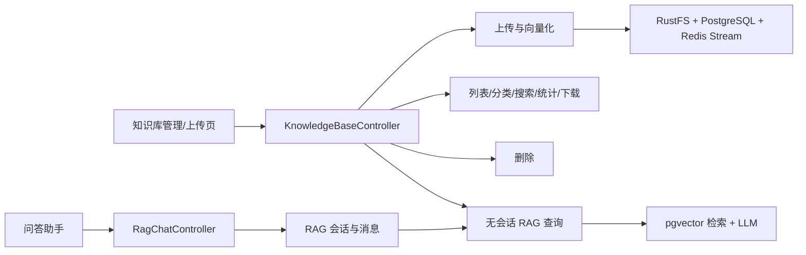
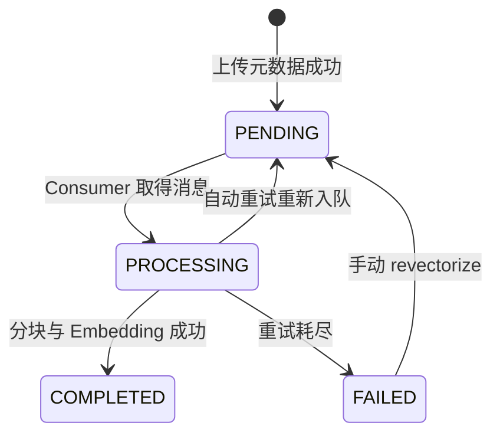

# 知识库 Controller 完整调用链总览

> 覆盖 `KnowledgeBaseController` 与 `RagChatController`。本目录从真实 React 调用点开始，
> 沿 Controller、Service、PostgreSQL/pgvector、RustFS、Redis Stream、LLM 和 SSE 逐层解释，
> 并明确区分“当前页面正在使用”和“仅保留后端/API 封装”的接口。

## 1. 两个 Controller 的职责



`KnowledgeBaseController` 有 14 个接口，负责知识库资源和旧式无会话问答；
`RagChatController` 有 8 个接口，两个 Controller 共 22 个接口。后者负责当前页面使用的持久化
RAG 会话与 SSE 消息。

## 2. 当前前端真实使用情况

| 接口能力 | 当前页面调用 |
|---|---|
| 上传、列表、分类查询/更新、搜索、统计、下载、删除、重新向量化 | 是 |
| 单条知识库详情 `GET /api/knowledgebase/{id}` | 否 |
| 未分类列表 `/uncategorized` | API 已封装，页面未调用 |
| 同步查询 `/query` | API 已封装，页面未调用 |
| 无会话流式查询 `/query/stream` | API 已封装，页面未调用 |
| RAG 会话创建、列表、详情、标题、置顶、删除、SSE 消息 | 是 |
| 更新现有 RAG 会话的知识库关联 | API 已封装，页面未调用 |

当前问答主链是：

```text
KnowledgeBaseQueryPage
  → 首次提问先创建 RagChatSession
  → POST /api/rag-chat/sessions/{id}/messages/stream
  → 持久化用户消息和 AI 占位消息
  → 带历史上下文执行检索改写、pgvector 召回和 LLM 流式回答
  → SSE 返回 trace + 正文
  → 完成后把完整 AI 回答写回数据库
```

## 3. 文档导航

| 文档 | 覆盖内容 |
|---|---|
| `01-uploadKnowledgeBase-revectorize.md` | 上传、去重、RustFS、向量化任务与手动重试 |
| `02-getAllKnowledgeBases-getKnowledgeBase-downloadKnowledgeBase.md` | 列表、单条详情、文件下载 |
| `03-queryKnowledgeBase-queryKnowledgeBaseStream.md` | 无会话同步/流式 RAG 查询 |
| `04-categories-search-stats.md` | 分类、搜索和统计接口 |
| `05-deleteKnowledgeBase.md` | 会话解绑、向量/文件/数据库删除和并发边界 |
| `06-RagChatController-会话生命周期.md` | RAG 会话创建、列表、详情、更新和删除 |
| `07-RagChatController-SSE流式消息.md` | 当前主问答链的消息持久化、检索、SSE 和完成回写 |
| `08-知识库模块设计亮点.md` | 架构取舍、可靠性边界和改进优先级 |

## 4. 统一 JSON 响应闭环

普通接口返回 `Result<T>`：

```text
Controller Result.success(data)
  → HTTP 200 + { code: 200, message: "success", data }
  → request.ts Axios 拦截器
  → code===200 时提取 data
  → 页面更新 state
```

`BusinessException` 由 `GlobalExceptionHandler` 转成 HTTP 200 + `Result.error`，Axios 再把业务
错误转成 rejected `Error(message)`。

两个例外：

- 文件下载返回 `ResponseEntity<byte[]>`，不是 `Result`；
- SSE 返回 `Flux<String>` 或 `Flux<ServerSentEvent<String>>`，前端用 `fetch` 读取流，不经过 Axios
  的统一业务码拦截器。

## 5. 上传到可检索的异步闭环



实际组件关系：

```text
KnowledgeBaseUploadService
  → RustFS 保存原文件
  → KnowledgeBasePersistenceService 保存元数据(PENDING)
  → VectorizeStreamProducer 创建统一异步任务并 XADD
  → VectorizeStreamConsumer 再从 RustFS 下载并解析
  → TokenTextSplitter 分块
  → VectorStore.add 调用 Embedding 并写 pgvector
  → KnowledgeBaseEntity.vectorStatus=COMPLETED
  → 管理页每 5 秒轮询列表直到终态
```

## 6. RAG 检索公共主干

同步、无会话流式和 RAG 会话流式最终都复用 `KnowledgeBaseQueryService`：

```text
校验知识库并增加 questionCount
  → 清洗问题和历史消息
  → 可选 LLM Query Rewrite
  → 根据问题长度选择 topK/minScore
  → pgvector similaritySearch（过滤失败时本地过滤兜底）
  → 记录 retrieval trace/指标
  → 拼接文档上下文
  → 渲染 Prompt + 防注入指令
  → 默认 ChatClient 同步或流式生成答案
  → 统一“无有效信息”回答
```

## 7. 当前实现中必须正视的边界

- 上传和重新向量化调用 Producer 时没有活动事务，`TransactionAfterCommitExecutor` 实际立即
  执行；Stream 发送失败会被 Producer 吞掉并标记 FAILED，但上传/重试接口仍可能返回成功。
- 上传前解析一次文件，Consumer 又从 RustFS 下载并解析一次，存在重复 I/O 和解析成本。
- 下载接口的业务异常仍是 HTTP 200 JSON；前端按 Blob 接收，可能把错误 JSON 当文件下载。
- 删除流程没有外层事务，且跨 PostgreSQL、pgvector、RustFS；中途失败可能留下部分删除状态。
- 删除正在向量化的知识库存在竞态，运行中的 Consumer 可能在删除后重新写入孤儿向量。
- RAG 会话 SSE 没有限流；客户端断开触发 cancel 时没有完成/错误回调，可能遗留
  `completed=false` 的 AI 占位消息。
- `updateSessionKnowledgeBases` 不验证请求中的 ID 是否全部存在，缺失 ID 会被静默忽略。
- 多数管理页面 catch 只写 `console.error`，用户界面无法区分空数据和加载失败。
