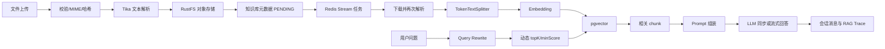

# KnowledgeBase 模块总览与 RAG 业务闭环

## 1. 模块基础讲解

`knowledgebase` 是平台的知识摄取、向量检索和多轮问答中心。它不是单纯的 CRUD 模块，而是把文件系统、
对象存储、PostgreSQL 元数据、pgvector、Redis Stream、LLM 和 SSE 串成两条主链路。

模块采用 Controller、Service、Repository 分层，并通过基础设施服务连接文件存储和解析，通过公共异步模板
连接 Redis Stream，通过 `LlmProviderRegistry` 连接默认模型。核心类职责如下：

- `KnowledgeBaseController`、`RagChatController`：知识库管理、问答和聊天 API。
- `KnowledgeBaseUploadService`：上传编排；`KnowledgeBasePersistenceService`：短事务写入。
- `VectorizeStreamProducer/Consumer`：异步向量化任务生产、消费、重试与状态联动。
- `KnowledgeBaseVectorService`：分块、批量 Embedding、pgvector 写入和相似度检索。
- `KnowledgeBaseQueryService`：改写、召回、Prompt、生成、指标和 Trace 的 RAG 核心。
- `RagChatSessionService`：会话、历史消息和流式占位消息的持久化。

主要设计思想是关注点分离、异步削峰、短事务、状态机、模板方法和 RAG 两阶段架构。优点是业务链路完整，
同步/流式问答兼备，且已有指标与检索日志。主要不足是跨 PostgreSQL、对象存储、Redis 和向量表的一致性仍靠
局部补偿；向量替换、流取消、并发消息顺序和租户隔离还没有形成生产级闭环。

## 2. 基础面试问题

**问题：请用一分钟介绍这个模块。**

回答：用户上传 PDF、Word、TXT 或 Markdown 后，服务校验并解析文件，保存到 RustFS 和 PostgreSQL，随后通过
Redis Stream 异步分块、生成 Embedding 并写入 pgvector。查询时可先用 LLM 改写问题，再按知识库 ID 做向量
召回，把相关 chunk 注入 Prompt，最后同步或 SSE 流式生成答案。聊天模式还会保存多轮消息并记录 RAG Trace。

**问题：为什么向量化要异步？**

回答：解析、Embedding 和批量写库都可能是秒级操作，而且依赖外部模型。异步化可缩短上传接口响应时间、削峰、
支持重试和失败状态查询，也避免 HTTP 连接生命周期绑定长任务。代价是最终一致性和任务幂等必须额外设计。

**问题：模块使用了哪些设计模式？**

回答：Controller-Service-Repository 分层；Stream 生产者/消费者继承公共抽象类，属于模板方法；
`LlmProviderRegistry` 是注册表/工厂；MapStruct 是 Mapper；上传失败删除对象属于补偿事务；`VectorStatus` 和
异步任务状态体现状态机；同步/流式生成是同一 RAG 流程的两种策略。

**问题：为什么 Entity 不直接返回前端？**

回答：DTO/record 隔离数据库结构和 API 契约，避免暴露关联关系、懒加载代理与内部字段，也能独立演进校验规则。

## 3. 进阶面试问题

**问题：一次知识库查询的主要延迟来自哪里？**

回答：可选 Query Rewrite 一次 LLM 调用、查询向量 Embedding、pgvector 检索、最终生成一次 LLM 调用。当前改写和
检索在返回 Flux 前同步完成，因此所谓流式只覆盖最终生成阶段，TTFT 仍包含前置阻塞延迟。

**问题：当前一致性边界有几个？**

回答：至少有知识库关系表、RustFS 对象、Redis Stream/异步任务表、pgvector 向量表和聊天消息表。数据库事务无法
原子覆盖所有资源，必须用 outbox、幂等键、补偿任务、版本化向量和定期对账实现最终一致性。

**问题：状态为 COMPLETED 是否等于可正确查询？**

回答：不一定。当前消费者在向量服务返回后才标记 COMPLETED，但批量写入不是原子替换；中途失败可能留下部分
新向量，删除旧向量失败又被吞掉也可能混合版本。查询端还没有强制校验 `VectorStatus.COMPLETED`。

**问题：代码最大的确定性缺陷是什么？**

回答：`KnowledgeBaseEntity.chunkCount` 从未在向量化成功后写入。它会一直是 0，导致前端分块数失真，并让消费者
的 `COMPLETED && chunkCount > 0` 幂等判断永远无法命中，重复消息仍会重新向量化。

## 4. 技术延伸问题

**问题：不用 Redis Stream 可以怎么实现？**

回答：小规模可用 Spring `@Async`，但进程重启会丢任务；可靠队列可选 RabbitMQ/Kafka；数据库任务表配合
`SKIP LOCKED` 适合低运维成本；云环境可用 SQS/Pub/Sub。选择依据是吞吐、重放、顺序、延迟和运维能力。

**问题：不用 pgvector 可以怎么实现？**

回答：数据量小可内存向量库；已有 PostgreSQL 时 pgvector 一致性和运维最简单；超大规模或复杂混合检索可用
Milvus、Qdrant、Weaviate、Elasticsearch/OpenSearch。不能只比较 QPS，还要比较过滤、备份、租户隔离和成本。

**问题：为什么 Java 21 虚拟线程不能替代 Reactor？**

回答：虚拟线程降低阻塞 I/O 的线程成本，适合同步编程模型；Reactor 提供数据流、取消、背压和操作符组合。
当前 MVC + SSE 可用虚拟线程处理前置阻塞，但流式 Provider 返回的 Flux 仍需正确传播取消和错误。

## 5. 改进方案问题

**问题：如何按优先级改造？**

回答：P0 修复 `chunkCount`、流取消占位消息和向量替换原子性；P1 引入 outbox 与删除补偿、查询前状态校验、
Embedding 版本；P2 增加分页、批量查询、结构化过滤和混合检索；P3 做租户权限、配额、脱敏和离线评测。

**问题：如何重构超长的 QueryService？**

回答：拆为 `QueryRewriter`、`Retriever`、`ContextAssembler`、`AnswerGenerator`、`StreamNormalizer` 和
`RagTraceRecorder`，由 `RagPipeline` 编排。每个阶段输入输出用不可变 record，便于独立压测、替换和评测。

**问题：如何证明改造有效？**

回答：建立上传成功率、任务等待时间、向量化耗时、重复消费率、零命中率、Recall@K、答案忠实度、TTFT、
流取消率和孤儿资源数；用固定评测集做版本前后对比，而不是只看接口返回 200。

## 6. 故障处理问题

**问题：上传成功但长期 PENDING，如何排查？**

回答：按 kbId 查异步任务是否创建和 messageId 是否写入；检查 Stream、消费者组、pending list 和消费者日志；
确认任务是否在 after-commit 阶段发送失败；最后核对 AsyncTask 与 VectorStatus 是否状态漂移。

**问题：回答总是“未检索到相关信息”，如何定位？**

回答：先确认知识库 COMPLETED 和向量行数，再查 Trace 中的原问题、改写结果、topK、阈值和 chunk 得分；验证
`kb_id` metadata 类型；关闭过滤测试全局召回；最后检查 Embedding 模型和维度是否与历史数据一致。

**问题：如何向面试官评价这份代码？**

回答：它已完成从文件摄取到 RAG 聊天的端到端骨架，分层、短事务、异步任务和可观测性方向正确；生产化短板
集中在跨资源一致性、向量版本、并发会话、取消语义、安全隔离和评测体系，而不是缺少功能接口。

