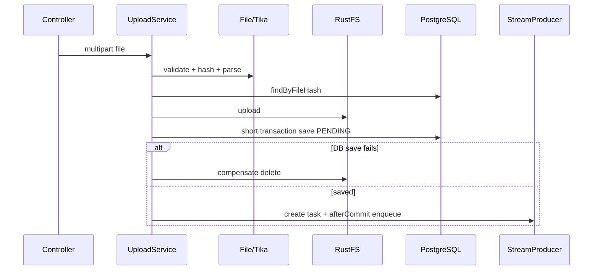

# 文件上传、解析、去重与事务边界

## 1. 模块基础讲解

上传链路由 `KnowledgeBaseUploadService` 编排：50 MB 大小校验、MIME/扩展名校验、SHA-256 去重、Tika 文本
解析、RustFS 上传、知识库元数据保存和异步任务入队。`KnowledgeBasePersistenceService` 专门承载短事务，
避免在数据库事务中调用 Tika、对象存储或 Redis。

优点是外部 I/O 不占用数据库连接，DB 保存失败时会补偿删除对象，文件哈希有数据库唯一约束兜底。缺点是上传
阶段已经解析完整内容，消息却只携带 kbId，消费者又下载并解析一次；任务创建/发送失败也没有覆盖所有补偿路径。

## 2. 基础面试问题

**问题：为什么同时校验 MIME 和扩展名？**

回答：扩展名由用户控制，只能作为提示；MIME 检测基于内容更可信，但也不是恶意文件扫描。两者结合可降低误传，
仍应对压缩炸弹、宏、超大页数和解析超时做资源隔离。

**问题：为什么使用 SHA-256 去重？**

回答：同一字节内容会得到稳定哈希，查找成本低，64 位十六进制字符串也便于唯一索引。它实现的是内容级去重，
不是语义去重；文件重新保存导致字节变化时仍会视为新文件。

**问题：为什么先上传对象再保存数据库？**

回答：数据库记录需要可用的 storageKey/url。当前顺序通过“对象上传成功、DB 失败则删除对象”补偿。反过来先写
DB 也可以，但要处理 DB 已提交而对象上传失败。两者都不是分布式原子事务。

**问题：为什么单独拆 PersistenceService？**

回答：Spring `@Transactional` 依赖代理，同类内部调用不会经过代理。拆 Bean 能保证短事务真正生效，并避免把
解析、S3/RustFS 和队列发送包进事务。

## 3. 进阶面试问题

**问题：并发上传同一文件会怎样？**

回答：两个请求都可能先查到不存在，再各自解析和上传；数据库唯一约束只允许一个 `fileHash` 成功。失败请求会
补偿自己的对象，但当前持久化层把约束异常统一转换为 INTERNAL_ERROR，没有重新查询已有记录返回“重复上传”。

**问题：当前为何有双重解析问题？**

回答：上传端解析出的 `content` 只用于空内容校验、响应长度和任务 payload JSON 的长度信息，Stream 消息不含正文；
消费者按 kbId 从 RustFS 下载并再次解析。这增加 CPU、内存和 I/O，50 MB 文件尤其明显。

**问题：入队失败会留下什么状态？**

回答：Producer 的发送失败回调会尝试把知识库和 AsyncTask 标为 FAILED；但若任务创建本身在元数据提交后异常，或
after-commit 回调未可靠执行，知识库、对象和任务可能不一致。因此仅靠 try/catch 不能覆盖进程崩溃窗口。

**问题：重复上传 FAILED 知识库合理吗？**

回答：当前直接返回旧记录并增加 accessCount，不会触发重新向量化。若旧记录是 FAILED，用户再次上传相同文件也
无法自愈。去重分支应按状态决定返回、复用任务或重新入队。

## 4. 技术延伸问题

**问题：怎样避免双重解析？**

回答：方案一，上传只做轻量验证，消费者统一解析；方案二，上传后把规范化文本保存为独立对象，消费者读取文本；
方案三，小文本放消息但需受消息大小限制。更推荐保存解析产物及 parserVersion，便于重试和重建索引。

**问题：如何实现可靠入队？**

回答：在保存知识库的同一数据库事务写 outbox 记录，后台 Relay 投递 Redis Stream，成功后标记 published；消费者
按 taskId 幂等。这样即使进程在 commit 后崩溃，也能扫描未发布 outbox 恢复。

**问题：大文件如何处理？**

回答：使用流式上传、对象存储直传、解析沙箱、页数/解压比限制、超时和内存配额；元数据先建 UPLOADING 记录，
异步完成解析。不要在 Web 请求里把整个文件和全文同时常驻堆内存。

## 5. 改进方案问题

**问题：如何具体改造上传状态机？**

回答：定义 `UPLOADING -> STORED -> PARSING -> VECTORIZING -> READY`，失败记录阶段、可重试性和错误码；每次
转换使用乐观锁/version 做 compare-and-set。API 返回 typed `UploadKnowledgeBaseResponse`，不再使用嵌套 Map。

**问题：如何修复并发去重？**

回答：保留唯一索引；捕获具体 `DataIntegrityViolationException`，删除本请求对象后按 hash 查询赢家记录；如果赢家
FAILED 则创建新任务。存储 key 可带 UUID，避免两个请求互相删除同一对象。

**问题：如何增强安全？**

回答：文件名只作展示，不参与路径；真实类型白名单、恶意文件扫描、压缩炸弹限制、解析子进程/容器隔离；下载用
`Content-Disposition` 安全编码；按用户设置大小、频率和总存储配额。

## 6. 故障处理问题

**问题：数据库有记录但 RustFS 文件不存在，怎么办？**

回答：按 storageKey 查对象和审计日志，确认上传后是否被错误补偿；把知识库标记 STORAGE_MISSING/FAILED；允许
用户重新上传并复用 ID，或删除元数据和向量。增加定期 DB-to-object 对账。

**问题：对象存储出现孤儿文件，如何处理？**

回答：按 key 前缀扫描对象，与数据库 storageKey 做差集；超过安全保留期后删除。生产中用删除任务表记录重试，
不要因主删除已返回成功就永远丢失补偿机会。

**问题：Tika 解析卡死或 OOM 如何排查？**

回答：记录文件类型、大小、页数和 parserVersion；复现时先隔离可疑文件；配置超时和最大展开大小；查看堆转储；
将解析移到受限 Worker，失败按不可重试格式错误或可重试基础设施错误分类。

