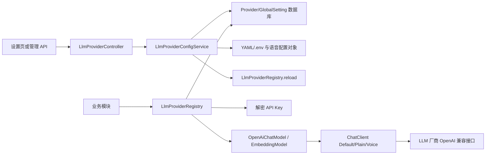

# LLM Provider 模块总览与多模型治理闭环

## 1. 模块基础讲解

`llmprovider` 不是单纯的“大模型配置 CRUD”，而是平台的 AI 控制面。它负责把可变的
Provider 配置转换成各业务模块能够稳定使用的 `ChatClient` 和 `EmbeddingModel`，并管理默认
模型、密钥、热重载、语音服务配置及连通性测试。

面试时可以先用一句话定性：

> 这个模块把模型厂商差异和业务代码隔离开。业务只声明“使用指定 Provider”或“使用默认
> Provider”，注册中心负责读取配置、解密密钥、构建 Spring AI 客户端、装配 Advisor 并缓存实例。

完整链路如下：

模块内部职责：

- `LlmProviderController`：暴露 Provider、默认 Provider、ASR/TTS 管理 API。
- `LlmProviderConfigService`：配置管理核心，包含 CRUD、校验、文件编辑、测试和热重载。
- `LlmProviderBootstrapService`：首次启动时把 `application.yml` 种子配置导入数据库。
- `ApiKeyEncryptionService`：使用 AES-256-GCM 加密数据库中的 API Key。
- `LlmProviderEntity`：保存某个厂商的 URL、模型、密钥密文及 Embedding 能力。
- `LlmGlobalSettingEntity`：用固定主键 `1` 保存默认 Chat/Embedding Provider。
- `LlmProviderRegistry`：虽然位于 `common/ai`，却是本模块的运行时数据面，负责模型构建和缓存。
- `ApiPathResolver`：适配带或不带 `/v1`、`/v3` 的 OpenAI 兼容地址。
- `LlmEmbeddingConfig`：用代理 Bean 桥接动态 Embedding Provider 与静态 Spring 注入。

核心设计思想是“控制面与数据面分离”：配置服务负责修改状态，注册中心负责服务运行时调用；
数据库是生产模式下的事实来源，YAML 是首次种子及测试回退来源。

当前实现使用了以下设计模式：

- 注册表模式：`LlmProviderRegistry` 统一查找模型客户端。
- 工厂模式：根据 Provider 快照创建 `OpenAiChatModel`、`ChatClient`、`EmbeddingModel`。
- 策略思想：通过 Provider ID 在运行时选择不同模型策略。
- 代理模式：`LlmEmbeddingConfig` 每次调用都委托给当前默认 EmbeddingModel。
- 缓存模式：`ConcurrentHashMap.computeIfAbsent` 延迟创建昂贵客户端。
- DTO 模式：前端只看到脱敏配置，不直接获得 Entity 和明文密钥。
- 单例行模式：全局设置表固定只有 ID=1 的逻辑记录。

## 2. 基础面试问题

**问题：为什么要单独设计 Provider 管理模块？**

回答：模型调用遍布简历评分、模拟面试、知识库、邀约解析和语音面试。如果每个业务模块直接读取
URL、API Key 并创建客户端，会产生重复代码，也无法统一切换模型、加密密钥和治理故障。Provider
模块把厂商配置和客户端生命周期集中管理，业务只依赖统一接口。

**问题：Provider 和 Model 是什么关系？**

回答：Provider 表示服务端点和认证边界，例如 DashScope、GLM 或本地 LM Studio；一个 Provider
配置当前使用的 Chat Model，还可以配置 Embedding Model。当前数据模型是一条 Provider 对应一个
Chat Model 和至多一个 Embedding Model，并不是完整的“一厂商多模型目录”。

**问题：为什么默认 Chat Provider 和默认 Embedding Provider 要分开？**

回答：聊天模型与向量模型能力、价格和维度不同。有的厂商只提供聊天，有的 Embedding 更适合当前
知识库，因此两个默认值独立管理。设置默认 Embedding 时还会校验 `supportsEmbedding` 和模型名。

**问题：业务模块如何选择 Provider？**

回答：显式传入 Provider ID 时调用指定客户端；为空时由注册中心读取全局默认值。结构化输出用
Plain 客户端，普通对话用 Default 客户端，实时语音面试用 Voice 客户端。

**问题：热重载是什么意思？**

回答：配置变更后清空 ChatClient 和 EmbeddingModel 缓存。正在执行的调用继续持有旧实例，新请求
首次访问时根据最新数据库配置懒创建新实例，因此不需要重启应用。

## 3. 进阶面试问题

**问题：为什么说它同时包含控制面和数据面？**

回答：管理 API、配置校验、数据库写入属于控制面；业务请求获取模型并发送 Prompt 属于数据面。
当前两者在同一应用内，但逻辑职责已经分开。规模增大后可以将控制面独立成配置服务，数据面通过
版本化配置快照或事件订阅更新。

**问题：当前代码的事实来源是什么？**

回答：Spring 正常启动时 Repository 和 EncryptionService 都会注入，所以运行时是数据库模式。
`application.yml` 只在数据库 Provider 表为空时作为种子导入。只有测试使用的简化构造器会进入
Legacy/YAML 内存模式。不能笼统地说“数据库失败就自动回退 YAML”，代码并没有捕获数据库异常后
自动降级。

**问题：Provider 切换能否做到正在执行的请求无感？**

回答：能做到弱无感。已有请求继续使用旧客户端，新请求使用新客户端，不会强行中断在途调用。
但当前 `clear()` 与并发 `computeIfAbsent()` 存在旧配置客户端重新写回的竞态，应使用配置版本号、
不可变缓存快照或统一锁改进。

**问题：模块的最大技术风险是什么？**

回答：最大风险不是创建客户端，而是配置一致性和安全。配置涉及数据库、内存缓存、外部 YAML、
`.env`、语音服务多个状态；同时 baseUrl 和 API Key 都是高权限数据。必须处理提交后发布、密钥轮换、
多实例同步、SSRF、防越权和审计。

## 4. 技术延伸问题

**问题：不用自建 Registry，还能如何实现多模型？**

回答：可以为每个厂商注册独立 `ChatModel` Bean，再用 `@Qualifier` 静态选择；也可以使用 Spring
Cloud 配置中心维护 Provider 配置；更大规模时可引入 AI Gateway，统一负责路由、配额、熔断、
重试和审计。静态 Bean 简单但不支持热切换，配置中心解决分发但不自动解决客户端生命周期，Gateway
治理能力强但增加网络跳数和运维成本。

**问题：如何支持模型级路由而不是 Provider 级路由？**

回答：把数据模型拆为 `ProviderCredential`、`ModelDeployment` 和 `RoutingPolicy`。一个 Provider
保存端点与密钥，多个 ModelDeployment 保存模型、能力、上下文长度、成本和限额；路由策略按任务、
租户、成本、延迟和健康度选择 deployment。

**问题：如何实现自动主备切换？**

回答：为任务定义候选 Provider 列表，维护熔断状态和 EWMA 延迟；仅对网络超时、429、部分 5xx
执行有限重试或切换，认证错误和请求错误不盲目重试。结构化任务还要保证 Prompt 和输出协议在不同
模型间兼容，并记录实际命中的 Provider。

## 5. 改进方案问题

**问题：如果只做三项改造，优先级如何排？**

回答：第一，为所有管理接口增加管理员鉴权、审计和 SSRF 防护；第二，建立单一配置事实来源并在
事务提交后发布版本化变更事件；第三，拆分 1494 行配置服务，把 Provider、Global Setting、Voice
Config、文件存储和连通性探测分成独立组件。

**问题：如何重新划分模块边界？**

回答：建议拆成 `ProviderCommandService`、`ProviderQueryService`、`ProviderRuntimeFactory`、
`ProviderHealthService`、`SecretService`、`VoiceAiConfigService` 和 `ConfigChangePublisher`。Entity 到
DTO 使用 MapStruct，配置校验提取成 Validator，文件操作实现独立 Repository 接口。

**问题：如何提升可观测性？**

回答：记录 `providerId`、`model`、`operation`、`outcome`、错误类别、延迟和 token 使用量；对配置
变更记录操作者、前后版本和时间；监控缓存命中率、客户端重建次数、Provider 健康状态、429 比例和
Embedding 维度不一致。Prompt/Completion 默认不记录，防止泄漏隐私。

## 6. 故障处理问题

**问题：所有 AI 功能突然不可用，怎么排查？**

回答：先查默认 Provider 是否存在且启用，再查 API Key 是否能解密、baseUrl 和模型名是否正确；
查看 Provider 测试结果和实际业务请求路径是否一致；最后检查缓存是否仍持有旧客户端、外部厂商是否
429/5xx，以及加密主密钥是否被错误轮换。

**问题：后台切换默认 Provider 后部分请求仍使用旧模型，为什么？**

回答：在途请求本来就会继续使用旧实例；另外多实例部署下 `reload()` 只清本机缓存，其他实例不会
同步；本机也存在 clear 与并发创建的竞态。应结合实例标识、配置版本和分布式变更事件排查。

**问题：服务重启后前端修改的语音配置丢失，为什么？**

回答：当前 ASR/TTS 更新写到 `config-yaml-path` 和 `config-env-path`，但 `application.yml` 的
`spring.config.import` 只导入了 classpath 的 opening 文件，没有导入这两个外部文件；`bootRun`
也只读取仓库根目录 `.env`。所以运行时内存修改有效，外部文件却不是重启后的配置输入源。

**问题：如何向面试官总结该模块？**

回答：它是整个平台的多模型控制面和运行时注册中心，亮点是数据库配置、AES-GCM 密钥保护、三类
ChatClient、动态 Embedding 代理和热重载；真正需要继续加强的是配置一致性、事务后发布、多实例
同步、管理面安全及故障治理。
