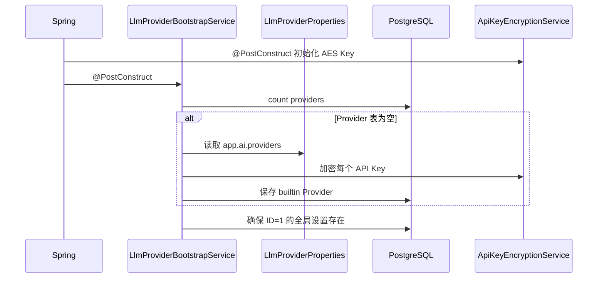

# 配置源、数据模型与启动引导

## 1. 模块基础讲解

模块存在两套 Provider 配置表达：

1. `LlmProviderProperties`：绑定 `app.ai`，保存 YAML 种子、默认值、Advisor 和安全配置。
2. 数据库：`llm_provider_config` 保存 Provider，`llm_global_setting` 保存两个全局默认 ID。

生产启动流程：

`LlmProviderEntity` 的关键字段：

- `id`：Provider 逻辑主键，最长 64。
- `baseUrl`、`model`：Chat API 地址和模型。
- `apiKeyCiphertext`、`apiKeyNonce`：密文与 12 字节随机 nonce 的 Base64。
- `embeddingModel`、`embeddingDimensions`、`supportsEmbedding`：向量能力描述。
- `enabled`：注册中心只加载启用的 Provider。
- `builtin`：标识是否由启动种子生成，但当前没有额外行为约束。
- `createdAt`、`updatedAt`：JPA 回调维护时间。

`LlmGlobalSettingEntity` 用 `SINGLETON_ID=1` 表达单例设置。它没有数据库外键，引用完整性主要依赖
Service 校验。该设计简单，但并发初始化和手工改库时可能产生悬空引用。

代码真实语义需要特别说明：所谓“双模式”是构造依赖决定的，不是运行时数据库故障自动降级。
正常 Spring Bean 一定注入 Repository，所以使用数据库；Legacy 模式主要用于单元测试。

## 2. 基础面试问题

**问题：为什么不直接每次读取 `application.yml`？**

回答：classpath 配置通常只读，且修改后需要重启。数据库允许运行时 CRUD、统一查询和加密存储，
更适合作为动态控制面的事实来源。YAML 适合作为部署时种子和默认值。

**问题：为什么全局设置单独建表？**

回答：默认 Provider 是系统级指针，不属于某个 Provider 自身。单独存储可避免每个 Provider 都有
`isDefault` 导致多个默认值，并让切换默认值只更新一行。

**问题：`@PrePersist` 和 `@PreUpdate` 有什么作用？**

回答：在 JPA 持久化和更新生命周期中自动写时间戳，减少 Service 重复赋值。但它使用应用服务器
时间，生产中更严谨的做法是统一时钟或数据库时间，并考虑审计组件。

**问题：`builtin` 字段当前有什么意义？**

回答：当前只记录 Provider 来源，创建 API 生成的 Provider 为 false，种子导入为 true。删除逻辑
没有禁止删除 builtin，因此它现在是元数据而不是权限或保护规则。

## 3. 进阶面试问题

**问题：`@PostConstruct` 上的 `@Transactional` 会生效吗？**

回答：默认不会可靠生效。Spring 事务基于代理，而 `@PostConstruct` 发生在代理完全可用之前，官方
文档明确不应依赖初始化方法上的事务。因此 `seedProvidersIfNecessary()` 可能没有预期的原子事务。
应改用 `ApplicationRunner` 调用另一个事务 Bean，或监听 `ApplicationReadyEvent` 后通过代理调用。

**问题：首次种子导入是否幂等？**

回答：单实例顺序启动时基本幂等，因为 Provider 表非空后跳过。但多实例同时启动时，两个实例都
可能观察到 count=0，并发插入同一主键；全局设置的 `existsById` 再 `save` 也有竞态。应依赖数据库
唯一约束并捕获冲突，或使用数据库锁/迁移脚本完成初始化。

**问题：默认 Provider 的选择稳定吗？**

回答：配置的 ID 存在时稳定；否则使用 `findAll().stream().findFirst()`，JPA `findAll()` 没有排序
保证，因此回退选择不确定。应显式 `OrderByIdAsc` 或定义清晰的优先级。没有 Provider 时还会写入
字符串 `dashscope`，可能形成引用不存在 Provider 的设置。

**问题：为什么 `supportsEmbedding` 和 `embeddingModel` 同时存在？**

回答：一个表示能力开关，一个表示具体模型。两者可以区分“厂商支持但尚未配置”和“明确不使用”。
但当前 Bootstrap 和 Legacy 读取逻辑只要模型非空就推断支持，削弱了显式 false 的语义，应统一不变量。

**问题：Embedding 维度为什么是危险配置？**

回答：pgvector 表和索引通常固定维度，切换到不同维度模型会导致写入失败或已有向量不可比较。当前
只校验正数，没有验证与 VectorStore 的 1024 维配置一致，也没有触发全量重建。

## 4. 技术延伸问题

**问题：还可以如何初始化基础数据？**

回答：推荐使用 Flyway/Liquibase 管理结构和非敏感默认数据，敏感密钥从 Secret Manager 注入；或
用独立管理命令在部署前初始化。相比 `@PostConstruct`，迁移工具有版本、锁和执行历史，更适合多实例。

**问题：单例设置除了固定主键还能怎么设计？**

回答：可以使用键值配置表 `key/value/version`，也可以使用单行表配数据库 CHECK 约束；多租户场景
则把主键改成 tenantId。固定 ID 最简单，但扩展到租户和环境维度时需要迁移。

**问题：如何支持配置回滚？**

回答：配置表增加 `version`、`status`、`createdBy`，每次变更写新版本而不是覆盖；默认指针引用已发布
版本。发布失败时不改变 activeVersion，回滚只需切回上一版本，并向所有实例广播版本事件。

## 5. 改进方案问题

**问题：如何修复启动事务问题？**

回答：把事务逻辑放到独立 `ProviderSeedService.seedInTransaction()`，由 `ApplicationRunner` 注入并
调用；方法使用 `@Transactional`，保证调用经过代理。再利用唯一约束和幂等 upsert 处理多实例竞争。

**问题：数据模型还应增加哪些约束？**

回答：增加默认设置到 Provider 的外键；对温度、维度做 CHECK；引入乐观锁 `@Version`；Provider ID
限制为安全字符集；区分 chatEnabled 和 embeddingEnabled；明确 builtin 是否允许删除。

**问题：如何统一配置来源？**

回答：生产只以数据库或配置中心为事实来源，YAML 只做只读 seed。语音配置也进入版本化配置表；
如果保留外部文件，必须通过 `spring.config.import=optional:file:...` 真正加载，并避免同时双写多个来源。

**问题：是否应保留 Legacy 模式？**

回答：可以保留为测试适配器，但应显式抽象 `ProviderConfigRepository`，实现 `JpaProviderConfigRepository`
和 `InMemoryProviderConfigRepository`，不要靠依赖是否为 null 在一个大 Service 中分支。

## 6. 故障处理问题

**问题：启动时 Provider 表有数据但全局设置没有，系统会怎样？**

回答：Bootstrap 会创建 ID=1 的全局设置；但如果初始化事务失效，中途异常可能留下部分 Provider。
应检查启动日志、两张表数量、默认 ID 是否真实存在，并验证密钥能否解密。

**问题：启动时报“解密 Provider API Key 失败”怎么处理？**

回答：通常是加密主密钥与写入时不同、密文损坏或 nonce 不匹配。先确认环境变量未变化，不要直接
覆盖主密钥；从备份恢复原密钥，逐条验证后再执行有计划的密钥轮换和重加密。

**问题：为什么数据库里只有部分种子 Provider？**

回答：Bootstrap 会跳过 ID、baseUrl 或 model 无效的条目，但 API Key 为空不会跳过。还要考虑多实例
竞争和初始化中途失败。检查 `Skip invalid provider seed` 日志及主键冲突。

**问题：默认 Provider 指向不存在的 ID 怎么恢复？**

回答：先选一个启用且配置完整的 Provider 更新全局设置，再 reload 缓存。根治方式是增加外键和更新
前校验，并让启动修复逻辑检查“记录存在”之外的引用完整性。
