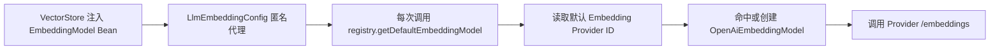

# Embedding 模型动态代理与向量一致性

## 1. 模块基础讲解

聊天模型输出文本，Embedding 模型把文本映射为固定维度向量，供 pgvector 相似度检索和 RAG 使用。
本项目允许 Chat Provider 与 Embedding Provider 独立配置，核心调用链是：

`LlmEmbeddingConfig` 没有在启动时固定一个实际模型，而是提供稳定的代理 Bean。代理每次 `call()` 或
`embed()` 都查询 Registry，所以默认 Embedding Provider 切换后，依赖这个 Bean 的 VectorStore 无需
重新注入。

创建 EmbeddingModel 前执行三类校验：

- `supportsEmbedding` 必须为 true。
- `embeddingModel` 必须非空。
- 模型名不能被启发式判断为常见聊天模型。
- 维度优先使用 Provider 级配置，否则回退全局 `embeddingDimensions`。

这种设计解决了“Spring Bean 是静态的、Provider 是动态的”的矛盾，属于代理模式和延迟绑定。

## 2. 基础面试问题

**问题：Embedding 和 Chat Model 的区别是什么？**

回答：Chat Model 根据上下文生成 token；Embedding Model 输出定长数值向量，用距离衡量语义相似度。
两者接口、输出和计费不同，不能把 `qwen-plus` 等聊天模型当成向量模型。

**问题：为什么需要 `supportsEmbedding`？**

回答：不是所有 OpenAI 兼容 Provider 都实现 `/embeddings`。显式能力标志能在调用前失败，而不是等
到上游 404；设置默认 Embedding 时也能过滤无能力 Provider。

**问题：代理 Bean 为什么每次都查询 Registry？**

回答：如果 Bean 在启动时直接绑定旧模型，运行时切换默认 Provider 不会生效。每次委托可获得当前
默认值，同时保持 VectorStore 注入点不变。

**问题：为什么 EmbeddingModel 也要缓存？**

回答：模型对象包含 API 客户端、默认选项、重试和观测配置，重复构建没有必要。按 Provider ID 缓存，
配置变化后再失效即可。

## 3. 进阶面试问题

**问题：只校验维度大于 0 为什么不够？**

回答：应用的 pgvector 配置固定为 1024 维。若切换到 1536 维模型，模型调用本身可能成功，但向量
写入数据库会失败；即便数据库允许多维，旧向量和新向量也不能直接比较。维度是数据契约，不只是参数。

**问题：更换同维度 Embedding 模型是否不需要重建索引？**

回答：仍然需要。不同模型即使维度相同，向量空间也不一致，新查询向量与旧文档向量没有可比性。
必须把 model/provider/version 写入知识库元数据，并对已有文档全量重新向量化后原子切换索引版本。

**问题：模型名启发式校验可靠吗？**

回答：不可靠，只能拦截明显错误。`qwen` 前缀可能未来也用于 Embedding 命名，未知聊天模型也可能绕过。
更稳妥的是调用模型能力探测、维护厂商模型目录，或让配置显式声明 capability 并在上线前测试。

**问题：动态代理在一次批处理内会切模型吗？**

回答：代理每次方法调用解析一次默认模型。单次 `EmbeddingRequest` 内不会切换，但一个多批次向量化
任务若中途改变默认值，后续批次可能使用新模型，产生混合向量空间。任务开始时应固定 deployment
版本，而不是每批动态解析默认值。

**问题：默认 Embedding 切换和缓存清理有什么关系？**

回答：默认指针改变后代理会解析到新 ID；若新 ID 已缓存可直接复用。理论上不必全清缓存，但配置
更新同一 ID 时必须失效对应 EmbeddingModel。

## 4. 技术延伸问题

**问题：除了 pgvector，还能使用什么向量方案？**

回答：可选 Milvus、Weaviate、Qdrant、Elasticsearch/OpenSearch 向量检索或 Redis Vector。pgvector
优势是与业务数据同库、事务和运维简单；独立向量库在超大规模、分片和专业索引治理上更强。

**问题：如何做双模型平滑迁移？**

回答：建立 v1/v2 两套向量列或索引，后台用 v2 全量回填；查询阶段先 shadow 比较结果，达到质量
阈值后切流；最后延迟删除 v1。迁移状态需要可恢复、可观测，不能直接覆盖旧向量。

**问题：如何选择 Embedding 维度？**

回答：权衡语义质量、存储、索引内存和查询延迟。先用业务数据做 Recall@K、NDCG 和延迟测试，再
决定维度；不是维度越大越好。模型支持 dimensions 参数时还要确认厂商是否真的按请求维度输出。

## 5. 改进方案问题

**问题：如何保证向量数据契约？**

回答：定义 `EmbeddingProfile(providerId, model, dimensions, normalization, version)`，知识库和每条
向量记录 profileVersion。创建/切换默认模型前验证 VectorStore schema；不同 profile 禁止混查。

**问题：如何改进默认 Embedding 切换？**

回答：默认切换不能只是更新一行设置。应先执行能力探测和小样本质量验证，创建重建任务，完成后再
切换 active index/profile；若失败保留旧模型，避免知识库立即不可用。

**问题：如何提高测试覆盖？**

回答：测试代理每次解析最新默认 ID；测试不同维度被拒绝；测试同维度不同 model 要求重建；并发
切换时批处理固定版本；真实 HTTP 回归覆盖 `/embeddings` 路径和 dimensions 字段。

**问题：当前代码中哪个 Legacy 问题需要先修？**

回答：`updateDefaultEmbeddingProvider` 应增加非数据库分支；否则测试/Legacy 构造器下 Repository
为 null 会空指针。删除 Legacy Provider 时也应保护默认 Embedding ID。

## 6. 故障处理问题

**问题：向量写入报维度不匹配怎么处理？**

回答：记录实际响应数组长度，和 Provider 配置、全局 1024 维、pgvector 列定义逐一比较。不要简单
截断或补零；修正模型/profile 后重新向量化受影响数据。

**问题：切换 Embedding 后搜索结果突然变差，为什么？**

回答：最常见原因是新查询向量与旧文档向量来自不同模型，即使维度一样也不兼容。检查向量元数据、
回填进度和 active index，必要时回滚默认 profile。

**问题：Provider 明明支持聊天，Embedding 却 404，怎么查？**

回答：检查 `supportsEmbedding`、embeddingModel、最终 `/embeddings` URL 和账号权限。OpenAI Chat
兼容不代表 Embedding 兼容，某些厂商的向量 API 地址或认证方式不同，需要独立 Adapter。

**问题：知识库任务中途切换 Provider 后数据混乱，怎么恢复？**

回答：按任务批次和 profileVersion 找出混合写入记录，删除或重建该批次；让后续任务在创建时固定
Provider 快照，并把版本写入异步任务消息，消费者不能临时读取“当前默认值”。
