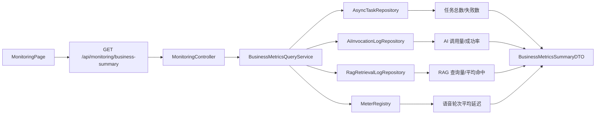

# Monitoring 模块总览与业务监控闭环

## 1. 模块基础讲解

`monitoring` 是面向管理后台的业务健康概览模块。它不直接执行面试或 AI 任务，而是把异步任务、
AI 调用、RAG 检索和语音面试四个领域的数据聚合成一份 `BusinessMetricsSummaryDTO`，供 Dashboard
快速判断系统是否健康。

面试时可以这样定义它：

> 这个模块是业务可观测性的查询面。它把数据库中的持久化审计日志、任务状态和 JVM 内的 Micrometer
> 指标组合成管理视图，让运维先发现“哪里异常”，再通过 traceId 和明细日志下钻定位原因。

当前链路如下：

模块本体只有三个类：

- `MonitoringController`：薄 Controller，仅路由和统一响应。
- `BusinessMetricsQueryService`：计算最近 24 小时的业务摘要。
- `BusinessMetricsSummaryDTO`：使用 record 承载窗口起点和七项指标。

它依赖的采集面位于 `common/observability`：

- `AiMetricsRecorder`：AI 调用计数、延迟、重试和失败。
- `RagMetricsRecorder`：改写、检索和回答三个阶段指标。
- `AsyncTaskMetricsRecorder`：Redis Stream 任务生命周期计数。
- `VoiceMetricsRecorder`：语音链路通用 Timer/Counter。
- `TraceIdFilter`：把 `X-Trace-Id` 放入 MDC 和响应头。

当前实现的核心特点是“数据库事实 + 内存指标”混合查询。数据库适合 24 小时历史统计，MeterRegistry
适合低成本实时聚合；但两者的时间窗口、实例范围和持久性不同，不能把它们不加说明地视作同一口径。

## 2. 基础面试问题

**问题：监控和可观测性有什么区别？**

回答：监控通常围绕预先定义的指标和告警回答“系统是否异常”；可观测性还组合指标、日志和 Trace，
帮助探索未预先定义的问题，回答“为什么异常”。当前 Dashboard 是监控入口，AI/RAG 日志和 traceId
提供部分可观测性能力，但还不是真正的分布式 Trace。

**问题：为什么业务指标不能只看 CPU 和内存？**

回答：基础设施健康不等于用户体验健康。CPU 正常时，AI 可能大量 429、RAG 可能零命中、异步任务
可能堆积、语音面试可能延迟很高。业务 SLI 才能反映用户实际获得的服务质量。

**问题：当前 Dashboard 展示哪些指标？**

回答：最近创建的任务数、其中 FAILED/DEAD_LETTER 数、AI 调用数和成功率、RAG 查询数和平均命中块
数，以及当前实例语音轮次 Timer 的均值。

**问题：为什么 DTO 使用 record？**

回答：它是不可变的跨层数据载体，没有业务行为，record 能自动生成构造器和访问器，语义比可变
JavaBean 清晰，也符合项目命名规范。

**问题：为什么 Controller 不直接查 Repository？**

回答：多个数据源的窗口、计算和降级属于业务编排，放在 Service 才便于测试、复用和演进；Controller
保持只处理 HTTP 路由和响应包装。

## 3. 进阶面试问题

**问题：当前摘要真的是统一的“最近 24 小时”吗？**

回答：不是。数据库三类数据用 `LocalDateTime.now().minusHours(24)`；语音 Timer 是当前 JVM 自启动
以来的累计均值，重启会清零，多实例也只看到本机。DTO 的 `since` 不能准确描述语音指标窗口。

**问题：数据库日志和 Micrometer 指标各适合什么场景？**

回答：数据库日志适合按 traceId 下钻、审计和复杂明细查询，但存储和查询成本高；Micrometer 适合
高频聚合、Prometheus 拉取和告警，但不保存每次事件详情。合理设计是指标发现问题，Trace/日志解释问题。

**问题：当前实现是否已经接入 Prometheus/Grafana？**

回答：没有完整接入。运行时只有 `micrometer-core` 的传递依赖，没有 Actuator 自动配置、Prometheus
Registry、自定义 MeterRegistry Bean 和 management endpoint 配置。因此 Recorder 可能因可选注入为
null 而全部 no-op，代码注释描述的是可扩展目标，不是已经可采集的生产链路。

**问题：成功率为 0 能说明服务故障吗？**

回答：不能。当前无 AI 日志时也返回 0，前端显示 0%，它可能表示“没有流量”而不是“全部失败”。
指标应同时返回样本数，并用 nullable/status 区分 NO_DATA、UNAVAILABLE 和真实数值。

## 4. 技术延伸问题

**问题：完整可观测性平台如何搭建？**

回答：Micrometer/Actuator 暴露指标，Prometheus 采集，Grafana 展示和告警；日志输出到 Loki/ELK；
Micrometer Tracing 或 OpenTelemetry 生成 W3C Trace/Span 并导出 Tempo/Jaeger。三类信号通过 traceId、
service、environment、provider 等受控字段关联。

**问题：为什么不让前端直接查询 Prometheus？**

回答：Prometheus 查询接口不应直接暴露给普通前端，且 PromQL 变化会耦合 UI。后端聚合 API 可以做
权限、缓存、口径治理和多数据源组合；专业运维页面则直接用 Grafana 更合适。

**问题：可以用时序数据库替代当前数据库统计吗？**

回答：可以把吞吐、错误率、延迟等数值交给 Prometheus/Mimir；AI 调用详情仍保留在 PostgreSQL 或
日志系统。时序库擅长窗口聚合和 rate，关系库擅长审计详情，二者不必互相替代。

## 5. 改进方案问题

**问题：最优先的三项改造是什么？**

回答：第一，补 Actuator 和 Prometheus Registry，让 Recorder 真正产生可导出指标；第二，修正 Dashboard
的时间窗口和 NO_DATA 语义；第三，把 24 小时 AI/RAG 统计改成数据库聚合查询，避免加载完整 Entity。

**问题：如何重构模块边界？**

回答：定义 `MetricSnapshot`/`MetricValue`，每项携带 value、sampleCount、window、scope、availability；
数据库聚合和 Prometheus 查询分别实现数据源 Adapter，Service 只做口径编排，不直接依赖四个底层仓库。

**问题：如何保护监控接口？**

回答：只允许管理员角色，增加 USER/IP/GLOBAL 限流、短时缓存和审计；错误详情和 trace 查询做更高
权限控制，避免暴露模型、内部状态和可能含敏感信息的错误消息。

## 6. 故障处理问题

**问题：Dashboard 所有卡片都是 0，怎么排查？**

回答：先查数据库三张表是否有最近数据；再确认查询时区和 since；语音指标检查是否存在 MeterRegistry
Bean、Recorder 是否拿到 null、实际 Timer 是否已记录。当前项目缺指标自动配置时，语音为 0 是预期降级。

**问题：Dashboard 很慢但业务接口正常，为什么？**

回答：AI/RAG 查询会加载最近 24 小时全部 Entity，包括 TEXT 字段，再在 JVM 内计算。数据量增大时
会占用数据库带宽、堆内存和 GC。应使用 `COUNT/AVG/SUM` 聚合和合适索引，并对摘要做短缓存。

**问题：前端显示“最近窗口”，表格数据却对不上摘要，为什么？**

回答：摘要查询最近 24 小时，而 scenario/provider 表格使用 AI Observability API 的最近 50 条记录，
窗口不同；前端对 null latency 还按 0 计入平均值。需要由后端提供同口径分组聚合。

**问题：如何向面试官总结该模块？**

回答：它已经建立业务监控查询骨架和四领域指标入口，优点是控制层简单、跨域聚合直观；生产化关键
是把采集链路真正接通，统一窗口与实例范围，治理标签基数，并用指标、日志、Trace 完成下钻闭环。
