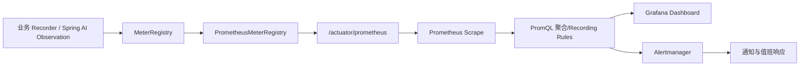

# Actuator、Prometheus、Grafana、告警与安全

## 1. 模块基础讲解

要把当前 Recorder 变成生产监控，需要完整链路：

当前仓库缺少 `spring-boot-starter-actuator`、`micrometer-registry-prometheus` 和 `management.*`
暴露配置，也没有自定义 MeterRegistry Bean。因此只引入 micrometer-core 并写 Recorder 还不足以产生
可抓取指标。

生产接入还需：

- Actuator 只暴露必要 endpoint。
- Prometheus endpoint 置于内网或独立 management port。
- Spring Security/mTLS/网关限制访问。
- 配置 common tags：service、environment、region、version，避免 instance 之外的无界标签。
- 设计 recording rules 和告警，而不是让 Grafana 页面临时做全部重计算。

## 2. 基础面试问题

**问题：Actuator 和 Micrometer 是什么关系？**

回答：Micrometer 提供指标 API 和 Registry；Spring Boot Actuator 负责自动配置 Registry、系统 Binder
和 `/actuator/metrics` 等管理端点。Prometheus Registry 再提供 Prometheus 格式导出。

**问题：Grafana 会直接采集应用吗？**

回答：通常不会。Prometheus 定期 scrape 应用并存储时间序列，Grafana 查询 Prometheus 展示；告警
可由 Prometheus/Alertmanager 或 Grafana Alerting 处理。

**问题：健康检查和业务指标有什么区别？**

回答：Health 表示实例是否可接流量，适合 readiness/liveness；业务指标反映服务质量趋势。不能因为
某次 AI 调用失败就让 liveness 失败重启，也不能只看 health=UP 就认为业务正常。

**问题：为什么 management endpoint 默认不能全部暴露？**

回答：env、configprops、heapdump、metrics 等可能泄露配置、拓扑和敏感信息。应最小暴露、鉴权、内网
隔离和审计。

## 3. 进阶面试问题

**问题：如何为 AI 成功率设置告警？**

回答：按 5 分钟和 1 小时双窗口计算错误率，要求最小调用量；按 provider/scenario 分组；排除 noData；
429、timeout、parseFailure 分开告警。短窗口发现突发，长窗口避免抖动。

**问题：为什么告警要基于 SLO burn rate？**

回答：固定阈值不知道错误预算消耗速度。Burn rate 比较实际错误率和 SLO 允许错误率，能兼顾严重突发
与缓慢持续退化，减少无效告警。

**问题：Prometheus 如何计算 Timer 平均延迟？**

回答：对 `_seconds_sum` 和 `_seconds_count` 在窗口内求 rate 后相除；集群先 sum 再除。P95 则用
histogram_quantile 对 bucket rate 聚合，前提是启用了 percentile histogram/SLO buckets。

**问题：Actuator 有了就一定有业务指标吗？**

回答：不一定。Recorder 必须实际被调用、Registry 必须注入、标签一致、endpoint 要暴露且 Prometheus
要成功 scrape。还要检查配置开关 `structured-metrics-enabled` 和不同调用链覆盖范围。

**问题：为什么监控接口本身需要鉴权？**

回答：业务成功率、模型、错误、任务状态和 traceId 都属于内部运行信息，可帮助攻击者判断系统结构和
故障窗口。当前 `/api/monitoring/business-summary` 没有 `@RateLimit`，仓库也未见安全配置，应视为风险。

## 4. 技术延伸问题

**问题：除了 Prometheus 还有什么方案？**

回答：OpenTelemetry Collector 可统一接收 OTLP 并导出多后端；Datadog/New Relic 提供托管平台；
VictoriaMetrics/Mimir 支持大规模 Prometheus 兼容存储。选择取决于规模、成本和运维能力。

**问题：如何设计告警分级？**

回答：P1 用户核心流程大面积失败，立即值班；P2 单 Provider/单区域持续退化；P3 趋势异常和容量预警。
每条告警包含影响、Dashboard、Runbook、owner 和静默策略，避免只有一个“失败数>0”。

**问题：什么是 Recording Rule？**

回答：Prometheus 预先周期计算复杂 PromQL 并保存结果，Dashboard 和告警直接查询新序列，降低重复
计算，统一成功率/P95 等口径。

## 5. 改进方案问题

**问题：如何最小化接入生产指标？**

回答：增加 Actuator 和 Prometheus Registry；只暴露 health/prometheus；配置 management 独立端口和
网络策略；给关键 Timer 配 SLO buckets；Prometheus scrape；建立 AI、RAG、异步、语音四组 Dashboard。

**问题：如何验证接入不是“配置看起来正确”？**

回答：启动应用后确认 MeterRegistry Bean 类型；制造一次已知业务调用；检查 `/actuator/metrics` 原名；
检查 `/actuator/prometheus` 规范化序列；确认 Prometheus target UP；用 PromQL 验证 count 增长。

**问题：如何保护 Dashboard API？**

回答：管理员 RBAC、限流、短缓存、CORS 最小化、错误信息脱敏、trace 详情二次授权；Actuator 使用独立
安全链，禁止公网匿名访问。对查询操作也记录审计。

**问题：如何编写 Runbook？**

回答：按告警列出含义、用户影响、确认指标、下钻标签、相关日志/Trace 查询、常见根因、临时止损、
恢复验证和升级联系人。Runbook 必须能被值班人员直接执行。

## 6. 故障处理问题

**问题：Prometheus target DOWN 怎么排查？**

回答：检查应用 endpoint 是否存在、management port/path、网络策略、TLS/认证、抓取超时和服务发现；
若应用业务正常但 endpoint 404，优先检查 Actuator/Prometheus 依赖和 exposure 配置。

**问题：Target UP 但没有 app 指标怎么办？**

回答：确认 Recorder 获得真实 Registry、业务路径已执行、指标开关开启、名称规范化、标签查询条件；
通过 `/actuator/metrics/{原始名称}` 先在应用侧验证。

**问题：告警频繁抖动怎么处理？**

回答：增加最小样本量、for 持续时间、多窗口判断和合理阈值；分离 noData；避免用瞬时 Gauge 或单次
失败告警；检查部署/重启造成 Counter reset 是否被 PromQL 正确处理。

**问题：Actuator 被公网访问后怎么办？**

回答：立即网络封禁并检查访问日志，评估已暴露 endpoint 和敏感数据，轮换可能泄漏的凭证；随后改
内网端口、认证授权、最小 endpoint 暴露和安全测试。

**问题：官方资料如何支撑这些结论？**

回答：可参考：

- [Spring Boot Metrics 官方文档](https://docs.spring.io/spring-boot/4.1/reference/actuator/metrics.html)
- [Micrometer Timer 官方文档](https://docs.micrometer.io/micrometer/reference/concepts/timers.html)
- [Micrometer MeterFilter 官方文档](https://docs.micrometer.io/micrometer/reference/concepts/meter-filters.html)
- [OpenTelemetry 可观测性基础](https://opentelemetry.io/docs/concepts/observability-primer/)
