# 语音面试模块总览与实时语音业务闭环

## 1. 模块基础讲解

`voiceinterview` 是平台里复杂度最高的核心模块之一。它不是把文字面试换成一个音频输入框，而是实现了“实时语音通话式 AI 面试”：用户创建语音面试会话后，通过 WebSocket 推送麦克风音频，后端将音频送入 ASR 转文字，再把识别文本交给 LLM 生成面试官回复，最后通过 TTS 合成音频回传给前端。面试结束后，再通过 Redis Stream 异步生成完整评估报告。

可以先从业务价值讲：

> 文字面试更像刷题，语音面试更接近真实面试压力场景。这个模块的价值是让候选人练习“听到问题、组织语言、口头表达、被追问、复盘反馈”的完整过程，同时把语音内容沉淀成可评估的文本记录。

核心业务闭环如下：

```mermaid
flowchart LR
  A["REST 创建语音面试会话"] --> B["前端建立 WebSocket"]
  B --> C["服务端启动 ASR 连接"]
  C --> D["面试官开场问题文本+语音"]
  D --> E["用户音频 Base64 PCM"]
  E --> F["ASR 实时字幕/最终文本"]
  F --> G["用户 submit 触发 LLM"]
  G --> H["LLM 流式生成面试官回复"]
  H --> I["句子级 TTS 并发合成"]
  I --> J["WebSocket 推送文本和音频"]
  J --> K["保存对话消息"]
  K --> E
  K --> L["结束会话"]
  L --> M["Redis Stream 异步评估"]
  M --> N["评估报告轮询查询"]
```

模块分层：

- `VoiceInterviewController`：HTTP API，负责创建/查询/暂停/恢复/删除会话，获取消息，触发和查询评估。
- `WebSocketConfig`：注册 `/ws/voice-interview/{sessionId}` WebSocket 端点。
- `VoiceInterviewWebSocketHandler`：实时链路核心，管理连接、音频、ASR、LLM、TTS、回声冷却、暂停超时。
- `VoiceInterviewService`：会话生命周期、阶段、消息持久化、Redis 缓存、评估触发。
- `QwenAsrService`：每个会话一条 DashScope ASR 实时 WebSocket，负责语音转文字。
- `DashscopeLlmService`：语音面试场景的 LLM 调用，支持流式输出和句子边界检测。
- `QwenTtsService`：每次合成建立临时 TTS WebSocket，收集 PCM 分片并返回音频。
- `VoiceInterviewEvaluationService`：将语音对话构造成 `QaRecord`，复用通用评估引擎生成报告。
- `VoiceEvaluateStreamProducer/Consumer`：Redis Stream 异步评估任务。
- `VoiceInterviewSessionEntity/MessageEntity/EvaluationEntity`：会话、对话消息和评估结果持久化。

关键技术点：

- WebSocket 双向实时通信。
- ASR、LLM、TTS 三段式 AI Pipeline。
- 虚拟线程承载阻塞型 LLM/TTS/JDBC 操作。
- `ConcurrentWebSocketSessionDecorator` 防并发写 WebSocket。
- `ConcurrentHashMap` 维护 WebSocket 会话和运行时状态。
- `AtomicBoolean` 做单会话 LLM 处理锁。
- `AtomicReference` 做 STT 合并缓冲。
- `Semaphore` 控制每会话并发 TTS 数量。
- `CountDownLatch` 等待一次 TTS 合成结束。
- Redis Stream 承载最终评估任务。
- `VoiceMetricsRecorder` 记录 ASR/LLM/TTS/turn 指标。

面试表达可以这样开头：

> 语音面试模块是整个项目里实时性和工程复杂度最高的一块。我把它拆成两条链路：实时通话链路和离线评估链路。实时链路通过 WebSocket 串起音频输入、ASR、LLM、TTS 和音频回传；离线评估链路在会话结束后用 Redis Stream 异步生成报告。这样用户端体验是实时的，重型评估任务又不会阻塞通话流程。

## 2. 基础面试问题

**问题：语音面试模块和普通文字面试模块的最大区别是什么？**

回答：普通文字面试主要是题目生成、答题和报告评估；语音面试还要处理实时通信和音频链路。它需要解决麦克风音频采集、ASR 实时转写、LLM 流式回复、TTS 合成、WebSocket 推送、回声抑制、断线恢复和暂停超时等问题。

**问题：为什么语音面试使用 WebSocket？**

回答：因为语音面试是双向实时交互。前端需要持续发送音频帧，后端也需要实时推送字幕、文本、音频和控制消息。HTTP 请求/响应模型不适合这种长连接、低延迟、双向通信场景。

**问题：一次语音面试从创建到通话开始经历什么？**

回答：前端先调用 REST API 创建会话，拿到 sessionId 和 WebSocket URL；然后连接 `/ws/voice-interview/{sessionId}`；后端建立连接后设置消息大小限制、创建安全 WebSocket decorator、初始化内存状态、启动 ASR，并发送欢迎消息和开场问题。

**问题：模块里有哪些持久化数据？**

回答：会话表保存用户、skill、难度、阶段、状态、时间和评估状态；消息表保存每轮用户 ASR 文本和 AI 回复；评估表保存总分、总评、逐题评估、优势、改进建议和参考答案 JSON。

**问题：最终评估为什么仍然异步？**

回答：语音面试结束后对整场对话评估需要 LLM 分析多轮问答，耗时和失败概率较高。如果同步做，会影响结束会话接口和用户体验。当前用 Redis Stream 后台处理，前端轮询评估状态。

## 3. 进阶面试问题

**问题：这个模块的核心难点是什么？**

回答：核心难点不是单个 API 调用，而是实时链路的组合稳定性。ASR、LLM、TTS 都是外部服务，任何一段都可能延迟、断线、超时或返回异常。模块要保证连接不断、状态不乱、重复提交不并发触发、AI 声音不被麦克风再次识别、前端能感知错误。

**问题：为什么要把实时通话链路和最终评估链路拆开？**

回答：实时通话链路追求低延迟，应该尽量快速处理用户每一轮输入；最终评估链路追求完整性和准确性，可以慢一些，并支持重试和死信。拆开后，通话中只保存对话记录，结束后再异步评估，职责更清晰。

**问题：为什么 Handler 里要维护内存状态？**

回答：WebSocket 是长连接，很多状态只在连接生命周期内有效，比如当前 WebSocket session、ASR 合并缓冲、AI 是否正在说话、LLM 是否处理中、最近活动时间、当前处理线程。这些状态不适合每个音频帧都落库，所以用内存 map 管理。

**问题：使用虚拟线程的原因是什么？**

回答：LLM 调用、TTS 合成、数据库保存都是 I/O 密集型阻塞操作。使用虚拟线程可以降低线程成本，让 WebSocket IO 线程快速返回，不被外部服务阻塞。但虚拟线程不是限流手段，所以代码仍然用 `AtomicBoolean` 和 `Semaphore` 控制单会话并发。

**问题：这个模块复用了哪些普通面试能力？**

回答：最终评估复用了 `UnifiedEvaluationService` 的分批评估、结构化输出和二次汇总能力；Skill reference 也复用了 `InterviewSkillService`。这说明语音面试的实时链路是新增的，但评分能力和知识基线可以和文字面试共享。

## 4. 技术延伸问题

**问题：如果不用 WebSocket，还能怎么做实时语音？**

回答：可以用 WebRTC，尤其适合浏览器音视频通话和更低延迟的媒体传输；也可以用 HTTP chunked/SSE 只做服务端推送，但不适合前端持续上传音频。当前 WebSocket 更容易和现有 Spring Boot 后端集成，适合文本帧封装音频和控制消息。

**问题：ASR、LLM、TTS 能不能合成一个端到端多模态模型？**

回答：可以。端到端语音大模型能减少中间环节，理论上延迟更低，也能保留语音情绪。但工程上可控性更弱，难以单独优化 ASR、LLM 或 TTS，也不方便保存可评估文本。当前三段式 Pipeline 更可解释、更容易落地。

**问题：如果要支持真人面试官接管，架构怎么扩展？**

回答：WebSocket 协议需要支持多角色连接，同一个 session 下候选人、AI、真人面试官都能加入。ASR 继续转写候选人语音，真人面试官可以选择发送文本或语音，AI 可以退到建议模式。后端需要房间模型、角色权限和消息广播。

**问题：如果要支持移动端弱网，应该怎么优化？**

回答：前端音频分片要更小，WebSocket 要支持重连和断点续传，服务端需要识别重复 chunk 或丢包。后端可降低音频质量、增加心跳和连接恢复逻辑。ASR 断线重连已有部分处理，但客户端网络抖动还需要协议层补强。

**问题：如果要降低延迟，可以从哪里优化？**

回答：ASR 侧降低 VAD 静默阈值但会增加断句风险；LLM 侧启用流式输出并缩短回答；TTS 侧句子级并发合成和分块推送；WebSocket 侧减少 Base64 开销或改二进制帧；Prompt 侧控制上下文长度。

## 5. 改进方案问题

**问题：当前模块最应该优先优化什么？**

回答：优先优化对话记录与评估输入的配对模型。当前消息保存是“用户本轮回答 + AI 下一轮回复”一条记录，评估时又把 AI 回复当 question、用户文本当 answer，可能出现问题和答案错位。建议引入明确的 `turn` 模型：上一轮 AI question、用户 answer、本轮 AI followUp 分开存。

**问题：权限隔离有什么问题？**

回答：`VoiceInterviewService` 当前创建会话时使用固定 `DEFAULT_USER_ID = "default"`，列表接口按默认用户查。真实生产环境需要从认证上下文读取 userId，并对会话详情、消息、删除、评估都做用户级校验。

**问题：限流配置是否已经生效？**

回答：配置里有 `rate-limit`，但代码里没有看到实际使用 `@RateLimit` 或 WebSocket 连接级限流逻辑。也就是说当前更多是配置占位，生产要补 IP 连接数、单用户并发会话、单会话消息频率和 TTS/LLM 并发限流。

**问题：异常断开后的评估触发有什么边界？**

回答：`afterConnectionClosed` 会调用 `endSessionIfInProgress`，内部只执行私有 `endSession(session)`，会把状态设为 `COMPLETED` 和 `evaluateStatus=PENDING`，但不会调用 producer 入队评估任务。后续需要手动触发评估或补偿任务，否则可能停在 PENDING。

**问题：WebSocket URL 生成有什么可改进？**

回答：`buildSessionResponse` 固定返回 `ws://localhost:8080/ws/voice-interview/{id}`。生产环境应从配置读取外部域名、协议和网关路径，支持 `wss`，避免部署后前端拿到本地地址。

## 6. 故障处理问题

**问题：用户连接 WebSocket 后没有开场语怎么办？**

回答：先看 WebSocket 是否连接成功，后端是否发送 welcome。然后检查 `triggerOpeningQuestionIfNeeded` 是否因已有历史消息跳过、会话实体是否存在、开场问题模板是否为空、TTS 是否合成失败、前端是否能播放 WAV。

**问题：用户说话没有字幕怎么办？**

回答：排查前端是否发送 `type=audio` 且 data 非空，Base64 是否是 16kHz PCM；后端是否启动 ASR；`QwenAsrService` 是否收到 partial 或 completed 事件；API Key、模型、网络连接是否正常。

**问题：AI 没有回答怎么办？**

回答：确认前端是否发送 `{"type":"control","action":"submit"}`。当前代码最终文本进入 mergeBuffer 后不会自动触发 LLM，必须 submit。再看 mergeBuffer 是否为空、`processing` 锁是否卡住、LLM provider 是否异常。

**问题：AI 有文字但没声音怎么办？**

回答：说明 LLM 成功但 TTS 失败或音频推送失败。检查 TTS API Key、模型、voice、30 秒超时、返回 PCM 是否为空、WAV 转换是否正确、前端是否支持播放返回的 Base64 WAV。

**问题：面试结束后报告一直不出来怎么办？**

回答：查 session 的 `evaluateStatus`。如果是 PENDING，检查 Redis Stream 是否真的入队；如果是 PROCESSING，查消费者日志；如果是 FAILED，查 evaluateError 和 async task 死信。如果是异常断开自动结束，尤其要确认是否调用了 producer 入队。

