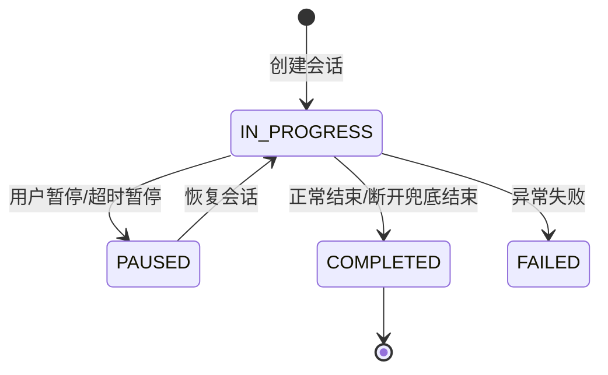
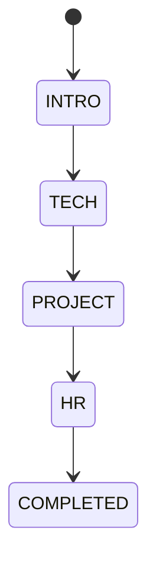

# REST 会话生命周期与状态机

## 1. 模块基础讲解

REST 层由 `VoiceInterviewController` 提供，主要处理实时通话之外的会话管理能力。实时音频交互走 WebSocket，REST API 负责创建会话、查询会话、暂停/恢复、结束、删除、查看历史消息、触发评估和轮询评估结果。

主要接口：

- `POST /api/voice-interview/sessions`：创建语音面试会话。
- `GET /api/voice-interview/sessions/{sessionId}`：查询会话详情。
- `POST /api/voice-interview/sessions/{sessionId}/end`：结束会话。
- `PUT /api/voice-interview/sessions/{sessionId}/pause`：暂停会话。
- `PUT /api/voice-interview/sessions/{sessionId}/resume`：恢复会话。
- `GET /api/voice-interview/sessions`：查询会话列表。
- `DELETE /api/voice-interview/sessions/{sessionId}`：删除会话。
- `GET /api/voice-interview/sessions/{sessionId}/messages`：查询对话历史。
- `GET /api/voice-interview/sessions/{sessionId}/evaluation`：查询评估状态和结果。
- `POST /api/voice-interview/sessions/{sessionId}/evaluation`：手动触发评估。

会话创建流程：

1. Controller 接收 `CreateSessionRequest`。
2. Service 补默认值：`skillId` 默认为 `java-backend`，`difficulty` 默认为 `mid`。
3. 创建 `VoiceInterviewSessionEntity`。
4. 设置阶段开关、计划时长、简历 ID、LLM provider、当前阶段。
5. 保存数据库。
6. 写入 Redisson 缓存，TTL 1 小时。
7. 返回 `SessionResponseDTO`，包含 sessionId 和 WebSocket URL。

会话状态：

阶段状态：

注意：`VoiceInterviewService` 提供了 `shouldTransitionToNextPhase` 和 `getNextPhase` 方法，用于根据时长和题数判断是否应该切阶段；但实时 Handler 中主要处理前端传来的 `start_phase` 控制消息，没有看到完整自动切阶段闭环。因此面试时应说“阶段判断能力已提供，自动切阶段还可继续打通到实时链路”。

## 2. 基础面试问题

**问题：REST API 和 WebSocket 的职责怎么分？**

回答：REST 负责会话管理和评估查询，比如创建、暂停、恢复、结束、删除、查历史、查报告；WebSocket 负责实时通话，比如上传音频、推送字幕、推送 AI 文本和音频。这样长连接和普通管理接口职责清晰。

**问题：创建会话返回的 WebSocket URL 有什么作用？**

回答：前端创建会话后拿到 sessionId 和 WebSocket URL，再连接 `/ws/voice-interview/{sessionId}` 进入实时语音面试。sessionId 是后续 WebSocket 识别会话、保存消息、查询状态的核心标识。

**问题：语音面试会话有哪些状态？**

回答：`IN_PROGRESS` 表示进行中，`PAUSED` 表示暂停，`COMPLETED` 表示已完成，`FAILED` 表示失败。评估任务状态另用 `AsyncTaskStatus` 表示，比如 PENDING、PROCESSING、COMPLETED、FAILED。

**问题：暂停和恢复怎么实现？**

回答：暂停时要求会话必须是 `IN_PROGRESS`，然后设置为 `PAUSED` 并记录 `pausedAt`，同时清 Redis 缓存。恢复时要求会话是 `PAUSED`，设置回 `IN_PROGRESS`，记录 `resumedAt`，再重新缓存并返回 WebSocket URL。

**问题：会话列表是怎么查的？**

回答：`getAllSessions` 传 userId 和 status，默认 userId 是 `default`。如果传状态就按 userId + status 查询，否则按 userId 查询，并返回 `SessionMetaDTO`，包含消息数量和评估状态。

## 3. 进阶面试问题

**问题：为什么会话缓存 TTL 只有 1 小时？**

回答：语音面试是实时会话，缓存主要加速进行中的读取，不是长期存储。1 小时覆盖大多数面试时长，同时避免缓存长期占用内存。历史数据仍以数据库为准。

**问题：缓存和数据库的关系是什么？**

回答：创建和恢复会话后会写缓存；结束、暂停会清缓存；查询会话时先读缓存，缓存没有再查数据库。缓存只是加速层，数据库是事实来源。一个边界是删除会话时当前代码删除数据库和关联数据，但没有显式清理缓存，需要补。

**问题：`endSessionIfInProgress` 的作用是什么？**

回答：WebSocket 异常断开后，Handler 会调用它兜底结束还在进行中的会话，避免状态一直停在 `IN_PROGRESS`。它只在状态是 `IN_PROGRESS` 时执行，已完成或已暂停不会重复处理。

**问题：`endSession` 和 `endSessionIfInProgress` 有什么差异？**

回答：公开 `endSession(String)` 会结束会话并调用 `VoiceEvaluateStreamProducer` 入队评估任务；`endSessionIfInProgress` 只调用私有 `endSession(session)`，会设置状态和 PENDING，但不会入队。这是一个需要补偿的边界。

**问题：阶段切换依据是什么？**

回答：`shouldTransitionToNextPhase` 综合当前阶段持续时间、最大时长、最大题目数、建议时长和最少题目数判断。达到最大时长强制切；达到最大问题数建议切；达到建议时长且题数达标也建议切。

**问题：为什么 `roleType` 和 `skillId` 都存在？**

回答：`roleType` 是旧字段，`skillId` 是新的模板 ID。创建时代码用 effectiveSkillId 同时设置 roleType 和 skillId，用于向后兼容。后续可以逐步统一到 skillId，减少概念重复。

## 4. 技术延伸问题

**问题：如果要支持用户重新进入未完成语音面试，怎么做？**

回答：用户恢复会话后重新建立 WebSocket，后端从数据库加载历史消息，开场问题不会重复发送，因为 `triggerOpeningQuestionIfNeeded` 会看到已有历史。前端可以展示历史对话并继续录音。

**问题：如果要支持预约面试或定时面试，实体怎么扩展？**

回答：新增 scheduledAt、expiredAt、timezone、calendarEventId 等字段。状态可以增加 CREATED/SCHEDULED，真正连接 WebSocket 时再转为 IN_PROGRESS。当前创建后直接是 IN_PROGRESS。

**问题：如果要做多租户，REST 层需要怎么改？**

回答：CreateSession 不应固定 userId，而应从认证上下文取 userId 和 tenantId。所有查询、删除、暂停、恢复、评估都必须按用户/租户过滤。缓存 key 也应包含 tenant/user 防止跨用户读写。

**问题：如果要支持阶段自动切换，怎么接入实时链路？**

回答：Handler 保存每轮消息后可以统计当前阶段题数和阶段开始时间，调用 `shouldTransitionToNextPhase`。若应切换，则调用 `startPhase` 或直接更新阶段，并让下一轮 Prompt 知道当前阶段变化。

**问题：如果要支持管理员查看所有会话，怎么做？**

回答：不能简单让 userId 为空返回全部。应该做权限校验，管理员接口单独设计，支持分页、条件过滤和脱敏。普通用户接口只能查看自己的会话。

## 5. 改进方案问题

**问题：Controller 层有哪些改进点？**

回答：`createSession` 已经使用 `@Valid`，但 `CreateSessionRequest` 基本没有校验注解。可以给 plannedDuration、skillId、difficulty、阶段开关加约束。pause 接口用 `Map<String,String>` 接收 reason，也可以改成强类型 DTO。

**问题：会话删除需要补什么？**

回答：删除数据库前后应清理 Redisson 缓存，停止可能存在的 WebSocket/ASR 会话，取消未完成评估任务，并做权限校验。当前 `deleteSession` 删除评估、消息和会话，但没有清缓存和任务。

**问题：WebSocket URL 固定 localhost 怎么改？**

回答：抽成配置，例如 `app.public.websocket-base-url`，开发环境用 `ws://localhost:8080`，生产用 `wss://api.example.com`。如果前面有网关，也要支持路径前缀。

**问题：无效 sessionId 怎么处理更好？**

回答：`parseSessionId` 当前解析失败返回 null，部分路径会静默处理。建议在外部接口中直接抛 `BusinessException(VOICE_SESSION_NOT_FOUND or BAD_REQUEST)`，避免调用方以为操作成功。

**问题：阶段判断方法目前没闭环，怎么补？**

回答：需要记录每个阶段开始时间和该阶段消息数。当前实体只有 currentPhase，没有 phaseStartedAt。可以新增字段或阶段事件表，切阶段时记录开始时间，评估和历史也能按阶段展示。

## 6. 故障处理问题

**问题：创建会话成功但 WebSocket 连接失败怎么办？**

回答：先看返回的 WebSocket URL 是否正确，生产环境是否还是 localhost。再检查 `WebSocketConfig` 的 CORS allowedOrigins、前端协议是否是 ws/wss、sessionId 路径是否正确。

**问题：暂停接口报错怎么办？**

回答：检查会话是否存在，当前状态是否是 `IN_PROGRESS`。如果已经 `COMPLETED` 或 `PAUSED`，pause 会抛 `BAD_REQUEST`。还要确认 sessionId 是 Long 数字。

**问题：恢复后没有历史消息怎么办？**

回答：恢复接口只返回会话信息和 WebSocket URL，不直接返回历史消息。前端需要调用 `/messages` 获取历史。若消息为空，查 `voice_interview_messages` 是否保存成功。

**问题：会话列表为空怎么办？**

回答：当前默认 userId 是 `default`。如果创建时 userId 固定 default，而查询传了其他 userId，就查不到。真实用户体系接入前，列表接口的 userId 需要和创建逻辑一致。

**问题：结束会话后评估没有启动怎么办？**

回答：正常 REST end 会调用 producer 入队。如果是 WebSocket 异常断开触发 `endSessionIfInProgress`，可能只设 PENDING 没入队。可以手动调用 `POST /evaluation` 或补偿任务扫描 PENDING 会话。

