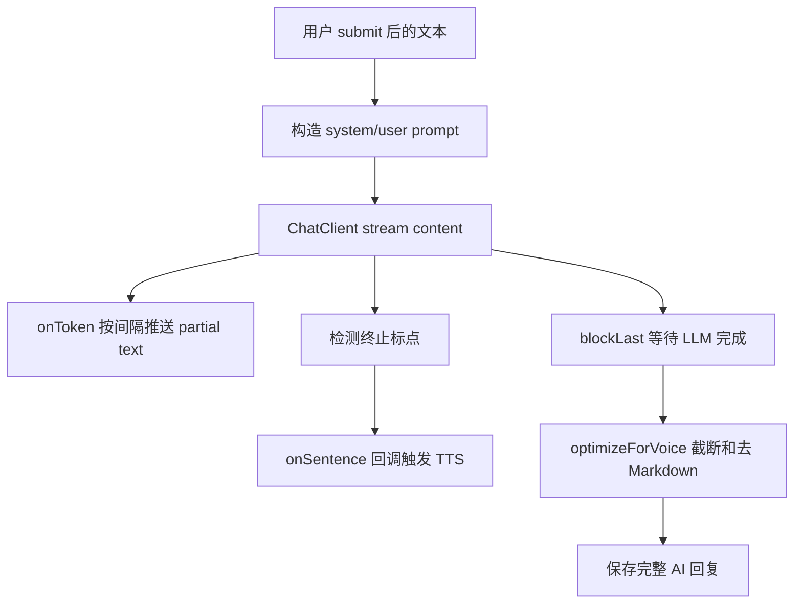

# LLM 提示词与流式追问生成

## 1. 模块基础讲解

LLM 链路由 `DashscopeLlmService` 和 `VoiceInterviewPromptService` 负责。它的输入是用户当前轮语音识别文本、会话实体和历史对话；输出是面试官下一轮文本回复。Handler 再把文本交给 TTS 合成语音。

LLM 调用有两种模式：

- `chat`：同步生成完整回复。
- `chatStreamSentences`：流式生成文本，并在检测到完整句子时回调触发 TTS。

当前 Handler 默认使用流式模式，取决于 `app.voice-interview.llm-streaming-enabled` 对应配置字段 `llmStreamingEnabled`。

提示词构建流程：

1. 根据 session 的 `resumeId` 从 `ResumeRepository` 查询简历文本。
2. 调用 `VoiceInterviewPromptService.generateSystemPromptWithContext(skillId, resumeText)`。
3. 系统提示词包含 Skill 工具加载指令、语音面试输出约束、简历上下文和防注入指令。
4. 用户提示词包含历史对话和当前用户输入。
5. 用户输入用 `PromptSanitizer` 清洗并包裹边界。
6. 通过 `LlmProviderRegistry.getVoiceChatClient(provider)` 获取语音场景 ChatClient。

语音面试输出约束包括：

- 每轮只问 1 个主问题。
- 必要时最多补 1 个短追问。
- 总长度控制在 2 到 4 句。
- 避免 Markdown、代码块和长段落。
- 不重复开场白。
- 候选人回答短或含糊时直接追问具体细节。
- 候选人要求换题时立即换方向。

流式生成机制：

句子边界检测基于终止标点：`。！？；!?;.`。每检测到一句完整文本，就把这句话交给 TTS 并发合成，降低用户等待第一段音频的时间。

`optimizeForVoice` 会对模型输出做语音友好处理：

- 去掉 Markdown 标记。
- 合并多余空格。
- 空回复返回“请继续。”
- 超过最大字符数时，尽量截断到句子边界。

## 2. 基础面试问题

**问题：语音面试的 LLM 提示词和文字面试有什么不同？**

回答：语音面试要求口语化、短句、每轮只问一个问题，并避免 Markdown、列表和代码块。因为用户是听问题，不是阅读长文本，回复过长会影响节奏。

**问题：为什么需要历史对话？**

回答：面试官追问需要知道前面问过什么、候选人答过什么。`DashscopeLlmService` 会把历史消息格式化为“候选人：xxx”“面试官：xxx”，注入当前 Prompt，避免重复提问并支持连续追问。

**问题：为什么要用 `getVoiceChatClient`？**

回答：语音面试是特殊对话场景，可能需要不同的 Advisor、Skill 工具或模型配置。通过 `LlmProviderRegistry.getVoiceChatClient(provider)` 可以和普通文字问答区分。

**问题：流式文本怎么推给前端？**

回答：LLM 每产生 token，服务端累积到 StringBuilder。达到配置的推送间隔和最小字符增量后，通过 WebSocket 发送 `{"type":"text","content":"..."}` 给前端，实现打字机效果。

**问题：为什么要做语音友好截断？**

回答：LLM 可能生成很长的解释，语音播放会拖慢面试节奏。配置 `aiQuestionMaxChars` 默认 120 字，超长时按句子边界截断，让面试官回复更像真实追问。

## 3. 进阶面试问题

**问题：流式 LLM 和句子级 TTS 是怎么并发的？**

回答：LLM 流式输出时，服务端检测到一句完整文本就调用 `onSentence`，在虚拟线程池中启动 TTS。LLM 继续生成后续 token，TTS 同时合成前一句。这样不是等完整回复生成后再开始 TTS，能降低首音频延迟。

**问题：为什么 onToken 推送要限制频率？**

回答：如果每个 token 都推 WebSocket，前端刷新和网络开销会很高。代码通过 `aiStreamPushIntervalMs` 和 `aiStreamMinCharsDelta` 控制推送频率，默认至少间隔约 180ms 且文本增长超过一定字符才发送。

**问题：Prompt 注入怎么处理？**

回答：用户输入和历史消息会经过 `PromptSanitizer.sanitize`，当前用户输入还会被 `wrapWithDelimiters("input", ...)` 包裹。系统提示词末尾追加防注入指令。简历文本也会被清洗并包裹为 resume 数据块。

**问题：Skill 工具指令在这里怎么用？**

回答：系统提示词会告诉模型“你是某 skill 方向面试官，如果尚未加载角色设定，请调用 Skill 工具加载该技能 SKILL.md”。这让语音面试复用项目里的 Skill 体系。

**问题：LLM 异常会怎样？**

回答：`DashscopeLlmService` catch 异常后不会向上抛，而是返回用户友好的错误文本，比如认证失败、超时、频率超限或网络失败。Handler 会把这个文本当 AI 回复继续走后续流程。优点是用户可感知，缺点是错误文本也可能被保存成对话。

**问题：为什么流式结束后还要推一次完整文本？**

回答：partial 推送用于实时显示，最终 optimized 文本用于确认完整回复。但当前 `text` 消息没有明确 final 标记，前端需要自行区分覆盖显示和最终显示。协议上可以继续优化。

## 4. 技术延伸问题

**问题：如果模型不支持 stream 怎么办？**

回答：可以关闭 `llmStreamingEnabled`，走同步 `chat`。后端等完整回复生成后，再一次性发送文本并调用 TTS。体验上首字延迟更高，但实现更简单、兼容性更好。

**问题：如何让模型追问更有层次？**

回答：可以在 Prompt 中加入面试阶段、当前阶段目标、已问问题摘要、候选人薄弱点和追问策略。例如项目面优先追业务目标、技术决策、故障排查；技术面优先追原理、边界、优化。

**问题：如何减少上下文过长？**

回答：历史对话可以只保留最近 N 轮，或者把早期对话摘要化。当前代码直接拼接历史消息，长会话中 Prompt 会越来越长。可以引入会话摘要和阶段摘要。

**问题：如何让 LLM 感知当前阶段？**

回答：目前系统 Prompt 主要基于 skill 和简历，用户 Prompt 里没有显式注入 currentPhase。可以把 session.currentPhase、difficulty、plannedDuration、已问数量放进 Prompt，让模型在不同阶段采用不同提问策略。

**问题：如何做多 Provider 路由？**

回答：`VoiceInterviewSessionEntity.llmProvider` 保存会话选择的 provider，LLM 调用时传给 registry。后续可以根据场景路由：实时追问用低延迟模型，最终评估用更强模型。

## 5. 改进方案问题

**问题：当前 LLM 上下文有什么改进点？**

回答：建议显式加入 currentPhase、difficulty、customJdText 和阶段目标。当前 customJdText 保存到 session，但 LLM Prompt 没看到直接使用它。JD 对语音面试题目应有影响。

**问题：错误处理要怎么优化？**

回答：LLM 异常时可以返回 error 消息，而不是把错误文本当面试官回复保存。这样避免最终评估把“AI 服务暂时不可用”当成面试问题。

**问题：流式文本协议怎么优化？**

回答：增加 `isFinal`、`turnId`、`sequence` 字段。partial 文本用于覆盖显示，final 文本用于落地。当前只有 `type=text` 和 content，前端语义不够清晰。

**问题：如何测试 LLM Prompt 服务？**

回答：当前 `VoiceInterviewPromptServiceTest` 被禁用，原因是旧 RolePrompt 接口已移除。建议重写测试，覆盖 skillId 注入、简历注入、防注入边界、语音输出约束和空简历场景。

**问题：如何避免重复提问？**

回答：可以在 Prompt 中明确列出已问问题摘要，也可以在保存消息时结构化记录 questionTopic。LLM 回复后做简单相似度检查，若与历史问题高度相似则要求重生成。

## 6. 故障处理问题

**问题：LLM 回复很长，怎么办？**

回答：检查 `aiQuestionMaxChars` 配置是否过大，`optimizeForVoice` 是否生效。如果模型经常输出列表或长段落，强化系统 Prompt，要求每轮只问一个问题、2 到 4 句。

**问题：LLM 重复开场白怎么办？**

回答：系统提示词已要求不要重复开场白，但如果历史对话没正确加载，模型会不知道已开场。检查 `getHistory` 是否查到消息，开场问题是否保存成功。

**问题：用户回答和 AI 追问不连贯怎么办？**

回答：检查历史对话注入顺序、消息保存顺序、Prompt 是否过长被模型忽略。也要看 ASR 文本是否准确，错误 ASR 会直接影响 LLM 理解。

**问题：前端看到乱码或 Markdown 怎么办？**

回答：`normalizeRealtimeText` 会去掉 `**`、代码块和列表符号，但模型仍可能输出复杂格式。需要加强 Prompt，并在前端对 content 做纯文本渲染。

**问题：不同 provider 表现差异大怎么办？**

回答：记录 sessionId、provider、model、Prompt 版本和输出质量，做 A/B 对比。可以为语音追问设置独立默认模型，避免和最终评估模型混用。

