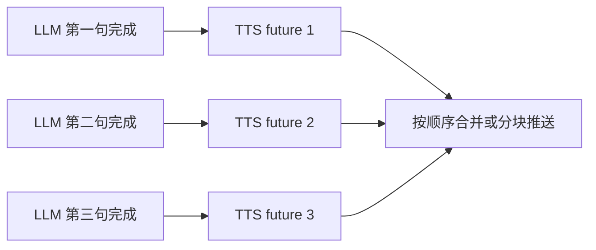

# TTS 音频合成与回声控制

## 1. 模块基础讲解

TTS 链路负责把 LLM 生成的面试官文本转成可播放语音。核心代码在 `QwenTtsService` 和 `VoiceInterviewWebSocketHandler`。

`QwenTtsService.synthesize(text)` 的流程：

1. 空文本直接返回空字节数组。
2. 创建 `CountDownLatch` 等待合成完成。
3. 创建 `ByteArrayContainer` 收集音频分片。
4. 创建 DashScope `QwenTtsRealtime` 临时 WebSocket。
5. connect 后下发 voice、format、mode、languageType、speechRate、volume。
6. `appendText(text)` 后 `commit()`。
7. 收到 `response.audio.delta` 时 Base64 解码并追加 PCM。
8. 收到 `response.done` 时 latch countDown。
9. 最多等待 30 秒，超时返回空数组。
10. finally 关闭 TTS 连接。

TTS 配置：

- `model=qwen3-tts-flash-realtime`
- `voice=Cherry`
- `format=pcm`
- `sample-rate=24000`
- `mode=commit`
- `language-type=Chinese`
- `speech-rate=1.0`
- `volume=60`

Handler 中的音频发送流程：

- TTS 返回 PCM。
- `convertPcmToWav` 手写 44 字节 WAV 头。
- Base64 编码 WAV。
- 发送 WebSocket 消息：`{"type":"audio","data":"...","text":"..."}`。

流式模式下，TTS 可以句子级并发：

并发控制：

- 每个会话创建 `Semaphore(maxConcurrentTtsPerSession)`。
- 每句 TTS 合成前 acquire，结束后 release。
- 默认每会话最多 3 个 TTS 并发。

音频推送模式：

- 合并模式：等待所有句子 TTS 完成，合并 PCM 后推一个完整 WAV。
- 分块模式：每句 TTS 完成后转 WAV，按 `audio_chunk` 推送。

回声控制：

- `state.aiSpeaking=true` 时，Handler 丢弃用户音频。
- AI 发送音频后，设置 `aiSpeakEndAt = now + 800ms`。
- 冷却期内继续丢弃用户音频。

## 2. 基础面试问题

**问题：TTS 在语音面试里负责什么？**

回答：TTS 负责把 AI 面试官生成的文本回复转成语音，让用户听到面试官问题，而不是只看到文字。

**问题：为什么 TTS 返回 PCM 后还要转 WAV？**

回答：PCM 是裸音频数据，浏览器播放通常需要容器格式。后端手动加 WAV 头，告诉浏览器采样率、声道、位深等信息，前端就能直接播放。

**问题：为什么每次 TTS 建临时连接？**

回答：当前 `QwenTtsService.synthesize` 是同步方法，每次文本合成建立一条 TTS WebSocket，合成完成后关闭。实现简单，不需要维护长连接状态。缺点是连接建立有额外开销。

**问题：TTS 超时怎么处理？**

回答：`synthesize` 用 `CountDownLatch.await(30, TimeUnit.SECONDS)` 等待结果，超过 30 秒返回空数组。Handler 收到空音频会记录错误并递增空音频指标。

**问题：分块音频和完整音频有什么区别？**

回答：分块音频是每句 TTS 完成立刻推给前端，首音频更快；完整音频是等全部句子合成并合并后一次推送，前端播放更简单但等待更久。

## 3. 进阶面试问题

**问题：为什么句子级并发 TTS 能降低延迟？**

回答：传统流程是 LLM 完整输出后再 TTS，首音频要等 LLM 全部完成。句子级并发中，LLM 生成第一句后立即启动 TTS，LLM 继续生成后续句子，TTS 同步进行。用户更早听到第一段音频。

**问题：为什么还要按顺序收集 TTS 结果？**

回答：多个句子并发合成完成顺序可能不一致，但播放顺序必须和文本顺序一致。代码把 futures 按生成顺序放入列表，再按列表顺序 get 和合并，保证语义顺序。

**问题：`Semaphore` 控制的是什么？**

回答：控制单个会话同时进行的 TTS 合成数量，避免一个长回答拆出很多句子后同时发起太多 DashScope TTS 连接，触发服务端限流或本地资源耗尽。

**问题：WAV 头里采样率为什么写 24000？**

回答：Qwen TTS Realtime 返回的是 24kHz、16bit、单声道 PCM。WAV 头必须和 PCM 实际参数一致，否则前端播放速度或音高会异常。

**问题：回声冷却为什么在服务端做？**

回答：服务端能知道 AI 何时开始生成和发送音频，可以在这段时间丢弃用户音频，防止 AI 声音被 ASR 当成用户输入。这是后端兜底机制。

**问题：服务端回声控制为什么不完全可靠？**

回答：后端只知道音频发送完成，不知道前端真实播放结束时间。浏览器可能排队播放、延迟播放或播放很久。服务端 800ms 冷却不能覆盖所有播放时长，所以最好前端播放期间也关闭麦克风或发播放状态。

## 4. 技术延伸问题

**问题：如果要进一步降低 TTS 延迟，怎么做？**

回答：可以维护长连接 TTS 会话，避免每句都建连接；开启分块推送；缩短 LLM 回复；使用更快音色/模型；把第一句更早截出来；或者换支持真正流式音频边合成边播放的服务。

**问题：如果要支持不同音色，怎么设计？**

回答：会话创建时传 voice 或 interviewerStyle，保存到 session。TTS 合成时从 session 读取音色，而不是全局配置。不同面试官可以有不同语速、语气和音量。

**问题：如果要支持 MP3/Opus 输出，怎么改？**

回答：取决于 TTS 服务是否支持对应格式。若返回 MP3，可直接推给前端播放，不需要手写 WAV 头。若使用 Opus，需要前端播放器和编码参数配套。PCM/WAV 简单但带宽较高。

**问题：如何做客户端回声消除？**

回答：浏览器采集麦克风时可以启用 echoCancellation、noiseSuppression、autoGainControl。播放 AI 音频时暂停上传音频，播放结束后再恢复，是最直接有效的方案。

**问题：如何让用户打断 AI？**

回答：需要 barge-in 机制。当前 AI 说话时服务端丢弃音频，用户无法打断。要支持打断，需要前端检测用户开始说话，发送 interrupt control，后端停止当前 TTS 播放/推送，清理 aiSpeaking 并让 ASR 接收新输入。

## 5. 改进方案问题

**问题：当前 TTS 连接模型有什么改进点？**

回答：每句 TTS 都创建临时 WebSocket，简单但有连接开销。可以按会话维护 TTS 长连接，或者维护连接池。但长连接要处理状态、并发和错误恢复，实现更复杂。

**问题：回声控制应该怎么增强？**

回答：后端 `aiSpeaking` 只做兜底。建议前端播放 AI 音频时停止录音上传，并在播放开始/结束时发 control 消息，让后端更准确地打开或关闭音频接收。

**问题：音频消息协议怎么改进？**

回答：`audio` 和 `audio_chunk` 应增加 sampleRate、format、duration、turnId 和 isFinal。这样前端更容易管理播放队列，也便于定位某轮音频的问题。

**问题：TTS 失败时用户体验怎么优化？**

回答：当前 TTS 失败时可能只有文字，没有语音。可以明确发送 `type=error` 或 `type=tts_error`，前端提示“语音生成失败，请查看文字问题”。还可以自动重试一次短文本 TTS。

**问题：如何测试 WAV 转换？**

回答：可以写单元测试验证 RIFF/WAVE/fmt/data 头、采样率 24000、单声道、16bit、dataSize 和文件长度。当前没有看到专门测试 `convertPcmToWav`。

## 6. 故障处理问题

**问题：TTS 返回空音频怎么办？**

回答：检查文本是否为空、TTS API Key 是否正确、模型和 voice 是否可用、是否超时、服务端是否返回 error 事件。日志中会有 “TTS returned empty audio” 或 “TTS synthesis timeout”。

**问题：前端播放速度不正常怎么办？**

回答：检查 WAV 头采样率是否和 PCM 实际采样率一致。当前按 24000Hz 写头，如果 TTS 配置返回了其他采样率但转换仍写 24000，就会播放异常。

**问题：AI 声音被再次识别成用户回答怎么办？**

回答：说明回声控制不够。检查前端是否在播放时仍上传麦克风音频，后端 `aiSpeaking` 是否及时设置。建议前端播放期间暂停录音，并增加播放结束 ack。

**问题：长回答音频等待太久怎么办？**

回答：开启 `chunkedAudioEnabled` 分块推送，或者降低 `aiQuestionMaxChars`，让 LLM 每轮问题更短。也可以调大 TTS 并发上限，但要注意 provider 限流。

**问题：TTS 合成偶发超时怎么办？**

回答：记录超时发生的 text 长度、provider、voice、响应 ID。可对长文本先截断，对超时句子重试一次，或降级为只显示文本。

