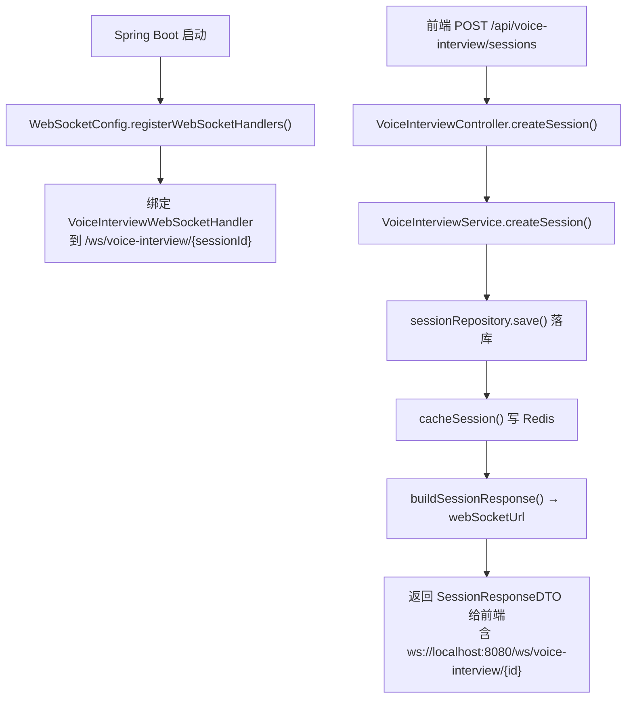
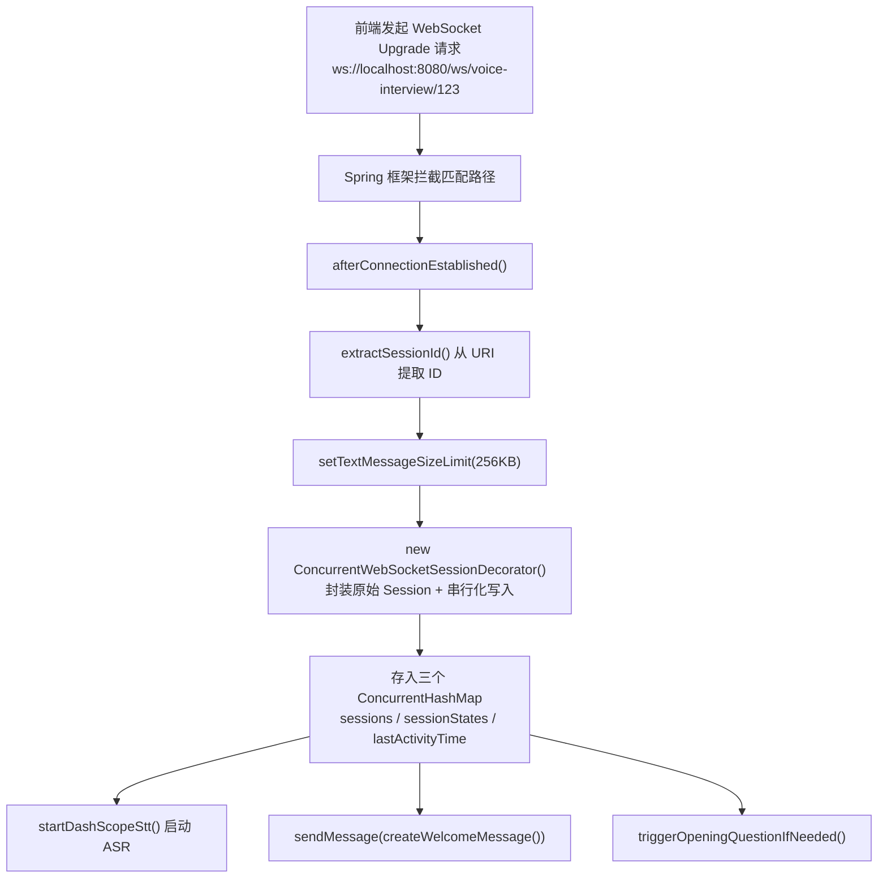
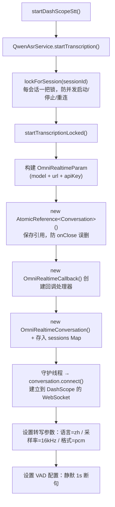
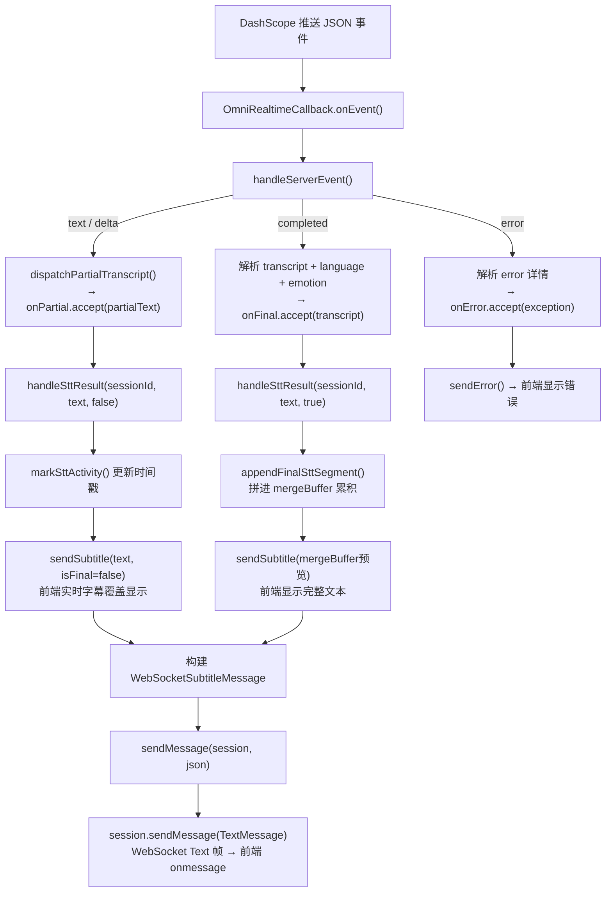
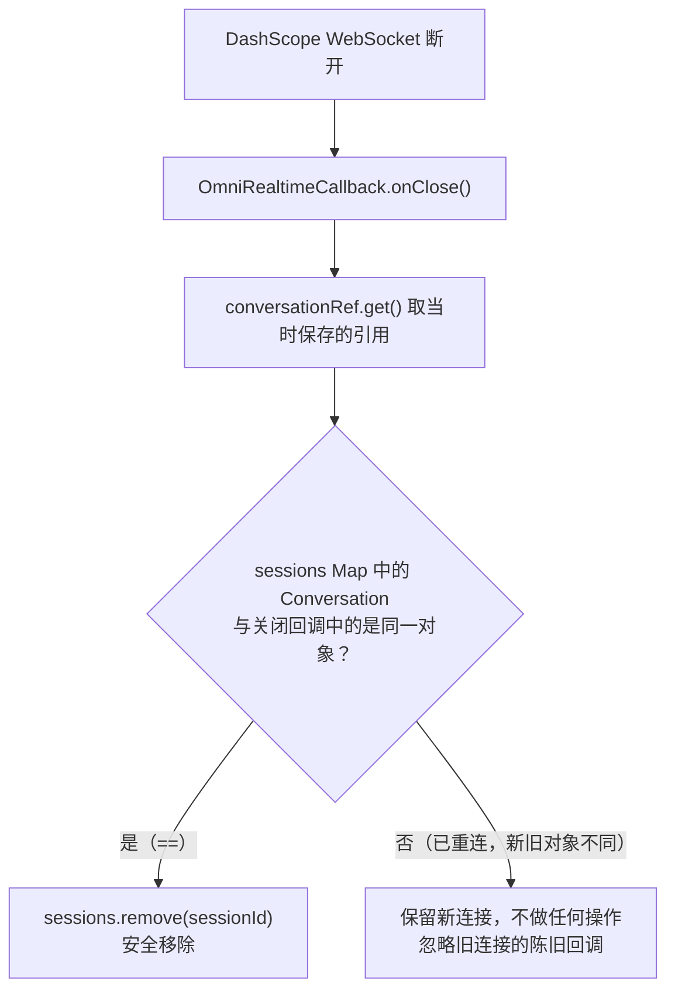
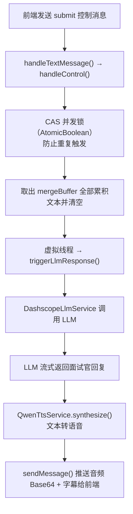

好的，按流程拆成 6 个独立的图。

---

### 图1：启动 + REST 创建会话

---

### 图2：WebSocket 连接建立

---

### 图3：服务端 → DashScope ASR 连接建立

---

### 图4：ASR 事件回调 → Handler 处理 → 前端展示

---

### 图5：ASR 连接关闭（onClose 引用比较）

---

### 图6：用户提交 → LLM + TTS 管线

