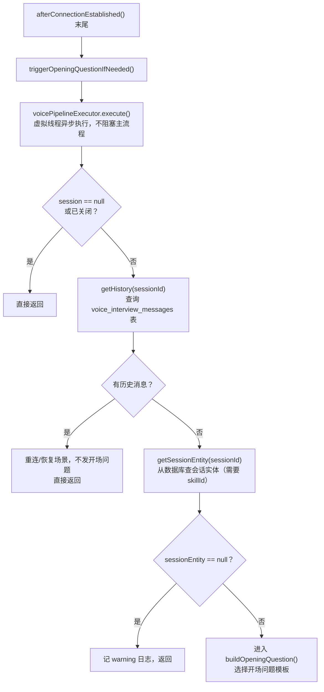
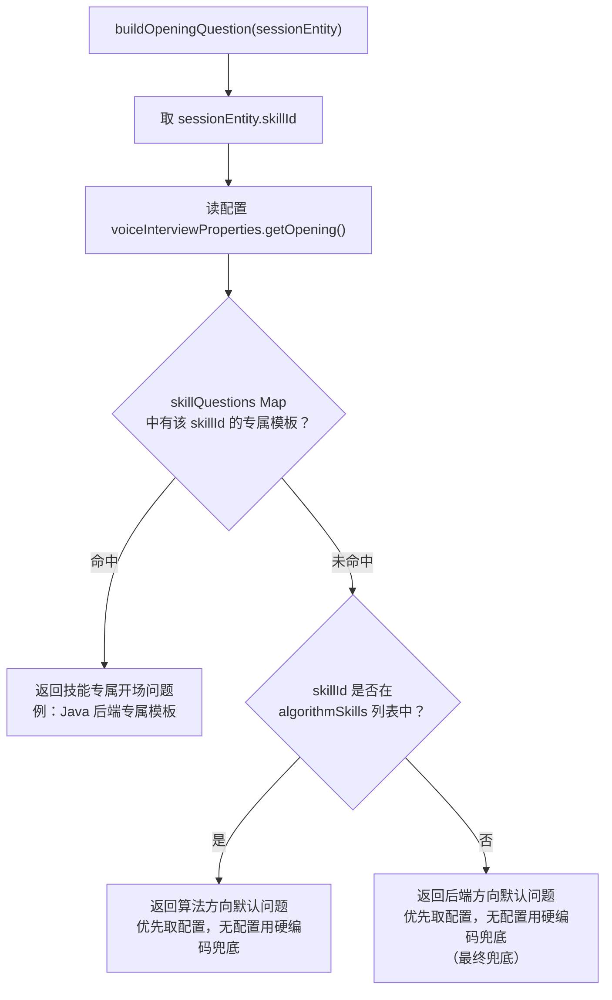
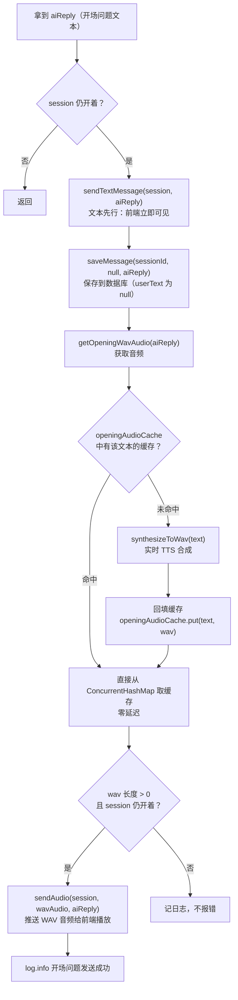

filePath: /Users/ogawaaya/Desktop/学习/interview\_guide/interview-guide-optimize/app/src/main/java/interview/guide/modules/voiceinterview/controller方法逐个详解/websocket语音面试流程/04-开场问题触发流程详解.md

按流程拆成 4 个图。

***

### 图1：触发入口 + 前置检查

***

### 图2：三级模板选择

***

### 图3：文本先行、音频随后

***

### 图4：应用启动预热 + PCM 转 WAV

```mermaid
flowchart TD
    subgraph 启动预热["@PostConstruct 启动时预热"]
        A["warmupOpeningAudioCache()"] --> B["voicePipelineExecutor.execute()<br/>虚拟线程异步，不阻塞启动"]
        B --> C["收集所有开场问题模板<br/>skillQuestions.values() + algoQuestion + backendQuestion"]
        C --> D["遍历 each template"]
        D --> E["preloadOpeningAudio(template)"]
        E --> F["synthesizeToWav(text)<br/>TTS 合成 PCM"]
        F --> G["convertPcmToWav(pcmData)"]
        G --> H["openingAudioCache.put(text, wav)"]
        D --> I["下一模板"]
        I --> D
    end

    subgraph PCM转WAV["PCM → WAV 手动格式转换"]
        G1["输入：原始 PCM 数据<br/>24kHz / 16bit / 单声道"] --> G2["构造 44 字节 WAV 文件头<br/>RIFF头 + fmt块 + data块"]
        G2 --> G3["所有整数以小端序写入"]
        G3 --> G4["System.arraycopy<br/>将 PCM 数据拼到头部之后"]
        G4 --> G5["输出：完整 WAV 字节数组<br/>浏览器可直接播放"]
    end
```

