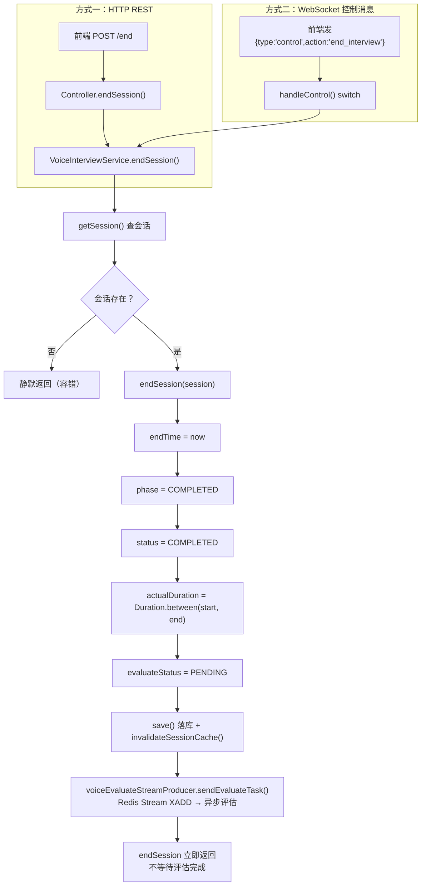
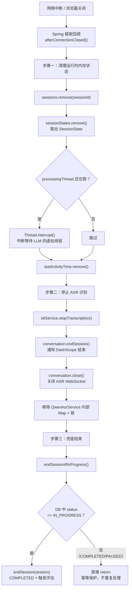

暂停与恢复机制

语音面试支持三种暂停与恢复方式：用户主动暂停、定时任务自动检测超时暂停、用户主动恢复。

**用户主动暂停**：前端调用 `PUT /api/voice-interview/sessions/{sessionId}/pause`，传入 `reason`，默认是 `user_initiated`。Controller 拿到后调 `VoiceInterviewService.pauseSession(sessionId, reason)`。方法内部先通过 `findById` 直接从数据库查会话实体，不走缓存，确保拿到最新状态。然后做状态校验——只有 `IN_PROGRESS` 的会话可以暂停，`COMPLETED` 和 `PAUSED` 的都抛异常。校验通过后把状态设为 `PAUSED`，记录 `pausedAt` 时间，`save` 到数据库。关键一步是紧接着调 `invalidateSessionCache` 删除 Redis 缓存——如果不删，Redis 里还存着之前 `IN_PROGRESS` 的旧数据，下次查会话时会从缓存命中拿到的还是旧状态，前端看到的状态就和数据库不一致了。

**用户主动恢复**：前端调 `PUT /api/voice-interview/sessions/{sessionId}/resume`。Service 层同样先查数据库、校验状态只有 `PAUSED` 才能恢复。然后状态改回 `IN_PROGRESS`，记录 `resumedAt` 时间，`save` 到数据库后调 `cacheSession` 重新写 Redis 缓存（1 小时 TTL）。恢复和暂停的缓存操作刚好相反——暂停删缓存迫下次查走数据库，恢复写缓存因为面试要继续靠缓存加速。还有一点不同，恢复返回的是 `SessionResponseDTO` 而不是 `Result<Void>`，因为前端需要新的 `webSocketUrl` 去重新建立 WebSocket 连接。恢复回去后，`afterConnectionEstablished` 重新执行，`triggerOpeningQuestionIfNeeded` 通过 `getHistory` 查到有历史消息，判断为重连场景，不会重复发开场问题，面试从暂停前的位置继续。

**自动暂停超时检测**：Handler 里有个 `@Scheduled(fixedRate = 30000)` 定时任务，每 30 秒跑一次 `checkPauseTimeout()`。它依赖的就是 `lastActivityTime` 这个 `ConcurrentHashMap`——每次 `handleTextMessage` 收到前端任何消息（audio 或 control）都会更新这个时间戳。只要用户持续说话或操作界面，计时器就不断重置。

检测分两级：4 分 30 秒没有活动时先发一个 30 秒预警通知给前端（`pause_timeout_warning`），告诉用户"会话即将暂停"。超过 5 分钟仍然没有活动，触发 `handlePauseTimeout`，做五件事：发暂停通知给前端 → 调 `pauseSession(sessionId, "timeout")` 把数据库状态改成 `PAUSED` → 调 `sttService.stopTranscription` 停止 ASR 释放 DashScope 连接 → 调 `session.close` 关闭 WebSocket 连接 → 从三个 Map 中移除该会话。和主动暂停最大的区别在于超时暂停会关闭 WebSocket——因为用户 5 分钟没活动了，没必要保持连接浪费资源，而主动暂停可能用户马上就要恢复，保留连接可以更快恢复。

***

## 会话结束与 WebSocket 关闭

会话结束有两种触发路径：用户主动结束和 WebSocket 异常断开。

**用户主动结束有两种方式**。一是走 HTTP REST，前端调 `POST /api/voice-interview/sessions/{sessionId}/end`，Controller 直接把 `Long` 型 sessionId 转成 String 调 `voiceInterviewService.endSession()`。二是走 WebSocket 控制消息，前端发 `{"type":"control","action":"end_interview"}`，在 `handleControl` 的 switch 分支中直接调 `interviewService.endSession(sessionId)`。

**endSession 核心流程**：先查会话，没找到就静默返回（容错设计，防止脏数据抛异常）。然后设置五个关键字段： `endTime` 设为当前时间、`currentPhase` 改为 `COMPLETED`、`status` 改为 `COMPLETED`、`actualDuration` 用 `Duration.between(startTime, now)` 精确计算到秒、`evaluateStatus` 设为 `PENDING`。最后 `save` 到数据库，清除 Redis 缓存。还有一个关键操作——调 `voiceEvaluateStreamProducer.sendEvaluateTask(sessionId)`，通过 Redis Stream 的 `XADD` 将会话 ID 入队到 `voice:evaluate:stream`，后台 `VoiceEvaluateStreamConsumer` 异步消费并调 LLM 生成评估报告。入队后 `endSession` 立即返回，不等待评估完成，所以用户退出时不会卡住。

**WebSocket 异常断开**：网络中断、浏览器关闭等场景下，Spring WebSocket 框架自动回调 `afterConnectionClosed`。这是清理逻辑的集中入口，分三步：第一步从三个 Map 中移除会话——其中 `SessionState` 如果还在跑 LLM 管线，通过 `Thread.interrupt()` 中断等待 LLM 响应的虚拟线程，立即释放资源。第二步调 `sttService.stopTranscription` 停止 ASR 识别，包括 `conversation.endSession()` 通知 DashScope 结束会话、`conversation.close()` 关闭 WebSocket 连接、移除 QwenAsrService 内部 Map 和锁对象。第三步调 `endSessionIfInProgress` 兜底结束。

`endSessionIfInProgress` 是整个关闭流程的安全网，它的幂等保护很关键——只有状态是 `IN_PROGRESS` 的才会走结束流程。这防止了一个典型时序问题：用户正常点击结束 → `endSession` 把状态改成 `COMPLETED` 并触发评估 → 浏览器随后发 WebSocket Close 帧 → `afterConnectionClosed` 调 `endSessionIfInProgress` → 检测到状态已经是 `COMPLETED`，直接 return，不会重复评估。如果没有这个保护，每次 WebSocket 断开都重新触发一次评估，同一场面试会被评估多次。

***

### 图1：暂停与恢复流程

```mermaid
flowchart TD
    subgraph 主动暂停["用户主动暂停"]
        A["前端 PUT /pause<br/>reason='user_initiated'"] --> B["VoiceInterviewService.pauseSession()"]
        B --> C["findById 直接从 DB 查（不走缓存）"]
        C --> D{"status == IN_PROGRESS？"}
        D -- "否" --> E["抛 BusinessException"]
        D -- "是" --> F["status = PAUSED<br/>pausedAt = now"]
        F --> G["save() 落库"]
        G --> H["invalidateSessionCache()<br/>删 Redis 缓存（关键）"]
    end

    subgraph 主动恢复["用户主动恢复"]
        I["前端 PUT /resume"] --> J["VoiceInterviewService.resumeSession()"]
        J --> K["findById 直接从 DB 查"]
        K --> L{"status == PAUSED？"}
        L -- "否" --> M["抛 BusinessException"]
        L -- "是" --> N["status = IN_PROGRESS<br/>resumedAt = now"]
        N --> O["save() 落库"]
        O --> P["cacheSession()<br/>重写 Redis 缓存（1h TTL）"]
        P --> Q["返回 SessionResponseDTO<br/>含新 webSocketUrl"]
        Q --> R["前端重新建立 WebSocket<br/>afterConnectionEstablished 再执行<br/>getHistory 查到有历史 → 不发开场问题"]
    end

    subgraph 超时自动暂停["定时任务自动暂停"]
        S["@Scheduled(fixedRate=30s)<br/>checkPauseTimeout()"] --> T["遍历 lastActivityTime Map"]
        T --> U{"空闲时间？"}
        U -- "> 4.5 分钟" --> V["sendPauseWarning()<br/>发 30 秒预警通知"]
        U -- "> 5 分钟" --> W["handlePauseTimeout()"]
        W --> W1["1. 发暂停通知给前端"]
        W1 --> W2["2. pauseSession(sessionId, 'timeout')"]
        W2 --> W3["3. sttService.stopTranscription() 停止 ASR"]
        W3 --> W4["4. session.close() 关闭 WebSocket"]
        W4 --> W5["5. 清理三个 Map"]
    end
```

***

### 图2：会话结束流程

***

### 图3：WebSocket 异常断开清理

