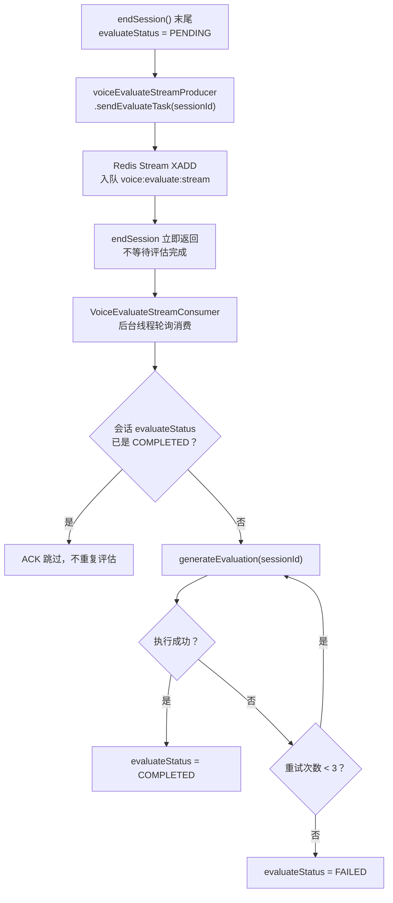
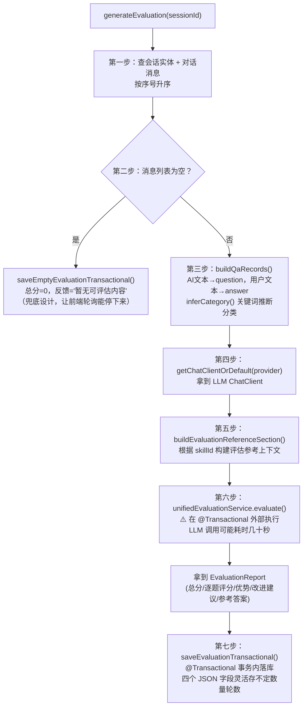
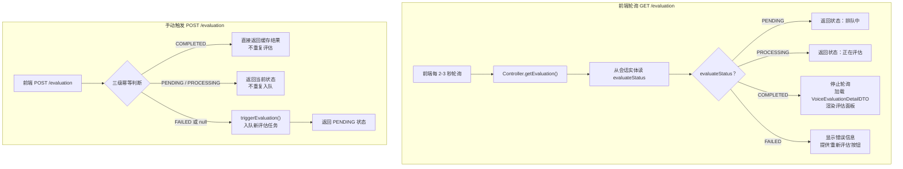

面试结束后，系统不是同步等 LLM 出评估报告的——那样用户得干等几十秒甚至更久。而是通过 Redis Stream 消息队列把评估任务异步投递出去，面试结束直接返回，评估在后台跑。

**触发时机**：在 `endSession()` 末尾，数据库里的 `evaluateStatus` 已经被设成了 `PENDING`，然后调 `voiceEvaluateStreamProducer.sendEvaluateTask(sessionId)`。这一步通过 Redis Stream 的 `XADD` 命令把 sessionId 入队到 `voice:evaluate:stream`。`VoiceEvaluateStreamProducer` 继承自 `AbstractStreamProducer`，封装了 Stream 写入细节；对侧 `VoiceEvaluateStreamConsumer` 继承自 `AbstractStreamConsumer`，在后台线程中轮询消费这条队列。消费者在消费前还会检查会话的 `evaluateStatus`，如果已经是 `COMPLETED`（比如用户手动触发过了），直接 ACK 跳过，不重复评估。失败重试最多 3 次，超过后标记 `evaluateStatus=FAILED`。

**评估的核心**是 `VoiceInterviewEvaluationService.generateEvaluation()`，分七步走：

第一步，查会话实体和所有对话消息，按序号升序排列。

第二步，如果消息列表为空——比如用户创建了会话但一句话没说就结束了——走 `saveEmptyEvaluationTransactional` 生成空评估，总分 0、反馈写"暂无可评估内容"，让前端轮询能拿到 `COMPLETED` 状态停下来，不会永远转圈。

第三步，把消息列表构建成 `QaRecord` 列表。语音面试的消息格式是 AI 提问在前、用户回答在后，所以每条 QaRecord 的 question 取 `aiGeneratedText`，answer 取 `userRecognizedText`。同时通过 `inferCategory` 方法基于关键词推断问题分类——AI 文本里包含"项目"、"实习"就归为"项目深挖"，包含"职业规划"、"优缺点"归为"HR 问题"，剩下的默认"技术问题"。这个分类只是启发式的，不要求精准，目的是让评估报告里能按分类汇总得分。

第四步，从会话里取 `llmProvider`，没有就用全局默认，拿到 ChatClient。

第五步，根据 `skillId` 构建评估参考上下文，把技能方向的知识点和考察维度传给 LLM，让评估更有针对性。

第六步是关键——调 `unifiedEvaluationService.evaluate()` 把对话记录送 LLM 生成评估报告。这一步**必须在** **`@Transactional`** **外部执行**，因为 LLM 调用是阻塞 I/O 操作，可能耗时几十秒，如果放在事务内会长时间占用数据库连接，导致连接池耗尽。

第七步，拿到 `EvaluationReport` 后通过 `saveEvaluationTransactional` 持久化。评估结果存到 `VoiceInterviewEvaluationEntity`，包含总分 `overallScore`、总评 `overallFeedback`，以及四个 JSON 字段——`questionEvaluationsJson` 存逐题评分、`strengthsJson` 存优势列表、`improvementsJson` 存改进建议、`referenceAnswersJson` 存参考答案。用 JSON 字段而不是固定列是因为对话轮数不固定，每个面试的提问数量都不一样，固定列根本没法设计。

**前端轮询**：评估完成后，前端通过 `GET /api/voice-interview/sessions/{sessionId}/evaluation` 轮询获取状态，2-3 秒一次。Controller 从会话实体的 `evaluateStatus` 判断当前进度——`PENDING` 显示排队中，`PROCESSING` 显示正在评估，`COMPLETED` 停止轮询并加载 `VoiceEvaluationDetailDTO` 渲染评估面板，`FAILED` 显示错误信息并提供"重新评估"按钮。

**手动触发**：如果自动评估超时或失败，前端可以调 `POST /evaluation` 手动触发。Controller 做了三级幂等保护——`COMPLETED` 直接返回缓存结果不重复评估，`PENDING` 或 `PROCESSING` 返回当前状态不重复入队，只有 `FAILED` 或 `null` 才调 `triggerEvaluation` 触发新的评估任务。

***

### 图1：评估触发 + 消费

***

### 图2：generateEvaluation() 七步流程

***

### 图3：前端轮询 + 手动触发

